# flow 工作流引擎设计文档

> 状态：**当前工作区代码的实际语义**（2026-10-18）。本文描述工作区实现，不保留
> 历史设计记录；被删除的 v1（SQLite/Postgres 双后端、Driver/Engine/fold 事件面、
> `run_tail`、NodeSlot 状态机）相关内容已不在本文件中。
>
> 本地持久化采用 [SQLite 数据结构与提交协议](adr/0002-sqlite-persistence.md)。
> `flow.sqlite` 同事务保存接受事实、当前状态、回执和待处理动作；SQLite v3 可离线复制升级到 v4。
> 计算扩容不提供 master 高可用。
>
> **部署与运维见 [OPS.md](OPS.md)**（部署形态、执行模式、启动重启终止、离线维护、
> 升级、故障处置、容量预算与安全边界）；本文只描述语义与结构。
>
> 相关文档：`docs/observability-design.md`（节点可观察性）、
> `docs/opentelemetry-design.md`（已定未实现）、
> `docs/IPC_PROTOCOL_BASELINE.md`（执行协议基线——**写于 v4，未随 v7 更新**，
> 其中的帧格式与 `PROTOCOL_VERSION=4` 已过时；权威以 `contract.rs`/`message.rs`
> 为准）。

---

新版定义语义、固定依赖/执行上下文、业务调用、LLM、regression、证据包和格式升级的完整合同见 [EXECUTION.md](EXECUTION.md)。

## 0. 核心设计抉择

这一节是全文的根。后面每一条规则都从这里推导出来；读本文前先读这里。

### 0.1 七个抉择与它们的目的

| # | 抉择 | 目的（不这样做的代价） |
| --- | --- | --- |
| **C1** | **SQLite 是唯一业务权威，事实与当前状态同事务提交** | 减少应用自行维护的分段、索引追赶、快照与恢复协议；外部副作用仍由授权、未决状态和人工裁决约束。数据库事务不等于外部操作恰好一次。 |
| **C2** | **节点执行语义只存在于 `flow-executor` 子进程；master 只做裁决与调度** | 工作流定义事实上是可执行代码（任意 JS + 任意出站 HTTP）。若在主进程内执行，一个失控脚本就能拖垮权威写者、让整个 journal 不可用。进程隔离把「用户代码」与「权威状态」分成两个故障域。进程内执行路径已全平台删除（`ExecutionMode` 只剩 `Ipc`）。 |
| **C3** | **外部副作用发生前，意图必须先落盘**（`OperationIntent` + `OperationAuthorized` 同一事务） | 崩溃窗口的本质困难是「请求发出去了吗？」。只有把「我要发这个请求」变成 journal 事实，恢复期才能区分「从未发出」（可安全重试）与「已授权、结果未知」（必须人工裁决）。没有这个事实，任何自动重试都是赌博。 |
| **C4** | **未知外部结果默认等人工裁决；显式 repeatable 节点可获持久重试授权** | 自动重试会把「至少一次」悄悄变成「可能多次」，而重复扣款/重复发信比失败更难收拾。系统选择**响亮地停下来**（run 进 `awaiting_resume`）而不是安静地猜。人工 `run.adjudicate` 是默认授权路径；`effect_policy=repeatable` 还须提交 `OperationRetryAuthorized` 并受尝试次数限制，见 [执行合同](EXECUTION.md)。 |
| **C5** | **单写者 + 数据目录排他 flock；计算容量可横向扩展，权威与提交点只有一份** | 分布式共识（Raft/多主复制）的工程与运维成本极高，而当前产品面的需求是「单机并发 + 计算扩容」。flock 让「双写者」在操作系统层不可能；`flow-agent` 只扩算力，**不提供 master 高可用**——这一点在代码与文档里都明确，不宣称 HA。 |
| **C6** | **控制帧只携带身份与元数据，用户值字节一律走 data 语义帧分块传输** | 若值能进控制帧，一个 200 MiB 的节点输出就能把会话帧撑爆（协议层只能杀会话）。v2 起 `ExecuteTask` 里的 `input`/`predecessors`/`params` 只是**声明**（`TaskValue::{Ref, Local}`），字节由 `TransferChunk` 按 256 KiB 分块送。控制帧因此有确定性上界（128 KiB）。 |
| **C7** | **每个 RPC 调用都要 token，但 token 是单用户凭据、不是多租户授权** | 系统没有用户体系，做成「多租户授权」会是假承诺。缺省只监听 loopback，对外暴露必须在外层自备 TLS + 认证。这个边界必须写在最前面，否则运维会误以为拿到 token 的不同人是不同租户。 |

### 0.2 由抉择推导出的三条铁律

1. **没有事实就没有决策**：协调器的每一次状态迁移都必须落到一条 journal 事件上
   （`journal_driver::advance_run` → `backend.internal(...)`）。内存里的推断只是
   缓存，崩溃后以 SQLite 已提交状态为准。
2. **不知道就不动**：`uncertain` 是唯一允许的「停下来」状态，它属于**平台故障面**
   （IO/断链/崩溃），不属于工作流失败面。二者绝不互相冒充（§13.3）。
3. **同一提交决定**：事实、当前状态、永久回执与后续动作一起提交到 `flow.sqlite`。
   该库及其活跃 WAL 不可作为缓存删除。`observations/` 独立且可丢弃，不参与业务裁决。

---

## 1. 定位、目标与非目标

flow 是一个**工作流执行引擎**：发布不可变的流程定义（DAG），以 run 为单位执行，
进程崩溃后从 SQLite 当前状态恢复。数据库损坏时隔离并报告错误，不猜测副作用。

**已实现的产品面**：`web/`（Vue 3 + @vue-flow 画布，直连本服务 JSON-RPC WebSocket）、
`flow-cli`（纯 RPC 命令行）、Tauri 桌面内嵌服务（进程内调用同一 RPC 模块）。

**明确的非目标**：

- 不做通用 DSL——表达式与脚本统一用 JavaScript（QuickJS 沙箱）。
- 不提供 master 高可用、日志复制、共享目录 fencing（C5）。多机只扩计算容量。
- 不多租户授权（C7）。
- 不把任意 HTTP 请求变成恰好一次执行（§11.4）。

---

## 2. 总体架构

### 2.1 crate 与二进制

```
crates/
  flow-dto        领域 DTO 与状态词汇表（零依赖叶子）：RunRecord / WorkflowSummary / …
  flow-config     统一配置（flow.toml，叶子 crate）：分层加载 + validate + 原子写回
  flow-journal    SQLite 写入 owner、事实分页、codec 预算、BLOB 值存储、离线维护
  flow-engine     执行引擎共享能力：定义模型与校验、JS 沙箱、表达式/模板、
                  journal_state（run 状态折叠）、观测日志、密钥、执行协议（v7 postcard 单流）
  flow-store      同一 SQLite 库的只读执行与产品查询
  flow-backend    journal 唯一权威后端：journal.rs（JournalBackend）+ journal_commands
                  （产品 CRUD，request_id 幂等）+ journal_views（物化读面）+
                  journal_driver（协调循环）+ journal_execution（Attempt 簿记）+
                  journal_import（legacy 只读保全）+ execution/（ipc 池 / remote 派发）
  flow-executor   受管理执行子进程：节点语义的唯一居所
  flow-agent      受信任远程执行中继（单条 mTLS/WSS 上联 + 本机执行器池）
  flow-rpc        jsonrpsee WebSocket 服务：journal_v2（产品 RPC 面）+
                  journal_triggers（cron + webhook HTTP）+ journal_download（值下载）
  flow-cli        命令行客户端（纯 RPC，不碰存储）
  flow-test-support  共享测试基建
  backend-e2e     v2 产品面端到端矩阵（真起进程）
  backend-perf    性能压测 harness（黑盒）
```

产品二进制按职责分属各自 crate，**没有统一多路入口**：

| bin | 所属 crate | 职责 |
| --- | --- | --- |
| `flow-journal-server` | flow-rpc | SQLite 产品服务（WS RPC + cron + webhook + 下载） |
| `flow-cli` | flow-cli | 命令行客户端（纯 RPC） |
| `flow-executor` | flow-executor | 受管理执行子进程（通道 FD 经 argv `--channel-fd` 传递） |
| `flow-agent` | flow-agent | 受信任远程执行中继 |
| `flow-journal-tool` | flow-journal | journal 离线维护（verify/rebuild-index/backup） |
| `flow-journal-dev` | flow-backend | 开发运行器，含 `check-projection` 事实重放校验 |
| `flow-journal-bench` | flow-journal | journal 写入基准 |
| `flow-journal-dev` | flow-backend | 开发运行器（run/resume/status/import-legacy） |

依赖方向（与 Cargo.toml 对齐的现状）：

```
flow-rpc ──> flow-backend ──> flow-engine ──> flow-dto
           ├─> flow-journal  （v2 值分页/下载）
           └─> flow-store    （同库只读查询）
flow-backend ──> flow-journal / flow-dto / flow-store
              └─> [dev-dependencies] flow-agent
flow-engine ──> flow-dto
             └─> flow-journal（只共享 StoredValue/ValueRef 词汇与 codec 预算）
flow-journal ──> 无 flow 依赖（叶子）
flow-agent / flow-executor ──> flow-engine, flow-journal（执行协议两侧）
flow-cli ──> flow-journal-server（纯 RPC 客户端）──> 上面的链路
flow-cli ──✗> flow-store    ✗（CLI 不碰存储与事件日志，没有第二条写入路径）
```

### 2.2 架构图：三条链路

协调器的锁序为 `workflow_metadata → decision → state`。`decision` 保持写决策、
持久化和状态发布的顺序；`state` 只保护同步内存访问，不跨 SQLite 查询或持久化等待。
运行中的状态读取可以取得上一个完整提交的快照。已接受的提交由后台任务持有决策锁，
调用方取消后仍会完成持久化、状态发布及调度通知；提交失败则停止后续决策。
派发通过提交通知观察取消，定时器只处理截止时间和排空，不再定时轮询状态锁。

Reducer 使用同一份类型化 `UndoLog` 保存受影响实体的变更前状态，按变更逆序恢复。
preview、后续事件失败和索引生成失败共用恢复路径；审计事件只保存计数与回执差量，
不复制累积历史。新增事件类型必须在穷尽匹配中选择恢复策略，存储与执行协议不变。

**三条链路，不是两条**。master ↔ executor 是同一种 IPC 协议；master 的身份取决于
部署形态（单机 = backend 直连，远程 = agent 中继），协议层与握手完全一致，只是
物理承载不同。

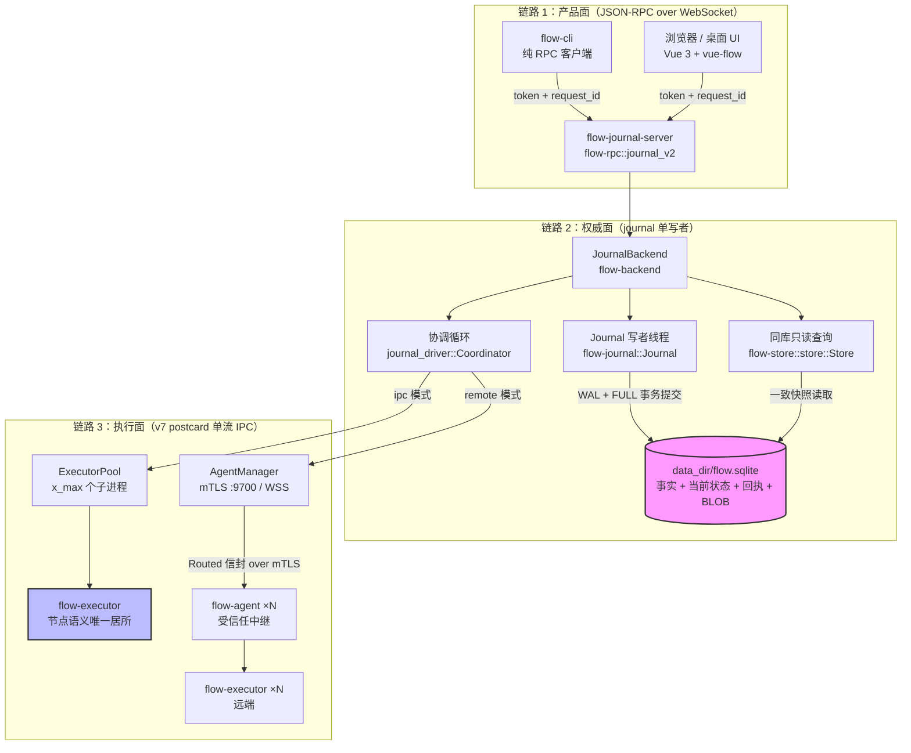

**焊死的规则**：

1. master↔executor 是同一种 IPC 协议；master = backend（单机）或 agent（远程中继）。
2. 节点执行语义只许存在于 `flow-executor`；master 只做裁决和调度。
3. 协议 v7 postcard 单流：控制与数据复用**同一条双向流、同一个 `Message` 枚举**，
   帧格式唯一——`u32 body_len(大端) | postcard(Message)`。没有独立的 data 通道、
   没有帧内 1 字节 `kind`：**postcard 的变体索引即帧类型**，`TransferChunk` 的
   二进制体由 postcard 原生承载（len varint + 原始字节，无 base64、无 JSON meta
   拼接）。control/data 的区分退化为**帧预算分类**：`frame_limit()` 只把
   `TransferChunk`/`AuditBatch`/`ObservabilityBatch`/`Routed` 四类放宽到
   `DATA_MAX_FRAME`（1 MiB），其余收紧到 `CONTROL_MAX_FRAME`（128 KiB）。
   v4 的 JSON 信封、三种帧 kind、十进制字符串戒律与 `Channel` 概念已随 v4 删除。
4. 写响应在 SQLite COMMIT 后返回，状态与回执已同时可见，没有异步投影追赶。
5. 本地 IPC 承载按平台选择，对上层透明：unix 用 socketpair，通道 FD 原号经 argv
   `--channel-fd <N>` 传给执行器（`pre_exec` 只关闭其余继承 FD，不做 dup2 落位）；
   Windows 及其余平台用 **本地 socket 回连**（named pipe / 文件系统 socket，由
   interprocess 统一实现；不占网络栈、无端口抢连窗口），执行器按
   `FLOW_EXECUTOR_CONNECT_ADDR` 回连出单条连接）。本地 socket 没有 FD 能力防串配，
   因此 spawn 时随机生成会话令牌经 `FLOW_EXECUTOR_SESSION_TOKEN` 注入、Hello 里回验。

### 2.3 执行模式矩阵

| 模式 | 平台 | 节点执行位置 | 备注 |
| --- | --- | --- | --- |
| `ipc` | 全平台（缺省） | `flow-executor` 子进程 | 执行器缺失/协议版本不符直接失败，不静默回退 |
| `remote` | 全平台 | 经 `flow-agent` 中继的远端执行器 | 单条 mTLS 或 WSS（v7 postcard 单流）；`mode=remote` 时 `[execution.remote]` 必填 |
| `in_process` | **已删除** | — | 全平台配置即报错；`ExecutionMode` enum 只剩 `Ipc` |

执行模式在**配置期与装配期双重把关**：`flow-config` 的 validate 在任何平台拒绝
`in_process`，`JournalBackend::start_execution_ipc` 在运行期再拒一次；两处都明确
报错，任何平台都不静默换模式。

**派发槽位语义**（`Coordinator.limit`）：

| 模式 | limit 来源 | 含义 |
| --- | --- | --- |
| `ipc` | `x_max.clamp(1, 16)` | 既是执行器池容量，也是全局在飞派发上限（协议 `A_MAX` = 16） |
| `remote` | 固定 `16` | 全局在飞派发上限 = `A_MAX`；每台 agent 的 `slots` 另行准入 |

---

## 3. 权威数据模型：一个业务数据库

结构、生命周期与验收的完整决定见 [ADR 0002](adr/0002-sqlite-persistence.md)。

### 3.1 事务、事件与 LSN

- `Transaction { v: 2, journal_id, lsn, tx_id, events: Vec<Event> }`。
- `Event { v: 1, kind, run_id?, run_seq, dispatch_id?, node_id?, audit_seq, payload }`。
- 首次业务提交为 LSN 1；提交序号由唯一写者分配，失败事务不占序号。
- 事实存为 transactions/events 关系记录；保存完整事务摘要并在读取事实时校验。
- CLI 与运行证据包可导出 JSONL；磁盘权威是 SQLite 行，提交时只序列化一次。
- `lsn` 是事务序号，`run_seq` 是 run 内业务序号，`audit_seq` 是 dispatch 内审计序号。

### 3.2 领域事件

| 事件 | 归属 | 语义 |
| --- | --- | --- |
| `SegmentStarted` / `SegmentSealed` | 保留编码枚举 | SQLite 不生成分段事件，外部提交仍拒绝 |
| `Command` | 命令 | 写命令回执落账（scope / request_id / fingerprint / result / lsn） |
| `WorkflowCreated` / `WorkflowUpdated` / `WorkflowPublished` / `WorkflowDeleted` | 产品 | 定义生命周期；版本号必须连续（`non-contiguous definition version`） |
| `ScheduleChanged` / `WebhookChanged` / `TemplateChanged` | 产品 | 触发器与节点模板（UI 资产也随权威走） |
| `RunStarted` | run | run 创建，input 快照 + depth + source 归因 |
| `RunCancelled` / `RunCompleted` / `RunFailed` | run | 三种终态 |
| `DispatchStarted` | 节点 | 一次派发开始：`node_execution_id` + `attempt` + `dispatch_id` |
| `InputPrepared` | 节点 | 模板展开后的输入面已提交（含 input / predecessors / params） |
| `ValueChunk` / `ValuePublished` | 值 | 大值分块与发布描述符（走 `QueueClass::Audit(output_id)` / Control） |
| `OperationIntent` + `OperationAuthorized` | 节点 | **同一事务两条**：外部操作授权事实（C3） |
| `OperationOutcome` | 节点 | 外部操作结果已捕获 |
| `NodeCompleted` / `NodeFailed` / `NodeSkipped` | 节点 | 节点终态 |
| `WaitRegistered` / `WaitResolved` | 节点 | 持久等待登记/解除（delay/signal/child/retry/uncertain） |
| `SignalReceived` | 节点 | 外部信号已落盘 |
| `Adjudicated` | 节点 | 人工裁决已落盘 |
| `LateAudit` | 节点 | 迟到的审计证据（不得推进 run_seq） |
| `MasterEpochStarted` | 数据集 | 写者任期开始；必须 dataset 级、epoch 恰好 +1 |
| `LegacyImport` | 数据集 | v1 历史只读保全基线 |

**协议层的两条结构性校验**（`State::apply_mode`，重放与提交同路）：

- `OperationIntent` 的下一条必须是 `OperationAuthorized`，且 `run_id`/`dispatch_id`/
  `node_id`/`payload` 全同、两者 `audit_seq` 都为 0；
- `OperationAuthorized` 的前一条必须是 `OperationIntent`。

### 3.3 State：唯一领域转移规则

`flow-engine/src/journal_state.rs` 的 `State::apply(&Transaction)` 是**唯一**的状态
转移函数。提交前用同一规则预演并生成当前实体变更，预演始终撤销；COMMIT 后才更新内存。
启动加载当前实体，正常启动不重放事实账本。离线事实核验仍可以使用 reducer。

```
Transaction 流 ──apply──> State {
    journal_id, applied_lsn, master_epoch, version,
    values: ValueCatalog,              // 当前库按需加载的值描述符/验证进度缓存
    workflows: BTreeMap<String, Workflow>,
    runs:     BTreeMap<String, Run>,
    schedules / webhooks / templates / legacy: BTreeMap<String, Value>,
    commands:  BTreeMap<String, CommandRecord>,   // 幂等窗口，见 §11.2
}
```

注意 `State` 上的 u64 字段（`applied_lsn` / `master_epoch` / 各 `audit_seq` /
`run_seq`）在序列化时**写成字符串**（`snapshot_decimal`），反序列化时两种形态都接受
——避免 JSON number 在 JS 客户端丢精度。

```
Run {
    run_id, workflow_id, workflow_version, definition: StoredValue, input: StoredValue,
    source, source_detail, parent: Option<Parent{run_id,node_id}>, depth,
    status: RunStatus, output, error, last_run_seq,
    nodes: BTreeMap<String, Node>,
}

Node {
    node_execution_id, attempt, dispatch_id, status: NodeStatus,
    output, branch, prepared: Option<Prepared>, wait: Option<Wait>,
    operation: Option<Operation>, attempts: BTreeMap<dispatch_id, Attempt>,
    error, skip_reason,
}

Attempt {          // 一次 dispatch 的账本：结果屏障记在这里
    audit_seq, audit_digests, audit_lsns, result: Option<Event>,
    result_lsn, sealed, integrity,
}
Operation { operation_id, fingerprint, permit_id, request, outcome: Option<StoredValue> }
Prepared   { input, predecessors, params, engine_build, node_semantics }
Wait       { kind: WaitKind, wake_at, child_run_id, output }

```

**关键折叠规则**（都有单测钉住）：

- `DispatchStarted`：清 `wait`、`status = Running`、`attempt = 上次 + 1`（必须恰好
  +1，否则 `unsafe dispatch retry`）、新建 `attempts[dispatch_id]`。
  **带未决 `operation`（outcome 为 None）时拒绝再次派发**——这是 C4 的折叠层闸门。
- `NodeSkipped`：整条替换记录为 `Skipped` + `skip_reason`，不带 attempts 账本。
- `InputPrepared`：校验 `prepared.input == run.input`、`node_semantics ∈ {1,2}`、
  每个前驱必须已 `Succeeded` 且输出逐字相同——**准备事实不得与已提交事实漂移**。
- 任何 `audit_seq > 0` 的事件：必须 `audit_seq == attempt.audit_seq + 1`，且
  dispatch 已 sealed 时只接受 `LateAudit`（`audit gap/duplicate or sealed dispatch`）。
- `NodeCompleted | WaitRegistered | NodeFailed`：**结果审计屏障**——
  `sealed_through` 必须等于 `attempt.audit_seq`；`prepared` 缺失时载荷必须带
  `preparation_failed: true`。通过后 `attempt.sealed = true`、记下原事件。
- `OperationAuthorized`：run 终态或已有 operation 即拒；`fingerprint` 必须等于
  请求字节的摘要（`StoredValue::Ref` 取 `value.digest`）。
- `WaitRegistered`：`kind == Uncertain` → `run.status = AwaitingResume`；
  其余（delay/signal/child/retry）→ `run.status = Running`。**同词同义**：
  运维看到 `awaiting_resume` 即代表需要人工介入。
- `NodeFailed` 带 `retry_wake_at` 且无 operation：节点转 `Waiting{Retry}` 而非
  Failed；**有 operation 时拒绝**（`external operation cannot use pure retry`）。
- `Adjudicated`：`accept_output` → Succeeded；`retry` → **Pending**（清 operation/
  error/output，等驱动器以 attempt+1 重新派发）；`failed` → Failed。三种都把
  `run.status` 拉回 `Running`。
- `Command`：幂等窗口 `COMMAND_WINDOW = 8192` 条，超窗按 lsn 序淘汰最旧一半。
  淘汰规则只依赖事件序，重放确定性不受影响。
- `MasterEpochStarted`：epoch 必须恰好 +1，且事件不得带 run/dispatch/node 身份。

### 3.4 写序协议与组提交

协调器串行决定 → reducer 预演并撤销 → 有界写入 owner → 一个 SQLite 事务：
事实、当前实体、永久回执、值正文/描述符及提交水位 → COMMIT → 内存 apply → 确认与调度。

- 专用线程独占写连接；`WAL + synchronous=FULL`，支持的平台同时开启 fullfsync。
- 控制与审计队列继续按字节和请求数背压、轮转；当前实体变更也计入字节预算。
- 批次最多等待 5 ms，SQLite 事务提交整批；失败时整批回滚并冻结 writer，不能确认半套数据。
- 调用方取消不取消 owner 已持有的提交；后续请求和协调循环会接续其结果。
- 查询连接只读，读取相同数据库；`committed` 与 `visible` 对应同一提交，无独立 projector。
- 外部副作用只能在授权提交后发送；未知结果继续等待人工裁决。

### 3.5 磁盘布局

```text
<data_dir>/
  flow.sqlite              # 唯一业务数据库
  flow.sqlite-wal          # SQLite 管理；运行中不可单独删除
  flow.sqlite-shm           # SQLite 管理
  observations/            # 独立、有界、允许丢弃的日志
```

目录 0700、主文件 0600，拒绝数据库符号链接。小值 ≤64 KiB 内联；大值按 ≤256 KiB
分块保存在 value_chunks 的 BLOB，单值上限 256 MiB。事实记录只保留 chunk 元数据，
读取/导出时恢复编码，正文不在事件 JSON 内重复保存。

### 3.6 表与索引

权威 DDL：[`flow-journal/src/schema.sql`](../crates/flow-journal/src/schema.sql)。

| 表 | 职责 |
| --- | --- |
| store_meta | 数据集身份、提交水位和领域提交模式 |
| transactions / events | 接受事实、完整事务摘要与提交字节数、run/dispatch 关联 |
| current_entities | 每个 `(kind,key)` 唯一当前对象；`parent/slot/extra` 是写时解析的键列，`workflow_id/status/source/name/dispatch_id` 是由 body 生成的查询列；覆盖更新 |
| value_chunks | output/chunk 索引下的原始正文与摘要 |

当前行仍以 JSON body 作为 wire/事实投影的载体，但所有查询用显式列和 `WHERE kind=...` 分区索引，
不再对 `key`/`body` 做 `json_extract` 表达式索引。workflow 元数据与每个 definition version 分开；
run 与 node 分开；node 与 attempt 分开。
command/audit 回执、值发布描述符、父子关系和 dispatch 所有权使用有明确用途的当前记录。
未完成流的进度不落盘：值连续性、总字节和摘要由写者在提交时校验一次。
不保留每次修改后的完整实体版本，不另建 execution index、projection、应用 checkpoint 或位置文件。

列表过滤、排序、分页与计数在 SQLite 执行，`WHERE kind=...` 分区索引覆盖 workflow/status/source/name，
另有 run-node、attempt、child、definition-version 和 run-event 索引。正常启动只取活跃 run。

---

## 4. 单机数据流

### 4.1 一条 run 的生命周期

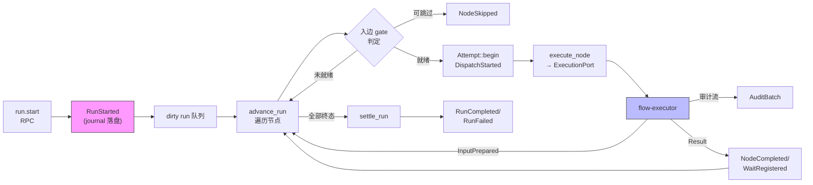

### 4.2 数据流动图：值从哪来，到哪去

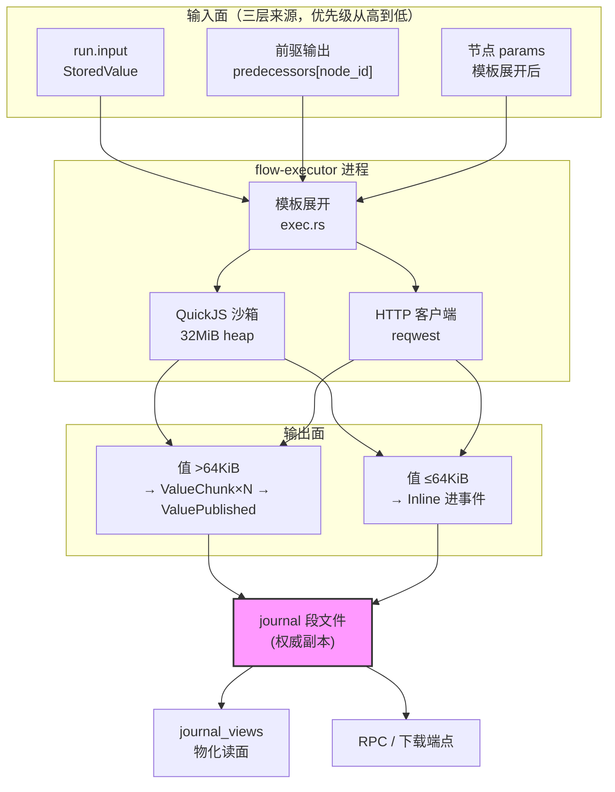

**关键点**：`execute_node` 传给出站执行器的不是字节，是**引用**。
`predecessors` 是 `BTreeMap<String, StoredValue>`，其中 `StoredValue::Ref` 携带
`(digest, location, size)`。真正的字节由 `transfer_inputs` 从 journal 值存储读出、
按 256 KiB 切块、经 data 帧送过去。执行器侧按 `INPUT_BUDGET = 8 MiB` 硬限聚合。

### 4.3 dirty-run 调度模型（不是工作窃取，不是线程池）

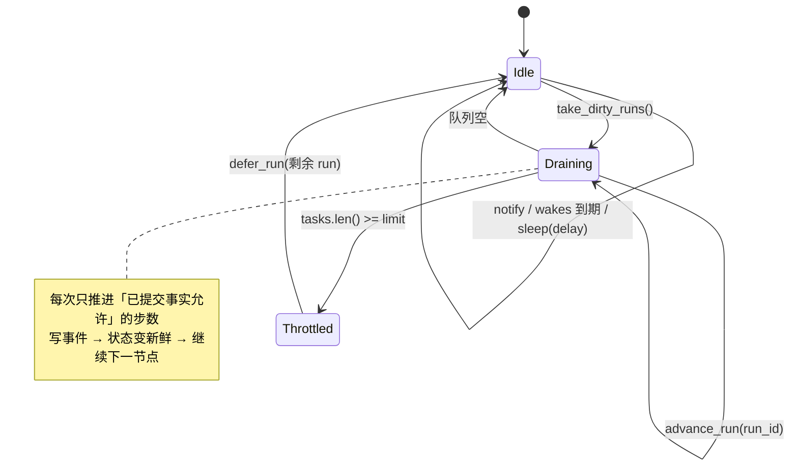

- 唤醒源共四个：`cancel.cancelled()`、`tasks.join_next()`、`notify.notified()`、
  `sleep(delay)`（`wakes` 里最近的到期时间）。
- `wakes: BTreeMap<i64, BTreeSet<String>>` 是**持久等待的定时器堆**：delay/retry
  到期时把 run 重新塞回 dirty 队列。
- 在飞任务数达到 `limit` 时，**整个剩余 dirty 队列被 defer 回去**（不是只跳过
  当前 run）——避免同一批里靠前的 run 反复抢占靠后 run 的机会。
- 任务 panic 或被 abort：`catch_unwind` 捕获，run 以 1000ms 延迟重试；
  协调循环自身 panic：**整个循环重启**，把所有非终态 run 重新 defer，
  从已提交证据重建（`inspect` 折叠态）后继续。

---

## 5. 时序图（单机）

### 5.1 一次普通节点派发（无外部操作）

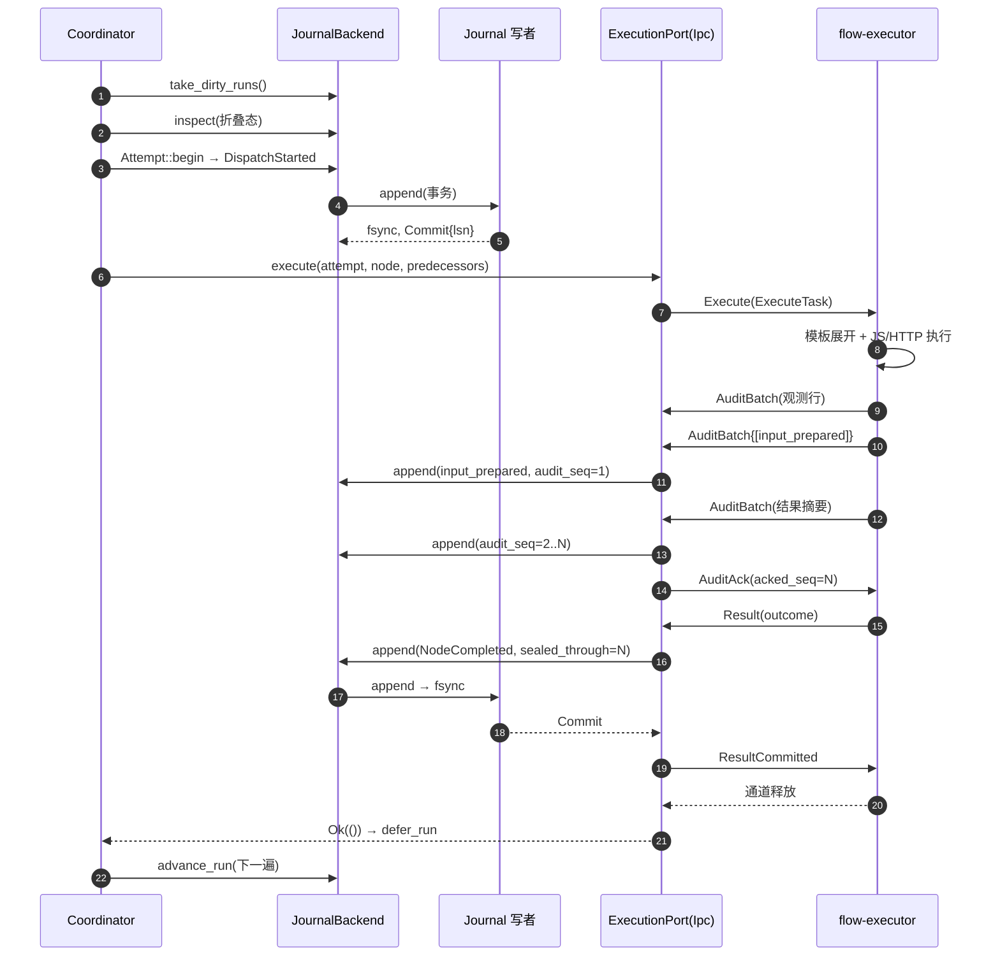

**要点**：

- `ResultCommitted` 是**执行器退出的许可**。执行器在看到它之前不敢退出，否则
  「结果已算但未落盘」的窗口会让崩溃恢复无法判断该不该重算。
- `AuditAck` 之前执行器不会认为审计安全；ack 超时（2s）后**原序号原内容重传**，
  因为审计记录幂等（`audit_seq` 严格 +1 已在折叠层去重）。
- `InputPrepared` 的 `audit_seq` 从 1 开始，`Result` 事件本身 `audit_seq = 0`
  （它不是审计，是结果），屏障条件写 `sealed_through == attempt.audit_seq`。

### 5.2 外部操作授权（C3/C4 的落点）

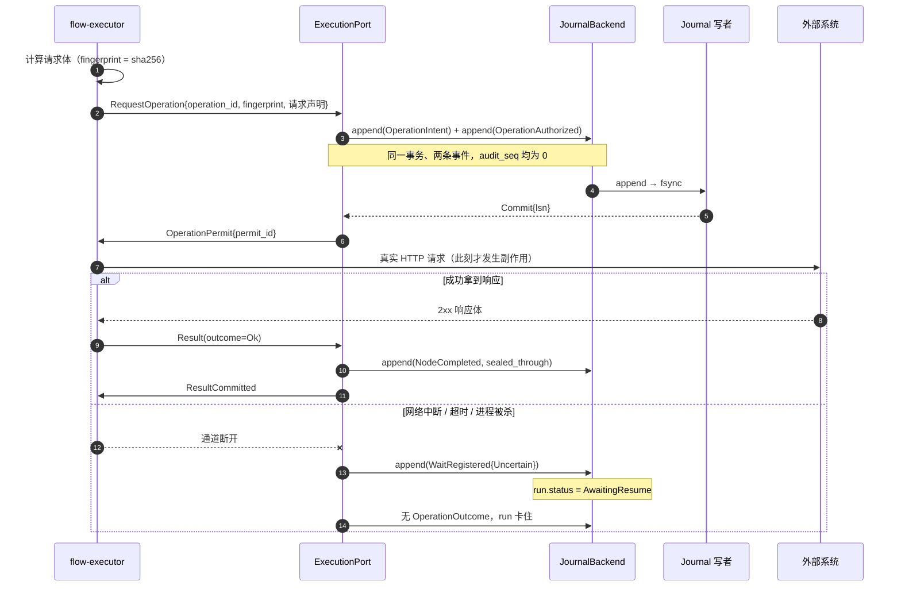

**为什么不能自动重发**：`OperationAuthorized` 落盘后，「请求可能已到达外部系统」
成为既成事实。此时任何重发都是把「至少一次」升级成「可能多次」。所以
`advance_committed_node` 看到 `operation.outcome.is_none()` 时，唯一动作是写
`WaitRegistered{Uncertain}` 然后返回——**连 gate 都不再评估**。

### 5.3 人工信号与裁决

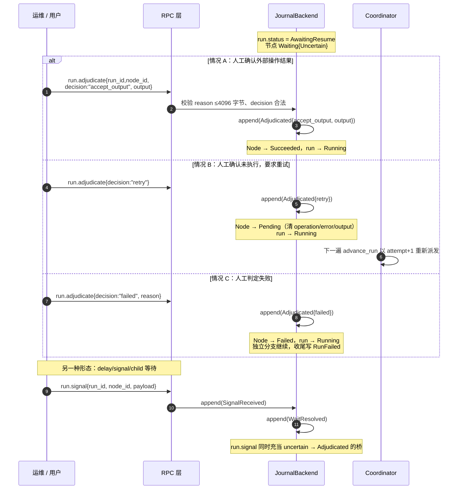

**裁决三种决策的语义差异**：

| decision | 节点终态 | 是否重新派发 | 适用场景 |
| --- | --- | --- | --- |
| `accept_output` | `Succeeded` | 否 | 运维从外部系统查到了真实结果，手工补录 |
| `retry` | `Pending` | 是（attempt+1） | 确认外部操作**没有**产生副作用 |
| `failed` | `Failed` | 否 | 确认失败，放弃该分支 |

### 5.4 崩溃恢复时序

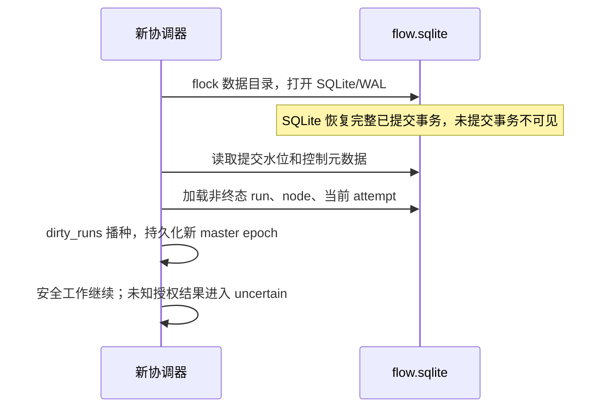

未发布值不能被业务引用；正文按需读取并核验。事实账本的全量检查属于显式 verify，
不是每次启动的前置扫描。损坏状态/正文报错，不自动以历史前缀冒充完整执行状态。

---

## 6. 状态图

### 6.1 run 状态机

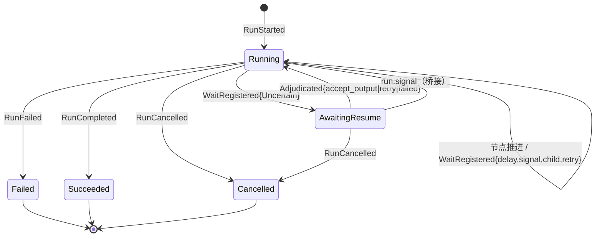

**`AwaitingResume` 是全系统唯一的人工介入点**。它只由 `WaitKind::Uncertain` 触发，
而 `Uncertain` 只由「已授权外部操作结果不明」产生。看到这个状态，运维必须去外部
系统查明真相，然后用 `run.adjudicate` 明确告诉引擎发生了什么。

### 6.2 节点状态机

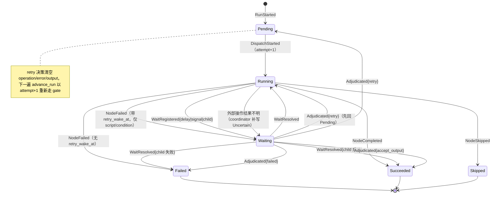

### 6.3 等待类型

| WaitKind | 触发者 | run.status | 解除方式 | 可自动恢复 |
| --- | --- | --- | --- | --- |
| `Delay` | delay 节点 / 重试 backoff | Running | `wake_at` 到期 → `WaitResolved` | 是 |
| `Retry` | script/condition 失败 | Running | `wake_at` 到期 → 重新派发 | 是 |
| `Signal` | human_task / input 节点 | Running | `run.signal` → `WaitResolved` | 否（等外部） |
| `Child` | sub_workflow | Running | 子 run 终态 → `WaitResolved` | 是 |
| `Uncertain` | 外部操作结果不明 | **AwaitingResume** | `run.adjudicate` → `Adjudicated` | **否（C4）** |

### 6.4 协调循环状态机

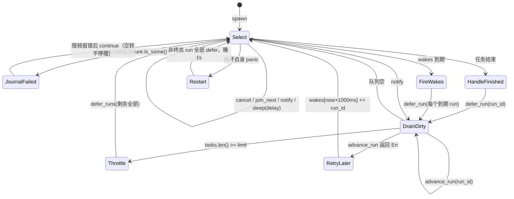

---

## 7. 多 executor 与远程执行

一个 master 管理一个 SQLite 数据目录，并通过本地 IPC 或远程 agent 扩展计算容量。
远程 agent 的连接、心跳、容量、drain 与断线对账继续保留；它们不承担 master 接管。
PG 节点注册中心及其配置、RPC、前端和租约准入已删除；后续有明确的多控制平面需求时另行设计。

### 7.1 remote 模式架构

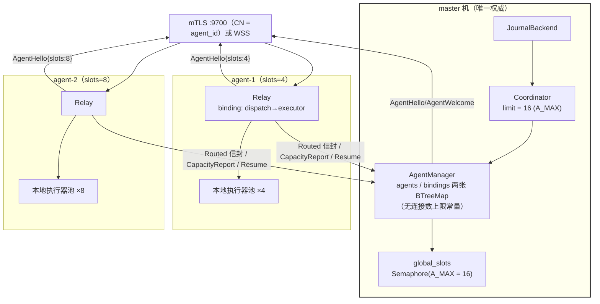

**关键结构**：

- **单条上联，双向复用**。v7 postcard 单流：agent 到 master 只有一条物理连接，
  所有帧（控制语义与 data 语义）都在它上面跑，靠 `frame_limit()` 按消息类型分
  预算，不靠物理分通道。`FAIR_TURN_BYTES = 64 KiB` / `FAIR_TURN_FRAMES = 4` 做
  多个 dispatch 之间的公平轮转，防止一个大数据量 dispatch 饿死其他 dispatch。
- **有界积压，不用无界队列**。`PER_EXECUTOR_QUEUE = 8`（每执行器）、
  `UPLINK_OUT_QUEUE = 256` 帧、`UPLINK_OUT_BYTES = 8 MiB`。满了就退错误，
  让上层感知背压，而不是把内存吃光。
- **准入是两级**：全局 `global_slots` 信号量（`A_MAX` 级）+ 每 agent 的
  `slots_total`（`CapacityReport` 动态上报）。`used < slots_total` 才允许 bind。
- **drain 中的 agent 优先级最低**。`slots_total` 已回收为 0、`used = 0` 的 agent
  反而最后被选中——避免把新派发扔进正在收工的 agent。

### 7.2 agent 注册与会话生命周期

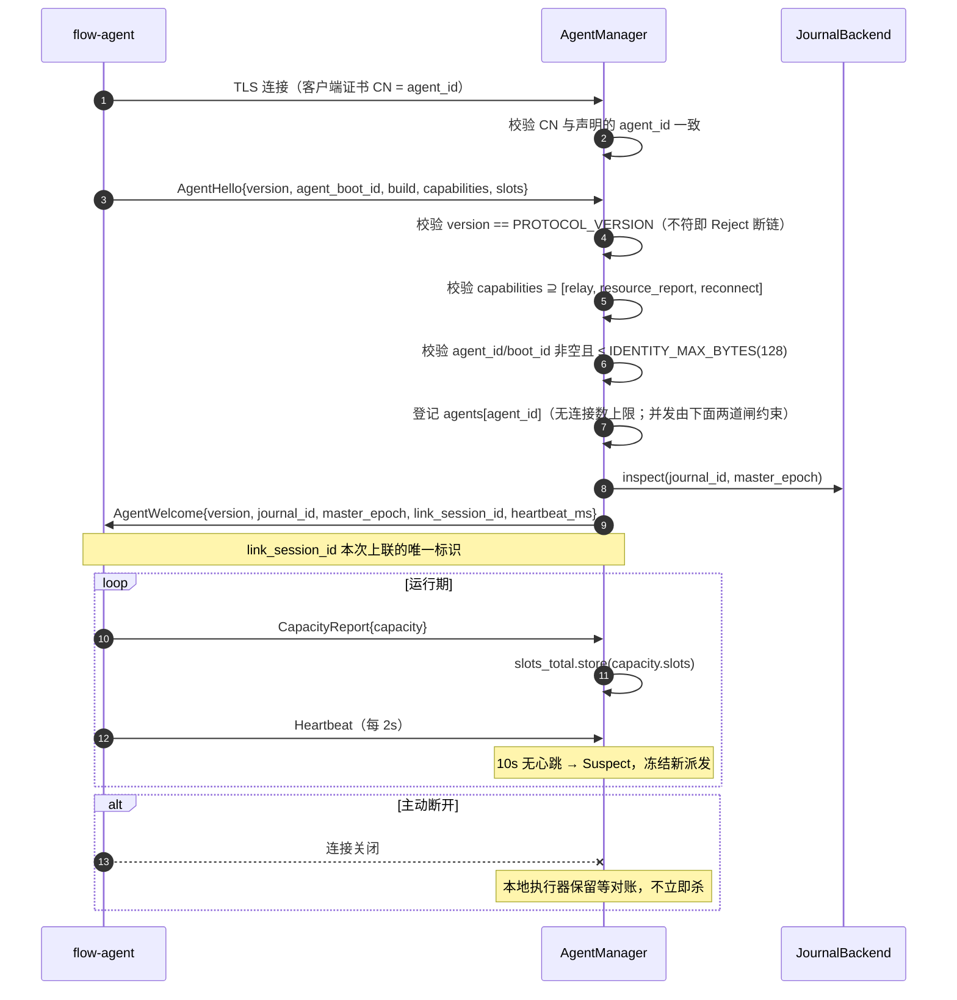

**`agent_boot_id` 与 `link_session_id` 的分工**：前者标识 agent 进程的一次启动
（跨重连不变），后者标识一条物理连接（每次重连都新）。Resume 对账用
`executor_boot_id` 判断「本地执行器是否还是原来那个」——boot 变了就必须对账，
不能假定续跑。

### 7.3 远程数据流动图

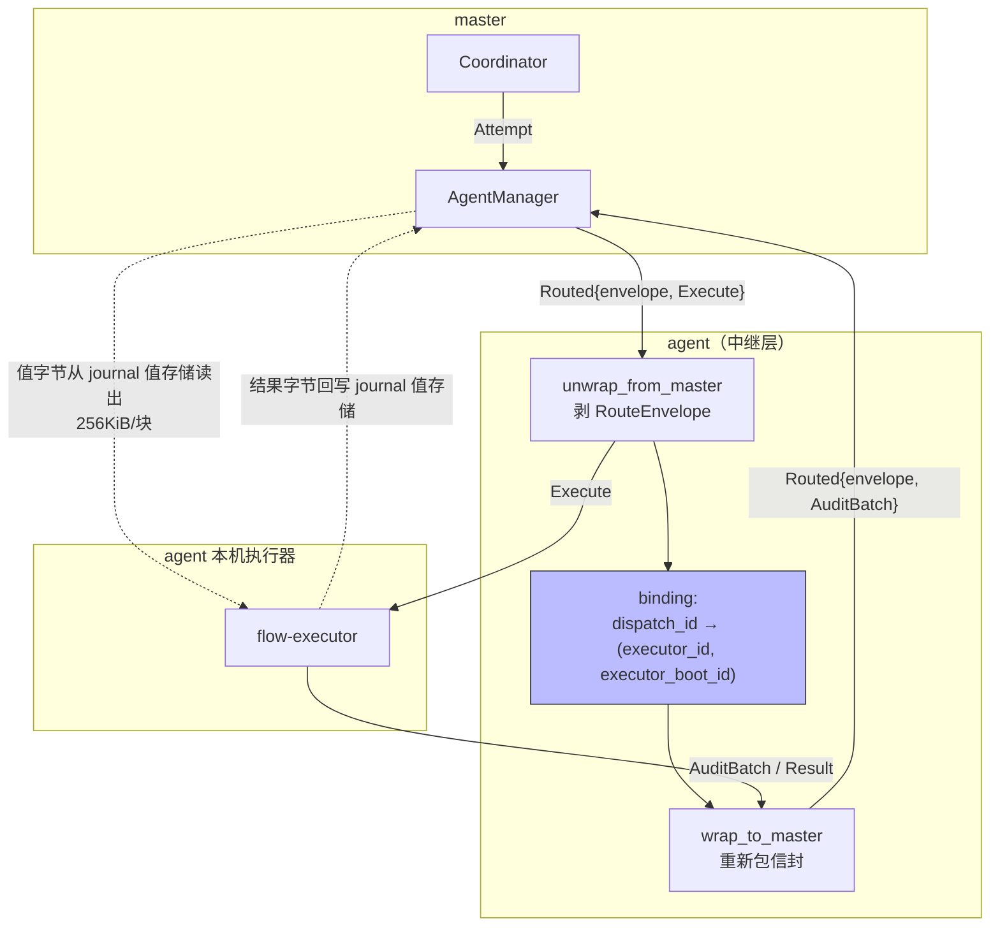

**agent 是哑中继，不是第二个决策点**。它的全部职责是：

1. 收到 `Routed` 信封，按 `dispatch_id` 找到本地绑定，剥掉信封转发给执行器；
2. 把执行器的上行消息按 `dispatch_id` 重新包上 `Routed` 信封发回 master；
3. 按字节/帧预算做公平轮转与有界退避。

**它不做**：gate 判定、审计屏障、授权决策、结果提交。所有裁决都在 master，
因为只有 master 持有 journal（C5）。

### 7.4 远程派发时序图

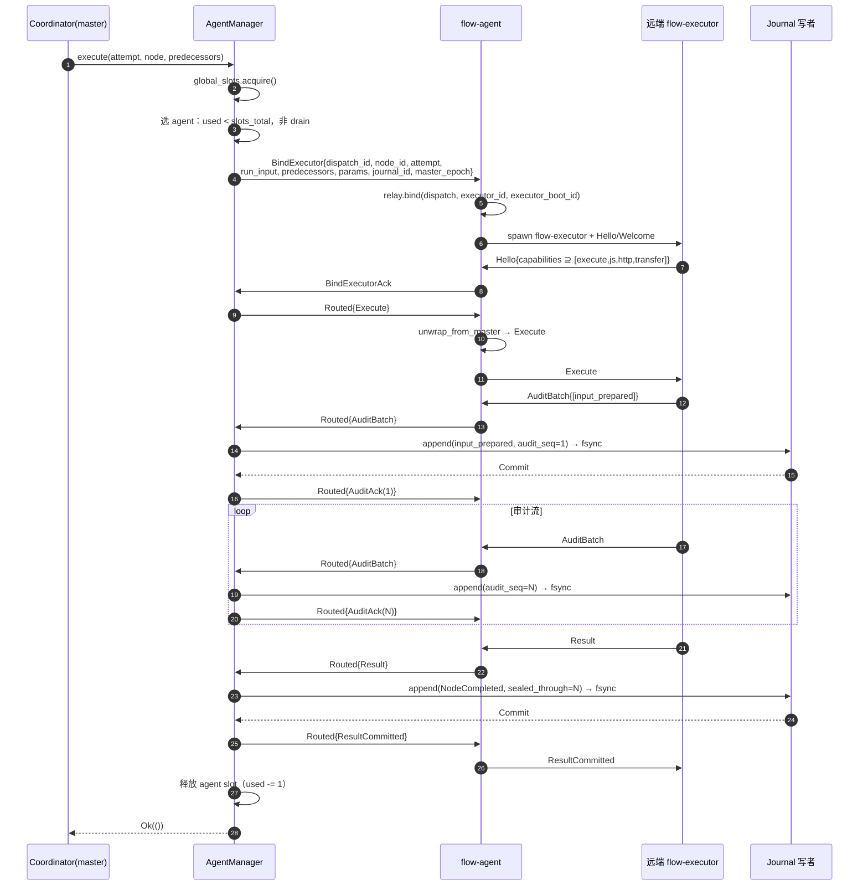

**与单机 IPC 的差异只有三处**：多一层 `Routed` 信封拆包、多一次 `BindExecutor`
握手、多一套 `CapacityReport` 准入。**协议消息集合完全相同**——同一套
`Message` enum，同一个握手顺序，同一组屏障条件。这正是「三条链路」设计的意义：
换部署形态不需要换执行语义。

### 7.5 断线重连与 Resume 对账（remote 模式的核心难点）

这是整个系统里最容易做错的地方，所以单独一节。**问题**：上联断了，master 不知道
远端执行器到底执行到哪一步——可能审计还没传完，可能结果已经算出来但没上报，
甚至可能外部操作的副作用已经发生。

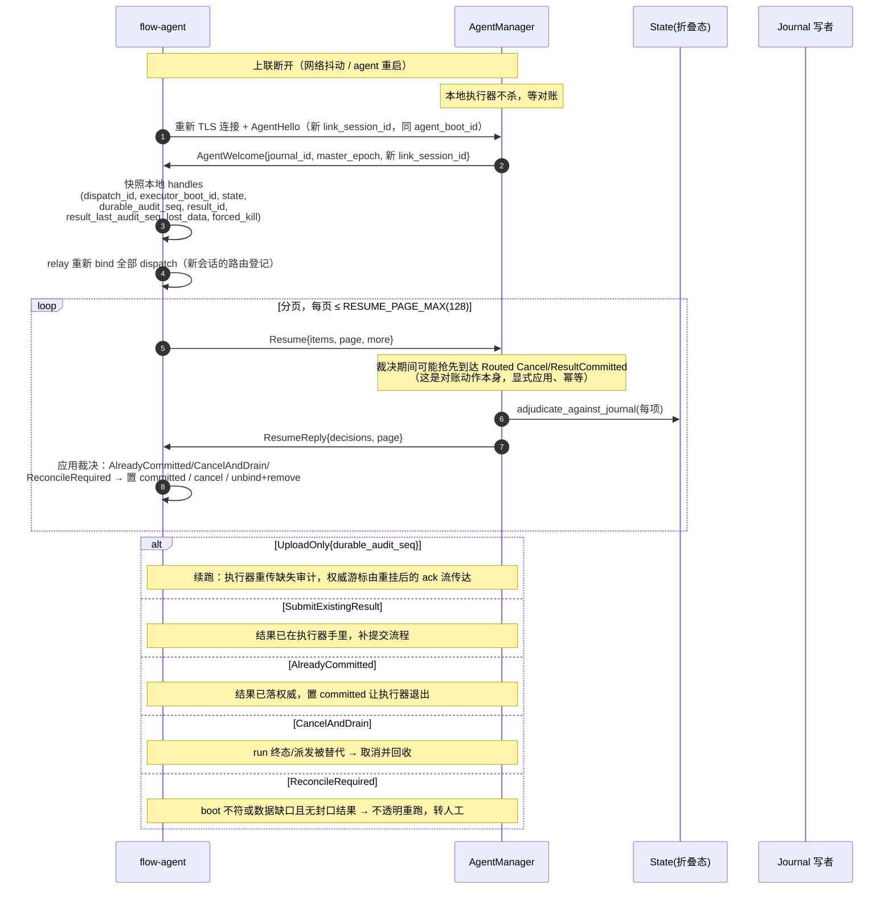

**裁决决策树**（`adjudicate_against_journal`，严格按序）：

```
run 不存在                       → CancelAndDrain
run 已终态                       → CancelAndDrain
node 不存在                      → CancelAndDrain
node.dispatch_id != item 的       → CancelAndDrain   （派发已被替代）
attempt 不存在                   → CancelAndDrain
attempt.result.is_some()         → AlreadyCommitted
bound_boot != item.executor_boot_id → ReconcileRequired
item.lost_data && result_id.is_none() → ReconcileRequired
item.result_id.is_some()         → SubmitExistingResult
否则                             → UploadOnly{durable_audit_seq: attempt.audit_seq}
```

**为什么 `bound_boot` 不匹配就要对账**：执行器进程重启过，它的内存状态全部丢失。
此时既不能假定它记得自己算到哪，也不能假定它没算——只有显式核对（人去看外部系统）
才安全。这与 C4 是同一条规则：**不知道就不动**。

### 7.6 drain：优雅收工

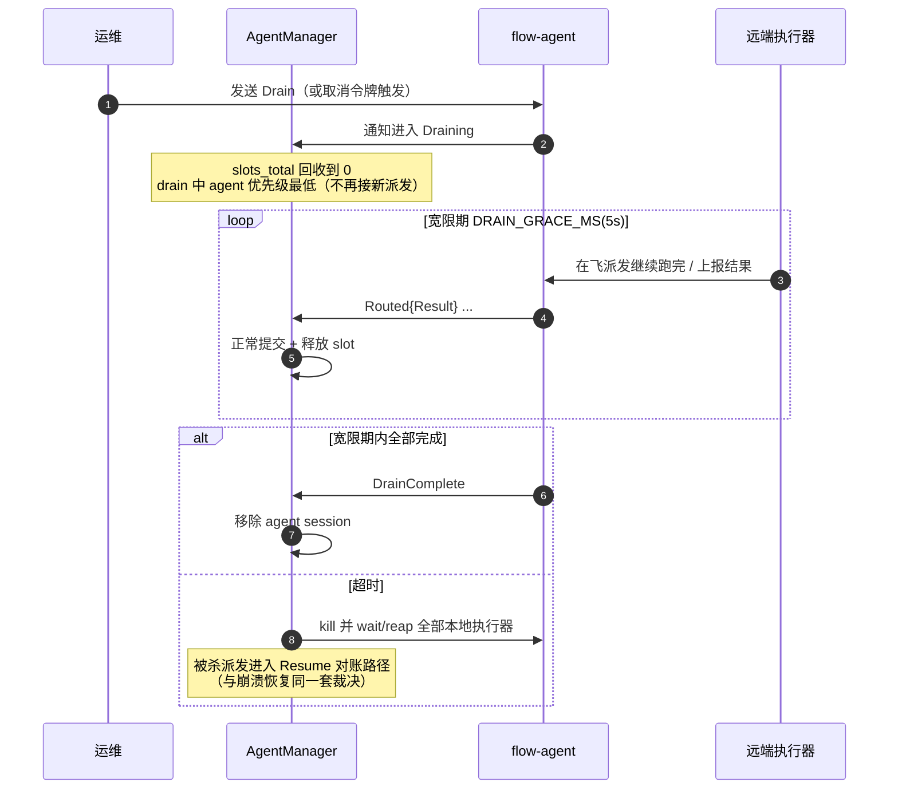

**drain 与崩溃走同一条对账路径**，这是刻意的：两种情况的观测完全相同——
「master 不知道远端执行器到哪了」。区别只在运维是否主动发起。

### 7.7 控制平面范围

每个数据目录只由一个 master 持有，本地目录锁与 SQLite 单写者约束继续生效。
执行端的 master_epoch、dispatch 身份和结果对账保持原有规则。
当前没有跨 master 的节点注册、租约、接管或日志复制功能；不为未来需求保留注册表脚手架。
删除后的配置和部署迁移见 [cluster 裁剪记录](plans/2026-10-23-remove-journal-cluster.md)。

---

## 8. 定义模型与校验

### 8.1 节点类型（12 种）

| 类型 | wire 名 | 外部副作用 | 崩溃后可安全重放 | 说明 |
| --- | --- | --- | --- | --- |
| `Start` | `start` | 否 | 是 | 入口，无操作 |
| `End` | `end` | 否 | 是 | 收口，输出计入 run output |
| `Script` | `script` | 否 | 是 | QuickJS 沙箱执行 |
| `Condition` | `condition` | 否 | 是 | 真值判定，产出 `branch: bool` |
| `Delay` | `delay` | 否 | 是 | 持久等待 `wake_at` |
| `HttpCall` | `http_call` | **是** | **否** | 任意出站 HTTP |
| `HumanTask` | `human_task` | 否 | 否（等 signal） | 人工任务，挂起等 `run.signal` |
| `Input` | `input` | 否 | 否（等 signal） | 表单收集，缺字段挂起 |
| `SubWorkflow` | `sub_workflow` | 间接 | 是 | 子 run，等终态透传输出 |
| `Harness` | `harness` | **是** | **否** | agent CLI/内置 runner：`mode=command` 跑外部 CLI（prompt 经 stdin，stdout 为输出）；`mode=agent` 由执行器内联驱动 conga-host 无头装配（typed 配置、密钥走参数、无独立 runner；配置冻结自 `[harness.agent]`；workdir 可选，缺省为每次 run 的临时沙箱） |
| `Email` | `email` | **是** | **否** | Resend 兼容 HTTP API |
| `Llm` | `llm` | **是** | **否** | 一次持久录制的 HTTP JSON 模型调用；工具操作用独立节点 |

**`has_side_effect()` 是 C3/C4 的开关**：这四种外部类型会走
`OperationIntent`/`OperationAuthorized` 授权路径。其余类型失败后可以放心重试。

**节点类型表的单一来源原则**：`NODE_TYPE_TABLE` 是 `(NodeType, &str)` 的常量表，
`as_str` / `parse` / `ALL` / `descriptor` / `has_side_effect` 全部由它派生。
新增节点类型只改这张表和 enum——手写这些面时漏改的那几处不会编译报错，
只在运行期表现为「类型不认识」或前端面板少一项。

### 8.2 校验规则（`flow-engine/src/model.rs`）

- **DAG 完整性**：节点 id 唯一、边引用的节点存在、无环、恰好一个 `start`。
- **端口合法性**：`condition` 的出边可带 `port: "true" | "false"`，其他类型不可带。
- **参数 schema**：每类型的 `params` 有独立校验；`input` 节点的 `fields` 必须
  是非空数组、每项含非空 `key`，`${...}` 模板值放行（运行期展开）。
- **密钥参数**：`x-secret` 标记的参数（目前只有 `email.api_key`）永不落 journal
  明文，只存引用（`flow-engine` 的 secret store）。
- **`sub_workflow` 深度**：`MAX_SUB_WORKFLOW_DEPTH = 16`（**不是**旧文档写的 8）。
- **不可变发布**：`WorkflowPublished` 后定义冻结；修改走新版本号，版本号必须连续。

---

## 9. 执行语义

### 9.1 汇合：按定义语义选择

v2 默认 `selected`：等待所有入边确定后，收集选中且成功的前驱；未选路径不阻断
汇合，全部路径 inactive 才传播 inactive，失败仍阻断下游。可用 `params.join: all`
显式要求全部前驱成功。它不在第一个前驱完成时提前启动。

以下图和优先级描述历史 v1 的 AND-join；v2 完整合同见 [EXECUTION.md](EXECUTION.md)。

`incoming_gate`（纯函数，无 IO）对每条入边求值：

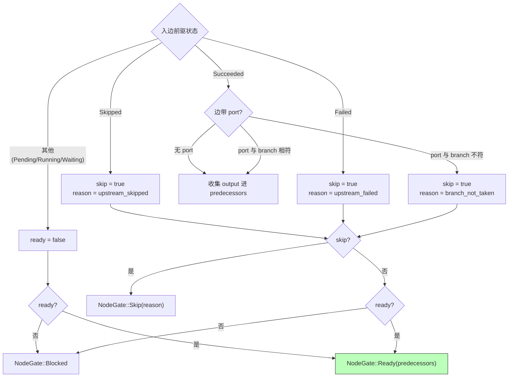

**优先级：`Skip` > `Blocked` > `Ready`**。任一条入边可跳过，整个节点就跳过——
不执行部分入边的「OR-join」。

### 9.2 失败不立即终结 run

**v1 语义保留**：节点失败后 run 不立即终态。独立分支继续跑完，失败分支的下游被
跳过（`reason = upstream_failed`），全部节点终态后由 `settle_run` 收口：

```
全部节点终态？
  ├─ 存在任一 Failed → RunFailed（错误取定义序第一个 failed 节点）
  └─ 否则 → RunCompleted，output = join_values(所有 end 节点输出)
```

`join_values` 的形状规则：单个 end → 直接取其输出；无 end 或全无输出 → `null`；
多个 end → 恒为 `map[end_id → output]`（**形状恒定**，不会因某个 end 被跳过
而从 map 退化成标量）。

### 9.3 重试：纯计算与显式 repeatable 外部操作

`execute_node` 的错误路径（全部转成已提交证据）：

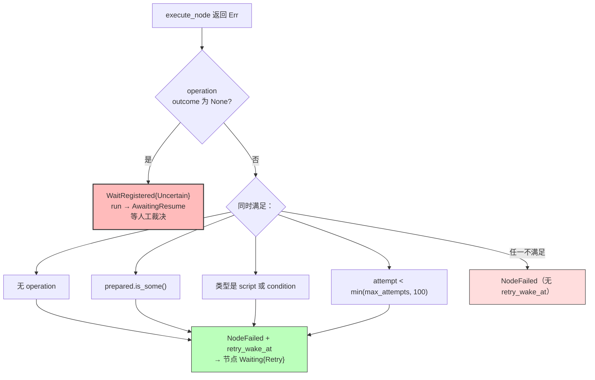

**`retry_wake_at` 与 operation 互斥**（折叠层强制：`external operation cannot use
pure retry`）。这是 C4 的又一道闸门——有外部副作用的操作，永远不能用「等一会儿
再试」蒙混过去。

`RetryPolicy` 缺省 `max_attempts = 1`、`backoff_ms = 0`，即**缺省不重试**；
`max_attempts` 上限 clamp 到 100。

外部节点的描述器公开 `retry_scope=declared_repeatable_only`。默认 `effect_policy=manual` 不自动重发；只有显式声明重复调用始终安全且配置了剩余尝试次数时，协调器才能提交 `OperationRetryAuthorized`，清除当前未知操作并进入持久 backoff，再创建下一次尝试。有限有效期幂等协议不应使用此声明。详细边界见 [EXECUTION.md](EXECUTION.md)。

### 9.4 输入节点：逐字段三级兜底

`input` 节点（最新加入的类型）按 `fields` 逐字段解析：

```
字段值 = run.input[key]      （run 级输入已提供）
      → params 默认值         （声明了 default）
      → 挂起等 run.signal 交付  （两者都没有）
```

字段齐则直接放行输出；缺字段则整节点进 `Waiting{Signal}`。这是 `AwaitingResume`
**之外**的另一类人工介入点，但它不是平台故障——是产品设计的正常等待，
`run.status` 保持 `Running`。

---

## 10. JS 沙箱与模板展开

### 10.1 QuickJS 沙箱边界

| 项 | 值 |
| --- | --- |
| 运行时 | rquickjs，`Runtime` + `Context::full`，**每次执行新建实例** |
| JS heap 上限 | 32 MiB（`set_memory_limit`） |
| 栈上限 | 512 KiB（`set_max_stack_size`） |
| 输入面预算 | 8 MiB（`input`/`nodes`/`tpl` 三者共享，逐个体积扣减） |
| 输出预算 | 8 MiB |
| JSON 深度 | 64 层（`validate_depth`，入参即校验） |
| 超时 | `DEFAULT_JS_TIMEOUT_MS = 2000`，靠 `set_interrupt_handler` 轮询 deadline |
| **BigInt 边界** | 超过 JS 精确整数域的 i64/u64 使用 BigInt 无损进出；超出 i64/u64 的结果拒绝 |

`JsLimits` 是**单一定义处**（`flow-engine/src/expr.rs`），本地与远程执行共用同一组
数字——否则「本机能跑、远程 OOM」会成为一类无法复现的问题。

**没有的能力**（刻意不给）：文件系统、`require`、动态 `import`、`eval` 外部代码、
网络（网络只经 `http_call`/`email` 节点，且必须走授权路径）。

### 10.2 模板展开：整体值与插值

`flow-engine` 的模板展开区分两种形态，这是很多 bug 的来源：

```
"${expr}"     → 整体替换：结果保留原类型（number/number[]/object 都行）
"prefix${a}suffix${b}" → 插值：结果恒为 string
```

- 展开预算 `expand_templates_bounded(..., 2s)`——模板递归/巨量展开不会卡死执行器。
- **不透明参数**：`NodeType::opaque_params` 列出的 key（如密钥参数）在展开前被
  移除、展开后原样插回，**永不参与模板求值**。
- 展开发生在执行器侧（`Task::prepare`），不是 master 侧——master 不运行用户代码
  （C2）。

---

## 11. RPC 层

### 11.1 方法面

`flow-rpc/src/journal_v2.rs` 注册 **51 个方法** + 1 个订阅（`run.subscribe`）。
所有方法共用一个入口：`flow_dto::rpc::Method` 目录和 `admit_call` 准入门。

方法按访问性质分两张清单——`READ_METHODS` 27 项 / `WRITE_METHODS` 24 项。**注意
这两张表不做权限分级，也没有「暂停期」语义**（不存在维护窗口：没有 paused 标志，
读写在运行期同权）。它们只服务三件事：

1. **写命令必须带 `request_id`**（`is_write_method` → 空即 `-32602`）；
2. **写命令的返回要解包成 `CommandReceipt`**（读面直接返回值）；
3. `command_scope()` 由调用方（CLI）用来推 scope，**服务端自己从不调用它**。

分类的实际效果是「写面有幂等键与提交游标，读面没有」——因为只有写面会改变权威
状态、才需要重放保护。

### 11.2 幂等：`request_id`

每个写方法接受调用方提供的 `request_id`（1..=128 字节）：

1. `fingerprint = sha256(请求体, 上限 9 MiB)`；
2. 查永久 command 回执：同一 `(scope, request_id)` 已有记录且 fingerprint **相同**
   → 直接返回上次结果，**不重复执行**；
3. fingerprint **不同** → `-32012 conflict`（`same request identity with
   different arguments`）；
4. 新请求 → 执行 + 落 `Command` 事件（含 `result`，受 `INLINE_BYTES` 限制）。

**缓存窗口**：内存最多保留 `COMMAND_WINDOW = 8192` 条，超窗淘汰旧缓存。
永久回执仍在 current_entities；命令先查缓存再查库，缓存逐出和重启不会放行旧身份。
本次不引入回执 TTL。

### 11.3 订阅：`run.subscribe`

唯一订阅。`event_format` 必须恰好是 `"v2"`（否则 sink 被 `-32602` 拒绝），
`mode` 可选 `audit` 或 `control`（缺省 control），`from_seq` / `from_lsn` 是规范
十进制字符串、缺省 0。

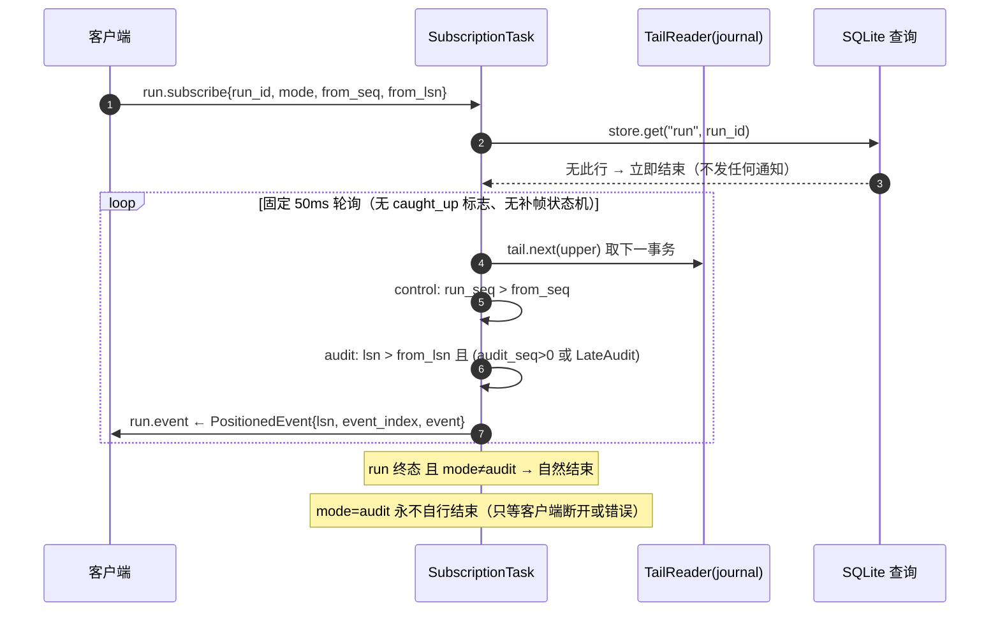

通知体是**原样的 `PositionedEvent`**（`{lsn, event_index, event}`），没有包装
信封、没有裁剪。每批累积到 `MAX_LINE_BYTES`（1 MiB）即发送；单条超限时先发一帧
`{"type":"stream_error","code":"RESPONSE_TOO_LARGE"}` 再关闭。

**刻意的简单**：固定 50ms 轮询，**没有** `caught_up` 标志，**没有** gap-filling
状态机，**没有**首帧快照（直接从 `from_seq`/`from_lsn` 起 tail）。（旧文档描述的
`run_tail` 相位机已随 v1 删除。）代价是轮询开销与「从 0 开始要重放全程」，
收益是订阅路径没有第二个状态机需要维护——而订阅状态机一旦出错，表现为
「前端事件丢一半」这类极难复现的问题。

**control 与 audit 是两种不同的流**：control 按 `run_seq` 推进（业务事件序），
audit 按 `lsn` + `audit_seq` 推进（含执行器审计事实与迟到的 `LateAudit`）。这也
是为什么 audit 订阅对终态 run 不自行结束——迟到的审计记录理论上永远可能出现。

### 11.4 错误码词汇（v2 单一来源）

| 码 | 名称 | 含义 |
| --- | --- | --- |
| `-32001` | unauthorized | token 缺失/不符（恒定时间比较，`admit_call` 对所有方法生效） |
| `-32011` | not found | **仅**六个精确串：`run`/`workflow`/`workflow version`/`schedule`/`webhook`/`template not found` |
| `-32012` | conflict | `flow_journal::Error::Conflict` / `ViewError::Conflict` / `TemplateNameTaken` / `request_id` 撞车 |
| `-32021` | limit | `flow_journal::Error::Limit`、`RESPONSE_TOO_LARGE` |
| `-32602` | invalid params | `invalid()` 助手 + jsonrpsee 参数解析失败 |
| `-32603` | internal | catch-all：journal 不可用、投影不可用、密钥 IO 失败 |

`-32011` 的窄映射值得注意：**只有那六个字符串**会被认成 not-found，其余
`Invalid` 一律降级为 `-32602`。新增一类「不存在」错误时必须同步加进
`failure()` 的 `matches!`，否则客户端会把它当参数错误处理。

**恰好一次对外部系统不成立**。`http_call` 在 `OperationPermit` 之后发生，此时
进程崩溃 → 恢复期只能判定「结果不明」→ 等人工裁决（C4）。**没有任何自动机制**
能把任意 HTTP 调用变成恰好一次；这是分布式系统的固有边界，不是实现缺陷。

### 11.5 触发器

**cron**（`journal_triggers::fire_due`）：20s tick；判定条件
`previous_before(now + 1s)`（提前 1 秒容错时钟抖动）；去重键 = RFC3339 的下一次
触发时间字符串。

**webhook**（`POST /hooks/{id}`）：Bearer token + `Idempotency-Key`（≤128 字节）、
body ≤ 8 MiB。

| 响应 | 含义 |
| --- | --- |
| `401` | Bearer 不符 |
| `400` | 载荷非法 |
| `409` | `Idempotency-Key` 重复且载荷不同 |
| `200` | 旧 hook 已受理（run 已创建）；独立业务入口 `/invoke/{id}` 使用 202 |
| `503` | 存储或服务暂不可用 |

---

## 12. 崩溃恢复

### 12.1 启动序列

1. 抢占数据目录 flock，校验 SQLite 格式和数据集身份；旧格式目录拒绝打开，不自动迁移。
2. 打开只读查询连接，加载控制元数据、schedule fire 水位、活跃 run/node/current attempt。
3. 终态 run、旧 attempt 和值进度按需读取；缓存不承担永久去重职责。
4. 播种 dirty runs，安装协调器，提交 master epoch 后继续安全执行。

不需要应用 checkpoint，也不等待独立投影。WAL 的恢复由 SQLite 完成。

### 12.2 故障处置

| 现象 | 处置 |
| --- | --- |
| 当前实体摘要不符 | 报错停止使用；不自动覆盖权威数据 |
| 写入/COMMIT 出错 | writer 冻结，修复介质条件后重开；原请求结果可能未知，按身份查回执 |
| 历史事实或正文校验失败 | 显式报告；停写、保留证据、从校验通过的一致备份恢复 |

备份使用 SQLite Backup API 的一致快照，包含事实、当前状态、回执和 BLOB。
不支持把任意旧 LSN 的日志前缀直接恢复成完整当前库。

### 12.3 观测日志不是权威

observations 使用独立队列与磁盘限额。删除后日志永久丢失，但不改变执行结果。
`flow.sqlite` 及运行中的 WAL 不具备这种可删除属性。

### 12.4 故障注入

`flow-backend/src/execution/dispatch.rs::fault` 提供一个**全局**命名观测点注册表
（`register` / `clear` / `checkpoint`），测试用它确定性地在「结果提交前」
「取消后」等精确位置切断。因为注册表是全局的，注入测试必须串行执行。

---

## 13. 不变量清单

这份清单是代码审查与测试设计的验收标准。每条都应有对应用例；违反任何一条
都是 bug，不是「设计选择」。

### 13.1 权威性

| # | 不变量 |
| --- | --- |
| I1 | flow.sqlite 是业务权威；事实、当前状态、回执和待处理动作原子提交 |
| I2 | `lsn` 全局无缺口；唯一写者分配，失败事务不占号 |
| I3 | 同一 `data_dir` 同时只有一个写者（flock 排他，进程内 + OS 双层） |
| I4 | 接受事实与查询状态同时提交，不存在独立投影进度 |
| I5 | 所有 run 状态迁移都是 `State::apply` 折叠的结果，不存在第二份状态语义 |

### 13.2 副作用安全（C3/C4）

| # | 不变量 |
| --- | --- |
| I6 | 任何外部副作用发生前，`OperationIntent` + `OperationAuthorized` 必须已作为**同一事务**落盘 |
| I7 | `operation.outcome` 为 None 的节点不得再次派发（`unsafe dispatch retry`） |
| I8 | 未知结果默认等待人工裁决；仅显式 repeatable 且持久提交机器重试授权时可自动重试 |
| I9 | `retry_wake_at` 与 `operation` 互斥（`external operation cannot use pure retry`） |
| I10 | `OperationIntent` 与 `OperationAuthorized` 在事务内相邻、载荷全同、`audit_seq` 均为 0 |
| I11 | `OperationAuthorized` 的 `fingerprint` 必须等于请求字节摘要 |

### 13.3 平台故障 ≠ 工作流失败

| # | 不变量 |
| --- | --- |
| I12 | `RunStatus::AwaitingResume` 只由 `WaitKind::Uncertain` 触发，只表示平台故障 |
| I13 | 节点失败不立即终结 run；独立分支跑完，下游跳过，`settle_run` 收口 |
| I14 | `delay`/`signal`/`child`/`retry` 等待期间 `run.status` 恒为 `Running` |
| I15 | 协调循环 panic → 整个循环重启，从折叠态重建，不丢已提交证据 |

### 13.4 审计与屏障

| # | 不变量 |
| --- | --- |
| I16 | `audit_seq` 在 dispatch 内严格 +1；重复序号必须内容相同（`audit retransmit with different content` 是错误） |
| I17 | 结果事件的 `sealed_through` 必须等于 `attempt.audit_seq`（`NodeCompleted` 额外 +1） |
| I18 | dispatch 已 sealed 后只接受 `LateAudit`，且不得推进 `run_seq` |
| I19 | `InputPrepared` 的 `prepared.input` 必须等于 `run.input`，`node_semantics` 必须为 1 或 2 |
| I20 | `Attempt::finish` 幂等：同 dispatch 已有结果时，比较 kind 与去掉 `sealed_through` 的载荷 |

### 13.5 进程与协议边界

| # | 不变量 |
| --- | --- |
| I21 | 节点执行语义只存在于 `flow-executor`；master 不在进程内运行用户代码 |
| I22 | 执行器缺失或协议版本不符 → 明确失败，**不**静默回退进程内执行 |
| I23 | 控制帧 ≤ 128 KiB 且不含用户值字节；变长值走 data 语义帧 256 KiB 分块 |
| I24 | `ResultCommitted` 之前执行器不得退出（否则「已算未落盘」无法判别） |
| I25 | `in_process` 执行模式在任何平台都不可配置 |

### 13.6 执行协议线路（v7 postcard 单流）

**唯一帧格式**：`u32 body_len（大端）| postcard(Message)`。整条线只有这一种帧，
没有第二种物理通道；postcard 的**变体索引即帧类型**。

```
┌─────────────────────┬──────────────────────────────────────────────┐
│ u32 body_len (BE)   │ postcard(Message)                            │
└─────────────────────┴──────────────────────────────────────────────┘
 读端一见长度头就校验上限，分配任何载荷缓冲之前拒绝非法长度
```

**帧预算按消息类型分类**（`frame.rs::frame_limit`）——分类只服务上限，不构成通道：

| 预算 | 常量 | 覆盖的消息 |
| --- | --- | --- |
| data 语义 | `DATA_MAX_FRAME` = 1 MiB | `TransferChunk`、`AuditBatch`、`ObservabilityBatch`、`Routed` |
| control 语义 | `CONTROL_MAX_FRAME` = 128 KiB | 其余全部（含 `Hello`/`Execute`/`Result`） |

`Execute` 是控制帧里**唯一承载大块用户可控内容**的消息：`ExecuteTask.node` 是
未展开的节点定义（`Value`）。dispatch 侧按 `CONTROL_MAX_FRAME / 2` 预检，超限
拒绝派发而不是杀会话。其余控制帧只带短身份串（`IDENTITY_MAX_BYTES` = 128）与能力
列表——`Hello.capabilities` 同样可变长，因此 `encode_frame` 对它一样吃
`CONTROL_MAX_FRAME` 上限（`frame.rs` 用 200 KiB 的能力列表钉住这条）。

**版本门集中在握手**：v5 起每帧不再自带版本号，`Hello`/`Welcome` 携带
`version`（= `PROTOCOL_VERSION` = 7），任一侧不匹配即明确拒绝。跨版本配对在握手
处收口，不依赖逐帧校验。

**审计计费与 wire 编码解耦**：`record_bytes()` 是主进程与执行器共用的确定性
**JSON** 编码长度函数（窗口预算与幂等内容比对用），与 postcard wire 编码无关。
同一个 `audit_seq` 在两条线路上有两种编码，但只有 JSON 那一种参与计费。

**消息目录（28 个变体）**，按方向：

| 方向 | 消息 |
| --- | --- |
| 子 → 主（单向） | `Hello`、`Ready`、`Accepted`、`AuditBatch`、`RequestOperation`、`Result`、`Stopped`、`ObservabilityBatch` |
| 主 → 子（单向） | `Welcome`、`Execute`、`AuditAck`、`OperationPermit`、`ResultCommitted`、`Cancel` |
| 双向 | `TransferChunk`、`InputReady`、`Heartbeat`、`Reject`、`Routed` |
| agent ↔ 主（上联管理） | `AgentHello`、`AgentWelcome`、`CapacityReport`、`BindExecutor`、`BindExecutorAck`、`Resume`、`ResumeReply`、`Drain`、`DrainComplete` |

四行合计 8 + 6 + 5 + 9 = **28 个变体**，与 `message.rs` 的 `type_name()` 分支一一
对应（`postcard_decode_rejects_unknown_variant_index` 用索引 28 越界钉住这个数）。

**`Routed` 是远程中继的唯一包络**：`Routed{envelope, inner: Box<Message>}`。
v5 起内层 `TransferChunk` 的字节由嵌套枚举原生承载，v4 那个专用
`KIND_ROUTED_TRANSFER_CHUNK` 帧与其三处 `dispatch_id` 一致性校验随枚举嵌套自然
消失。`dispatch_id` 仍是路由键：远程中继按它把帧包进信封发往归属执行器。

`routable()` 规定内层禁止嵌套 `Routed`、禁止上联管理帧与握手帧；`Reject` 与
`Heartbeat` 例外——执行器的任务失败通知与心跳必须能经 agent 中继给主进程。
这条规则在**出站 wrap 侧与入站解包侧双向执行**（master 解包 `Routed` 时同样
校验内层）；`Reject` 自身没有派发归属字段，由 agent 的 fair_mux 桥按来源句柄
注入归属标签后再包装——否则上联包装器按「无归属」静默丢弃，master 的终态
错误入口就收不到远程基础设施故障。取消后的排空有截止时间
（`CANCEL_REAP_TIMEOUT_MS` = 30s）：持续心跳但不响应 Cancel 的执行器到点由
master 派发方放弃等待、agent 侧强制收割，不能无限占用槽位。

**对抗性输入的防线**（`message.rs`/`frame.rs` 的单测各钉一条）：

- 帧内尾随垃圾 → postcard 未恰好消费完帧体 → 协议错误（防「合法消息 + 附加字节」走私）；
- 巨型长度声明（`String` len varint = `u64::MAX` 量级）→ 先做边界检查再取字节，
  小帧内立即报错，**不先按声明长度分配**；
- 变体索引越界（目录 28 个）→ 明确拒绝；
- 半帧/粘帧 → `FrameDecoder` 累积缓冲，仅在帧完整、预算通过后才从缓冲摘除；
- **`Routed` 嵌套深度**（`ROUTED_MAX_DEPTH` = 8）→ `Routed.inner` 的反序列化带
  深度计数，超限在解码层拒绝。没有这道门，每层仅约 7 字节的嵌套可在 1 MiB 合法
  帧内塞约 15 万层递归，postcard 递归下降解码（及派生 Drop/Debug）栈溢出 abort，
  且发生在握手/令牌校验之前——对等端一发帧即可打崩单写者权威进程。深度门同时
  让成功解码值的派生递归有界。

**为什么删掉 `Channel`**：v4 用一字节 `kind` + JSON meta 区分三种帧、另设
`Channel` 概念表达 data 归属；v5 把整个 `Message` 枚举交给 postcard 后，变体索引
天然承载类型、嵌套枚举天然承载层级，这两个概念都只剩冗余。线路两端都是 Rust，
用户 JS 摸到的是节点输入值而不是协议帧——v4 为 JS 安全整数设的十进制字符串戒律
也随之删除。

---

## 14. 测试策略

| 层 | 位置 | 覆盖 |
| --- | --- | --- |
| **单元** | 各 crate `#[cfg(test)]` | 折叠规则、gate 判定、模板展开、codec 预算、协议编解码、幂等去重 |
| **e2e** | `crates/backend-e2e/tests/` | 与 `remote-e2e` 共同覆盖真实 server/executor/agent、故障注入和新版产品合同 |
| **性能** | `crates/backend-perf/` | 黑盒压测 harness |
| **故障注入** | `execution/dispatch.rs::fault` | 在「结果提交前」「取消后」等精确位置确定性切断 |

**e2e 是这份设计的真正守门人**。原因：本文档的多数不变量（I6–I24）只有在
「进程真的被杀、连接真的断」时才可能被违反。单测里 mock 掉的时序，恰是这些
bug 的栖息地。

---

## 15. 已知限制与未做

**明确未实现**（不要按已实现规划）：

| 项 | 状态 |
| --- | --- |
| master 高可用 / journal 复制 / 多写者 | 未实现，与 C5 冲突 |
| 多 master 调度与接管 | 非当前产品范围（§7.7） |
| 多租户授权与用户体系 | 未实现（C7） |
| 恰好一次外部调用 | **不可能实现**（§11.4） |
| OpenTelemetry 链路追踪 | 已定未实现（`docs/opentelemetry-design.md`） |
| `in_process` 执行模式 | 已全平台删除 |

**已知取舍**：

- **单写者与 WAL 成本**：写入由唯一 owner 串行决定，长读、大正文与维护会影响 WAL 和尾延迟；不提供多协调器 HA。
- **订阅是轮询**：固定 50ms，无 gap-fill 状态机（§11.3）。
- **历史保留未裁剪**：事实、永久回执、旧 attempt 与正文继续增长；本次没有引入 TTL 或 GC。
- **审计吞吐受 W_BYTES 约束**：单 dispatch 在飞审计 ≤ 2 MiB，是协议硬上限。

---

## 16. 快速索引：从「我想改 X」到该读哪里

| 想改的东西 | 该读 |
| --- | --- |
| 加一种节点类型 | `flow-engine/src/model.rs` 的 `NODE_TYPE_TABLE` + `descriptor`；`flow-executor/src/task.rs` 的执行分支 |
| 改 run 状态语义 | `flow-engine/src/journal_state.rs` 的 `State::apply` |
| 改调度/汇合规则 | `flow-backend/src/journal_driver.rs` 的 `incoming_gate` + `advance_run` |
| 改写盘行为/组提交 | `flow-journal/src/writer.rs` |
| 改协议消息 | `flow-engine/src/execution_protocol/{contract,message}.rs`（改 `contract.rs` 即需 bump `PROTOCOL_VERSION`） |
| 加 RPC 方法 | `flow-rpc/src/journal_v2.rs` 的 `READ_METHODS`/`WRITE_METHODS` + 对应 handler |
| 改触发器 | `flow-rpc/src/journal_triggers.rs` |
| 改 agent 中继 | `flow-agent/src/{runtime,relay,pool}.rs` |
| 离线维护 | `flow-journal/src/bin/flow-journal-tool.rs`（`verify`/`rebuild-index`/`backup`）；`flow-journal-dev check-projection`（事实重放 diff） |
