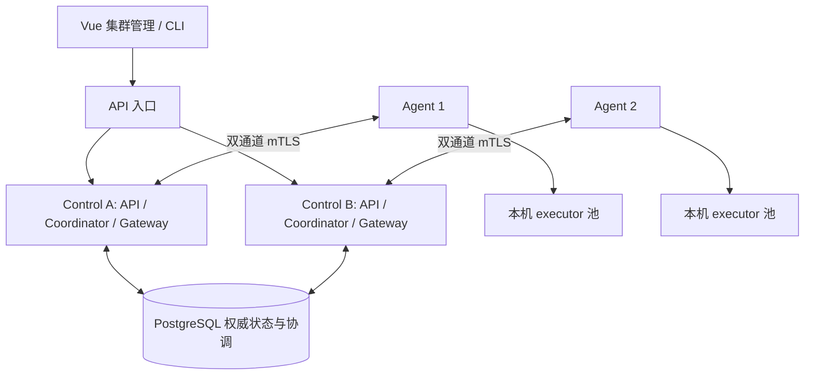

# PostgreSQL 多节点执行与管理平面方案

日期：2026-10-11。状态：设计提案，尚未实现。
当前已实现的选择是“独立 journal + PG 节点注册与进度管理”，见
[JOURNAL_CLUSTER.md](JOURNAL_CLUSTER.md)。下文的共享 PG 业务权威、跨节点 run 编排与
inbox/outbox 仍属另一种架构提案，不描述当前 feature 的行为。
代码审查与现有行为见 [MULTI_NODE_REVIEW.md](MULTI_NODE_REVIEW.md)。

## 1. 架构决策

建议新增 `cluster` 部署模式：**PG 统一保存权威事实和协调状态，多个 control
节点分摊 run 编排，agent 管本机 executor，Vue 工作台管理整个集群**。
保留 journal 模式用于本地、桌面和无需 PG 的部署；两种模式共用领域规则，
单个数据集只使用一个权威存储。不能让多个主进程共享 JSONL 目录，也不做 PG +
JSONL 双权威提交。旧 PG 后端最多参考其故障模型，不能直接复活已删除的 v1 引擎。



初版每个 control 进程同时承担 API、coordinator、scheduler、agent gateway，
无需先拆微服务。API 请求可落到任意节点；agent 保持一组活跃 control/data 连接，
拥有该连接的 gateway 与拥有该 run 的 coordinator 可以不同。
跨进程消息依赖 PG 持久 inbox/outbox，不能直接查另一个进程的内存 channel。

agent 不直接连接 PG；注册、心跳和审计通过认证 gateway 进入 PG。这样数据库
凭据、权限和迁移都留在管理平面，执行机无需取得集群业务表写权限。

## 2. 所有权和标识

| 对象 | 稳定标识 | 每次重启或接管变化的标识 | 作用 |
| --- | --- | --- | --- |
| 数据集 | cluster_id | restore_generation | 隔离不同集群及备份恢复后的旧连接 |
| Control | node_id | incarnation_id | 拒绝重启前的进程心跳和内部命令 |
| Agent | agent_id（绑定证书主体） | boot_id、connection_generation | 机器身份与连接归属分离 |
| Run | run_id | owner_epoch | 一个 run 一个有效 coordinator |
| Dispatch | dispatch_id | 显式 adopt/revoke 版本 | attempt 的实际派发归属 |
| Executor | executor_id | executor_boot_id | 不能用 PID 认领旧任务 |
| Operation | operation_id | permit_id | 固定外部请求与一次授权；不能因接管生成新操作 |

Control incarnation、agent connection generation 与 run owner epoch 是不同的
屏障，不能混成全局 master_epoch。启动 B 不会撤销 A 正在编排的其他 run。
旧 dispatch 的证据可以保留；旧 owner 不再有改变 run 或授权新操作的权限。

## 3. PG 表与事务边界

下面是逻辑表结构和关键约束，**不是可直接执行的 migration**。所有表以
cluster_id 隔离；大整数对外仍用十进制字符串。PG BIGINT 的有符号范围需在 DTO
转换处检查，不把当前 u64 无检查地 cast 为 i64。

| 表 | 主要字段 | 约束 / 索引 |
| --- | --- | --- |
| control_nodes | node_id, incarnation_id, roles, desired_state, last_seen_at, lease_until, version, build | PK(cluster,node)；有效 incarnation 条件更新 |
| agents | agent_id, boot_id, connection_generation, gateway_node/incarnation, desired_state, observed_state, last_seen_at, lease_until, slots, labels, capabilities, build, revision | PK(cluster,agent)；已移除身份保留 tombstone |
| agent_slots | agent_id, boot_id, slot_no, dispatch_id, reserved_at | PK(cluster,agent,boot,slot)；dispatch_id 唯一（非空） |
| workflows / workflow_versions | 定义、checksum、immutable version、published | PK(cluster,workflow,version)；已发布不可变 |
| runs | run_id, definition_ref, input_ref, status, revision, last_run_seq, owner_node/incarnation, owner_epoch, lease_until, parent | PK(cluster,run)；状态与事件同事务更新 |
| run_nodes | run_id, node_id, execution_id, current_dispatch_id, state, output_ref, prepared_ref, wait | PK(cluster,run,node) |
| run_work | run_id, desired_revision, processed_revision, ready_at, priority, queue_reason | PK(cluster,run)；到期待编排部分索引 |
| dispatches | dispatch_id, run/node/attempt, owner_epoch, agent/boot/generation, executor/boot, slot_no, state, sealed_through, result_id, adopted_epoch | 唯一(run,node,attempt)；同节点一个未撤销当前 dispatch |
| audit_records | dispatch_id, audit_seq, raw_payload, digest, receipt_id | PK(cluster,dispatch,audit_seq)；同身份不同摘要报冲突 |
| run_events | run_id, run_seq, tx_id, event_index, kind, payload, owner_epoch | PK(cluster,run,run_seq)；按 run 顺序分页 |
| operations | operation_id, node_execution_id, request_fingerprint, request_ref, permit_id, status, outcome_ref, original_dispatch_id | operation_id 唯一；授权/结果不可被新派发覆盖 |
| command_receipts | principal, scope, request_id, fingerprint, result, receipt_id, expires_at | 唯一(cluster,principal,scope,request_id) |
| schedules / schedule_fires | cron, timezone, next_fire_at, misfire_policy / schedule_id, scheduled_at, run_id | 唯一(cluster,schedule,scheduled_at) |
| executor_inbox | report_id, source identity, dispatch_id, audit/result payload_ref, received_at, processed_at | 固定 report 身份去重；只表示收到证据 |
| gateway_outbox | command_id, dispatch_id, destination identity, kind, payload_ref, delivery_state, retry_at | 固定 command_id；按目标和待发送状态索引 |
| values / value_chunks | value_id, codec, digest, bytes, published / chunk_no, data | 唯一(value,chunk)；先有全部块，后 published |
| cluster_settings / secret_versions | policy revision / encrypted value、key version | 集群共享；明文密钥不进事件、回执或页面 |
| admin_actions | action_id, request_id, actor, target, reason, revision, status, error, timestamps | 幂等管理命令、可查询进度与审计 |

权威事件和 run/node 当前状态由**同一事务**更新，状态表是事件的可重建 materialization，
不能提供绕过领域决策的 UPDATE API。用每个 run 的 revision 和 last_run_seq
分配连续序号，不用 PG SEQUENCE 生成业务连续序号。

PG sequence 会有间隙；按序号分配也不能推导事务提交顺序。因此不沿用 journal 的
单个全局连续 LSN 作为所有订阅的游标。run 订阅使用 `(cluster_id, run_id, run_seq)`；
回执使用稳定 receipt_id + 受影响资源 revision。数据库 WAL LSN 不等于业务序号。
这是基于 [PostgreSQL sequence 文档](https://www.postgresql.org/docs/current/functions-sequence.html)
和并发事务行为作出的设计选择。

现有 `/journal` 保留为 journal 模式审计；cluster 增加 run 审计查询/JSONL 导出。
若以后需要整个集群的严格全序审计，再另行选择 CDC 或序列化提交，不在首版伪造全局游标。

## 4. 注册、心跳、剔除

### 4.1 注册协议

1. Control 启动连接 PG，校验 schema/cluster identity，注册新 incarnation。
   相同 node_id 的活跃进程不能被普通 UPSERT 静默替换；需要旧租约过期或显式 replace。
2. Agent 双通道 mTLS 握手通过后，gateway 校验证书主体映射、最低协议与能力、
   行政状态，再事务登记 boot、gateway incarnation 和新的 connection generation。
3. 同 agent_id 同 boot 的合法重连更新连接 generation，撤销旧连接；不同 boot
   在旧实例仍有效时拒绝普通注册，避免克隆机器争抢身份。
4. 注册后先 reconciling；盘点 executor 与 dispatch，完成 PG 归属核对再 ready。
   ready 不隐式恢复所有旧任务的执行权。

心跳条件更新必须包含 incarnation/boot/generation/gateway 归属；更新行数为 0
说明身份已失效，立即关闭旧会话。迟到心跳不能让 removed 节点复活。
数据库不可用时停止新派发和新授权；agent 不自选任务或自签 Permit。

### 4.2 生命周期

行政状态：`enabled / cordoned / draining / removed`。
观测状态：`connecting / reconciling / ready / suspect / offline / incompatible`。
两者分别展示：心跳健康不意味着管理员允许调度，cordon 不表示机器故障。

初始可调参数：heartbeat=5s，suspect=20s，offline=30s；run lease=15s，renew=5s。
这些是待压测的默认建议，不是执行超时。dispatch 重连期限与租约分开配置。
租约与失效时间以 PG 时间为准，UI 展示 server_time/last_seen_at，避免客户端时钟漂移。
`clock_timestamp()` 取实际时刻，`now()` 是事务开始时刻；短事务也要在取得行锁后
重新检查期限。[PG 时间函数](https://www.postgresql.org/docs/current/functions-datetime.html)

任何 control 的 reaper 可分批扫描过期行，带原 boot/generation/lease 条件更新，
只有更新成功者记录状态转移与唤醒事件。reaper 不直接删机器或重跑业务：

- suspect：停止新的容量分配，保留旧 dispatch 和证据。
- offline：进行 dispatch 恢复分类，允许纯计算重新排队，未知外部操作进入 uncertain。
- removed：持久 tombstone，并拒绝新注册/心跳；保留历史归属和审计。

管理剔除必须先提交禁调度/撤销事实，再 best-effort 通知 agent。TCP 断开、租约
过期、SIGKILL 都不能证明之前的 HTTP 请求没有在外部完成。

## 5. Run 编排、调度和容量预留

### 5.1 逐 run 租约

多个 coordinator 从 run_work 领取已到期且待推进的 run。
`FOR UPDATE SKIP LOCKED` 用于竞争队列行，避免消费者互相阻塞；不用于给管理页面
统计在线节点。[PG SELECT](https://www.postgresql.org/docs/current/sql-select.html)

下面仅展示已选中 run 的所有权更新；调用方还必须在事务中校验 control incarnation
仍有效，锁 run_work、检查待处理 revision，以及同步记录 owner 变更：

```sql
UPDATE runs
SET owner_node = $3,
    owner_incarnation = $4,
    owner_epoch = owner_epoch + 1,
    lease_until = clock_timestamp() + interval '15 seconds'
WHERE cluster_id = $1 AND run_id = $2
  AND status NOT IN ('succeeded', 'failed', 'cancelled')
  AND (owner_node IS NULL OR lease_until <= clock_timestamp())
RETURNING owner_epoch, revision, last_run_seq;
```

续租只允许相同 owner_node/incarnation/epoch 且尚未过期，过期不能自行续回。
丢失所有权就停止推进，不把 LeaseLost 写成 NodeFailed。
所有 domain append、派发 assignment、OperationAuthorized 和 result commit 都须
在短事务内锁 run 行、核对 owner identity/epoch/有效租约与 expected revision。
锁后重新读状态，再决定事件；不能先用内存决定、提交时只检查一个旧快照。

行锁的持有时间仅覆盖决定和提交，不跨网络发送、不等待 executor。
用 statement/lock/idle-in-transaction timeout 限制卡住的数据库会话。
提交授权后才允许出网；租约不能撤销已经交给 executor 的外部操作。

### 5.2 持久唤醒，防止丢工作

run 创建、信号、取消、结果、子 run 终态、到期等待都更新 run_work。
用 desired_revision/processed_revision 保留“owner 推进期间又到新事件”的事实。
owner 完成一轮只确认自己处理过的 revision；如果有更新，仍保持可领取。
delay/retry 保存 wake_at，释放 executor 和不必要的 owner 租约，到期再领取。
human_task、uncertain、sub_workflow 等待也不占执行槽。

LISTEN/NOTIFY 只唤醒 worker；启动/重连先建立 LISTEN，再查表补齐，周期轮询兜底。
通知在事务提交后发送，接收端掉线不会替它保存待处理任务。
领域结果和待处理 revision 才是可靠工作依据。
[PG NOTIFY](https://www.postgresql.org/docs/current/sql-notify.html)、
[PG LISTEN](https://www.postgresql.org/docs/current/sql-listen.html)

### 5.3 节点选择

先过滤：enabled + ready + 心跳有效 + 当前 gateway 有效 + capability/协议/build
兼容 + workflow/node selector 匹配。harness 的命令、工作目录和依赖必须由执行机
能力/部署 profile 描述；不能把管理机上的本地路径直接当远程机存在。

再按剩余资源、队列年龄、负载比例选择；不能只比较绝对 used 数。
首版使用明确的 slot 限额和按 profile 预留内存预算，CPU/RSS 遥测只作健康与排序参考。
需要 tenant/pool 公平配额时再扩展，不先引入复杂抢占算法。

同一事务在 run 权限屏障下锁候选 agent 行（drain 也锁同一行），重新校验行政/健康
状态，原子领取空闲 agent_slot，创建 dispatch assignment 与 Bind/Execute outbox。
所有资源计账由这些占槽事实派生；CapacityReport.in_flight 只作遥测。
锁顺序统一 run → agent → slot → dispatch；跨 run 命令按 run_id 排序，并重试死锁事务。

找不到资源：不创建业务 DispatchStarted，不加 attempt，保存 queued 原因和下次
检查时间。配置 queue_timeout 时才按策略处理。所有空槽消耗都必须有 dispatch 关联，
Bind 失败释放占槽的事务也要幂等。

一个断线 dispatch 仍预留原 slot，直到对账确认完成/退出或旧执行器被回收。
重启 boot 的新 slots 只有在本机 supervisor 已回收旧受控进程并完成对账后才开放。
未知 HTTP 副作用可继续待裁决，但 executor 已确认退出后不需一直占着物理 slot。
下调容量只停止额外派发，不无声取消已执行任务。

## 6. Gateway 与 executor 编排

### 6.1 连接所有者与 run 所有者分离

1. Coordinator 持有 run lease，事务写 assignment 和固定 command_id 的 outbox。
2. 目标 gateway 按 agent_id/boot/generation 领取对应命令，经活跃 mTLS 连接转发。
   Agent 对相同 dispatch 的重复 Bind/Execute 必须查询本地归属并返回已有确认，
   不能再次 spawn；当前 BindExecutor 实现需要补这条去重。
3. BindExecutorAck 的 executor_id/boot 进入 PG，与原 assignment 核对，记录 bound。
4. Gateway 收到 AuditBatch/Result，先写有界 executor_inbox/staging，保留认证来源、
   原始摘要和 report 身份。收到或暂存不生成 AuditAck/ResultCommitted。
5. 有效 run owner 消费 inbox，校验 dispatch、boot、连续 audit_seq、摘要、封口边界，
   事务提交权威事件/状态并写 ACK outbox。PG commit 成功后 gateway 才转发 ACK。
6. 已提交结果重发只返回原 receipt；同 result_id 不同内容报冲突。

gateway 崩溃后 agent 可连另一 gateway，新的 generation 撤销旧连接。
outbox/inbox 以来源和目的身份过滤；旧 gateway 不能恢复新派发执行权。
ACK 允许按连续 durable 前缀合并，审计批量提交，避免每条日志一个数据库往返。
为每 agent/control 设置有界 staging、outbox 和字节预算；大量 chunk 不放进 NOTIFY。

### 6.2 外部操作的准入

保留 `InputPrepared → RequestOperation → Intent+Authorized → Permit → Outcome`
顺序。授权事务锁 run，核对 lease/epoch、dispatch 仍有效、未取消、请求指纹一致，
operation_id 尚未授权。数据库提交后才能签发/转发 Permit。

OperationPermit 的 outbox **不能套普通消息无限重试**：

- 只能给对应的活 executor boot、dispatch 和当前已核对的连接。
- Executor 对 permit_id 做一次消费，后续重复 Permit 不再次执行操作。
- owner/boot 变化或不确定是否已经消费时，禁止自动重发到新 executor。
- 同一存活 executor 仍在等待原许可的恢复路径，要通过显式对账决策批准；不批准则
  uncertain。固定 ACK/ResultCommitted 的幂等重传与操作许可的恢复不是同一规则。

PG fencing 只能拒绝旧提交，不能使已经发出的 HTTP/email/harness 回滚。
外部系统支持幂等键时使用稳定 operation_id；不支持时保留人工裁决。
人工 retry 产生明确的新授权事实，页面必须展示重复副作用风险和裁决理由。

### 6.3 接管分类

| 已知事实 | 新 owner 行为 |
| --- | --- |
| 还未派发 / 尚未授权外部操作 | 重建 ready 工作，纯计算可重新派发 |
| 同 boot 的 executor 仍在，审计可补齐 | 写显式 adopt 到新 epoch；先核对补传，再按恢复决策处理 |
| 固定结果已封口且审计齐全 | 在新 epoch 写 adopt/result commit，原结果去重 |
| 结果已提交，只丢 ACK | 回原 ResultCommitted，不重新执行 |
| 已授权操作但没有可信 Outcome | uncertain；不自动转给其他机器重新调用 |
| Outcome 已完整持久化 | 基于原 Outcome 继续解析/产出，不重新发外部请求 |
| 旧 executor 已死，审计或大值有缺口 | 记录 incomplete，按节点语义恢复或人工核对 |
| Run 已取消、dispatch 已替换 | 拒绝业务变更，允许单独的迟到证据审计，发送 Cancel |

接管时先使旧 owner 的条件写失效，再核对旧 dispatch；不是一失联就释放容量并
创建相同副作用的新 dispatch。coordinator 接管失败不会把平台故障写成工作流失败。

## 7. 触发器、信号、子工作流、大值与密钥

- Cron：所有 scheduler 可以扫描到期 schedules，用行锁领取；fire 唯一键 +
  RunStarted + next_fire_at 同事务。明确 timezone 与 misfire_policy
  （skip/fire_once/catch_up，catch_up 有批量上限），不沿用每机 Local 时区。
  同一 schedule 同一 UTC fire 永远不因通用回执 GC 再执行。
- Webhook/手动启动：唯一 principal/scope/request_id，校验 fingerprint，原 run_id
  和 receipt 可跨 API 节点查询。明确保留期；过期请求按契约拒绝或要求新键，
  不宣称无限去重。触发器 fire 记录与普通回执保留策略分开。
- 取消/人工信号：API 事务保存命令并唤醒 run；owner 消费时重新读状态，按 revision
  与授权事务串行决定取消/Permit 的先后。父子取消做持久工作，失败后能继续传播。
- 子 run：WaitRegistered 与 child RunStarted 同事务；由 parent execution/attempt
  建唯一关联，跨节点重试返回同一 child；涉及两 run 时固定锁顺序。
- 大值：首版 PG bytea 分块保存，publish 验证块数量/总字节/摘要；输入下载不依赖
  agent 本地路径。字段用中立 ValueStore 接口。后续可换对象存储：先 durable upload，
  再 PG 发布引用；未发布块可 GC，已发布引用不得先删。
- 密钥：集群 secret_versions 使用共享加密存储或统一 secret provider；凭据只在
  Permit 的保密通道临时注入。API 本地 secret.key/secrets.json 不适合作为集群真相。
- 数据库 HA：普通本地 WAL commit 不自动保证故障切换零丢失。外部操作授权一旦
  丢失可能误判未执行，故自动接管要求经过验收的无已确认事务丢失方案，并隔离旧
  PG primary；异步复制/从旧备份恢复后提升 restore_generation、停止旧会话，
  对可能丢失的外部操作进入灾难恢复核对，不能盲目重放。
  [PG 复制与同步提交](https://www.postgresql.org/docs/current/warm-standby.html)

## 8. 多节点管理页面

沿用现有 Vue 路由、API、toast/modal、RunDetailView；管理面是同一工作台的入口，
不是设置页的一段本机 TOML。新增一级导航“集群”，local 模式通过 capabilities
返回“本地模式，未启用集群”；不显示伪造在线节点。

| 页面 / 路由 | 信息与交互 |
| --- | --- |
| 概览 `/cluster` | control/agent 健康数、已预留/可调度 slots、队列数量与最老等待、uncertain 数、PG 状态、最近故障和管理操作；点击指标带过滤进入列表 |
| 执行节点 `/cluster/agents` | 状态/池/labels/build 过滤；表格含名称、行政/观测状态、slots、在飞/预留、心跳年龄、build、gateway；cordon、恢复、drain、移除 |
| 节点详情 `/cluster/agents/:id` | boot/generation、连接归属、labels/capabilities、资源遥测、executor 列表、在飞 dispatch、历史故障、操作审计 |
| 管理节点 `/cluster/controls` | roles、incarnation、owner runs、连接 agents、心跳、版本、租约续租错误；drain 某 control 时阻止新认领并迁移连接 |
| 调度队列 `/cluster/queue` | workflow/run/node、等待时间、priority、selector、pending_reason、可匹配节点数；原因显示无在线节点/无槽位/能力不符/禁调度/配额/对账中；跳转 run |
| 运维操作 `/cluster/actions` | actor/target/reason、queued/running/succeeded/failed、实际进度、冲突/失败原因；刷新后可继续查看 |

RunDetailView 增加“执行位置”：每个 attempt 的 agent/executor、owner epoch、
迁移/接管原因、OperationAuthorized 与结果未知状态。不能把工作流 node_id 和机器
node_id 混用；页面上分别叫“流程节点”“执行节点”“管理节点”。

重要操作契约：

- **暂停调度（cordon）**：立即提交行政状态，不接新任务；在飞继续。
- **排空（drain）**：先 cordon，再等在飞任务结束；页面显示剩余任务与期限。
  用户明确选择期限到达后继续等待或取消，默认不把现在的 5s kill 当成优雅排空。
- **恢复调度**：只允许健康且完成对账的 agent。变更 desired_state 不伪造 observed ready。
- **移除**：持久 removed/tombstone；在飞未清空时先展示具体任务，要求明确强制
  撤销及理由。仍然 unknown 的外部结果展示待裁决，不自动标记成功或自动重试。
- **修改 labels/容量**：带 expected_revision，冲突返回最新状态；下调容量显示
  当前占用，不对执行中的任务无声抢占。

按钮调用后显示 action_id 和服务端进度；不能发送成功就把节点渲染成 offline。
页面显示采样时间，断线时保留最后快照并标“数据已过期”，不把 RPC 连接绿色当成
集群健康。首版 5s 轮询、有界分页即可，订阅可后加；重连立即刷新快照。

### 8.1 API 草案

读：`cluster.capabilities / overview / agents.list / agents.get /
controls.list / dispatches.list / queue.list / actions.list / actions.get`。

写：`cluster.agent.cordon / uncordon / drain / remove / update /
cluster.control.drain`，均带 request_id、target、expected_revision 和必要的 reason。
调用返回 `{action_id, committed, resource_revision, status}`；动作进度单独查询。

管理命令只写 PG desired state/admin_actions/outbox，再由目标运行时执行。
同身份同参数返回原动作；同身份不同参数冲突。RPC 错误保留 unauthorized/not-found/
conflict/invalid 的分层；权限至少区分 viewer/operator/admin，内部 agent 主体不能
调用管理员 API。当前单管理员 token 可用于首版单用户部署，但不能作为多角色授权。

设置页分“集群策略”和“当前管理节点启动配置”。前者是版本化 PG 配置，后者只读
展示节点实际配置/环境覆盖；任何本地 config.update 不得假装修改了全体节点。
web/src/rpc/methods.ts、服务端写方法清单及 CLI 都需同步新增管理写命令的幂等封装。
桌面本地服务继续 journal；连接 cluster 时采用远端 RPC，不暗中在桌面起 PG coordinator。

## 9. 代码落地顺序

| 阶段 | 代码边界 | 完成标准 |
| --- | --- | --- |
| P0 现有 remote 修复 | remote.rs、agent/runtime、triggers、命令去重、CI 打包 | heartbeat 黑洞、drain 竞争、cron 窗口淘汰、发布包执行器测试通过 |
| P1 领域与存储端口 | engine reducer、backend、RPC AppState、ValueStore | 抽取实际命令/查询/提交端口；journal 行为和现有 e2e 不变；PG 不复制另一套 DAG 状态机 |
| P2 PG 权威与单 control | 新 flow-pg crate/migrations、config、server 装配、共享密钥 | CRUD/触发/事件/值/run 状态同事务；原回执语义；完整单 control PG e2e |
| P3 多 control 租约编排 | run_work、owner fencing、inbox/outbox、gateway、dispatch | 两 control 同 run 竞争、SIGSTOP/kill 接管、取消对授权竞争、旧结果对账通过 |
| P4 agent 生命周期/API/首版页面 | agents、slots、reaper、cluster RPC/DTO、Vue cluster 视图 | 真实注册/健康/队列/执行位置；cordon/drain/remove 可查询、可审计、有权限 |
| P5 容量与发布验收 | perf、故障注入、CI/部署文档 | 超过 16 派发可伸缩且预算受控；3 control + 3 agent 长跑/滚动升级验收 |

从现有 `journal_state` 提取 run/node 级纯领域 reducer/decision，journal adapter 负责
原全局 transaction/LSN/value catalog，PG adapter 负责每 run transaction/revision。
不能简单把 `JournalBackend::internal(FnOnce(&State))` 换成一个 PgPool，仍让每个
请求加载整个集群 State。现有 `Attempt` 和 `DispatchRunner` 逐步依赖有 fencing
context 的提交端口，transport/mTLS/audit window/TaskRunner 尽量保留。

无需为每个 crate 建空泛 Repository；端口围绕业务事务：claim_run、advance_run、
reserve_dispatch、authorize_operation、append_audit、commit_result、accept_command。
PG 初始化和 migration 必须在 product server、测试 server 使用同一装配。
首版集群二进制建议 `flow-server --mode cluster`；现有 flow-journal-server 的名称与
本地行为保持清晰，不把 PostgreSQL 隐藏在一个叫 journal 的服务默认配置后面。

历史导入是离线单次工作：暂停写入、校验 journal、导入已发布定义/事件/值/回执，
验证状态和摘要后切换。活跃外部操作保留 uncertain，不能当作可自动重跑队列。
如果首版只允许新集群，也必须明确说明；本提案不假定用户已经授权丢弃现有数据。

## 10. 必须通过的故障验收

1. 两 coordinator 竞争一个 run：只有一个有效 epoch，其他独立 run 仍并行。
2. A SIGSTOP 超过租约，B 接管，A 恢复：A 所有旧写入/新 Permit 被拒；
   外部 POST 实际计数符合 operation 语义，不能只断言 run 最终 succeeded。
3. PG 提交成功后进程在发 ACK 前死亡：原 audit/result 回执可查询、无重复结果。
4. 授权已提交、Permit 丢失；Permit 已到、Outcome 丢失：区分同活 executor 的
   显式对账和不同 boot 的 uncertain，不能自动重发给新 executor。
5. Agent TCP 黑洞与单通道断开：停止新派发，有界 suspect/offline，其他 agent 正常。
6. drain 与 slots 预留并发：drain 提交之后没有新 assignment；既有任务按所选期限处理。
7. agent 重启/重复身份/removed 后重连/旧 generation 心跳：不能劫持当前注册或复活。
8. Gateway 与 run owner 分属不同 control；kill gateway 后换连接、kill owner 后
   换租约：绑定归属、证据补传和 ACK 都恢复，不依赖本地 BTreeMap。
9. 所有 agent 满载或离线：run 保持 queued，不耗业务重试，不误报工作流失败。
10. 多 scheduler 同一 fire、8192+ 其他命令、服务重启：该 fire 永远一个 run；
    定义 UTC/DST/misfire；webhook 同键异参冲突。
11. 信号/取消/子 run 完成与 owner 接管竞争：持久唤醒不丢，子 run 不重复创建。
12. 撤销后迟到 audit/result、重复 outbox Bind/Execute、审计缺口和大值摘要错误：
    无隐式重复 executor，无绕过封口成功；有界缓冲且单任务洪泛不饿死其他任务。
13. API A 写、API B 读/查询回执；集群 secret 更新后任一 owner 使用相同版本；
    不需粘性 API 会话，不依赖单机文件。
14. 管理 UI 断线/快照过期/操作冲突/非授权用户/排空期限到达：展示真实状态与进度。
15. 3 control + 3 agent，容量和审计预算内总派发数超过 16；测队列等待、WAL、
    audit ACK p95、故障检测/接管耗时与 uncertain 数，不能只测 RPC QPS。
16. PG failover 隔离旧 primary且不丢已确认授权；备份恢复检测 restore_generation，
    旧连接被拒并按灾难恢复规则核对未知操作。

这些用例需要真正 PostgreSQL、多服务进程与可控网络/进程故障。SQLite mock 或
现有单 journal 的测试通过不能替代集群验收。
