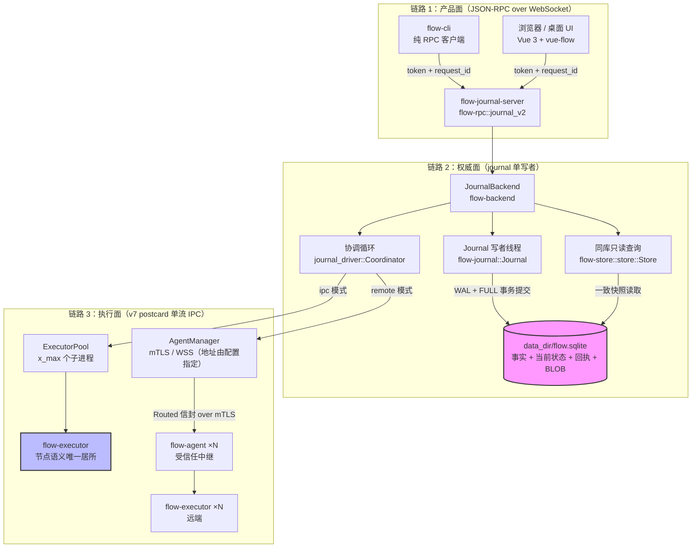

# 01 · 定位与总体架构（§1–§2）

> 本文是 [DESIGN.md](../DESIGN.md) 的分篇。章节编号与全文一致；总索引与核心抉择见 [DESIGN.md](../DESIGN.md)。

## 1. 定位、目标与非目标

flow 是一个**工作流执行引擎**：发布不可变的流程定义（DAG），以 run 为单位执行，
进程崩溃后从 SQLite 当前状态恢复。数据库损坏时隔离并报告错误，不猜测副作用。

**已实现的产品面**：`web/`（Vue 3 + @vue-flow 画布，直连本服务 JSON-RPC WebSocket）、
`flow-cli`（纯 RPC 命令行）、Tauri 桌面内嵌服务（进程内调用同一 RPC 模块）。

**明确的非目标**：

- 不做通用 DSL——表达式与脚本统一用 JavaScript（QuickJS 沙箱）。
- 不提供 master 高可用、日志复制、共享目录 fencing（C5）。多机只扩计算容量。
- 不多租户授权（C7）。
- 不把任意 HTTP 请求变成恰好一次执行（§11.4）。

---

## 2. 总体架构

### 2.1 crate 与二进制

```
crates/
  flow-dto        领域 DTO 与状态词汇表（零依赖叶子）：RunRecord / WorkflowSummary / …
  flow-config     统一配置（flow.toml，叶子 crate）：分层加载 + validate + 原子写回
  flow-journal    SQLite 写入 owner、事实分页、codec 预算、BLOB 值存储、离线维护
  flow-engine     执行引擎共享能力：定义模型与校验、JS 沙箱、表达式/模板、
                  journal_state（run 状态折叠）、观测日志、密钥、执行协议（v7 postcard 单流）
  flow-store      同一 SQLite 库的只读执行与产品查询
  flow-backend    journal 唯一权威后端：journal.rs（JournalBackend）+ journal_commands
                  （产品 CRUD，request_id 幂等）+ journal_views（物化读面）+
                  journal_driver（协调循环）+ journal_execution（Attempt 簿记）+
                  journal_import（legacy 只读保全）+ execution/（ipc 池 / remote 派发）
  flow-executor   受管理执行子进程：节点语义的唯一居所
  flow-agent      受信任远程执行中继（单条 mTLS/WSS 上联 + 本机执行器池）
  flow-rpc        jsonrpsee WebSocket 服务：journal_v2（产品 RPC 面）+
                  journal_triggers（cron + webhook HTTP）+ journal_download（值下载）
  flow-cli        命令行客户端（纯 RPC，不碰存储）
  flow-test-support  共享测试基建
  backend-e2e     v2 产品面端到端矩阵（真起进程）
  backend-perf    性能压测 harness（黑盒）
```

产品二进制按职责分属各自 crate，**没有统一多路入口**：

| bin | 所属 crate | 职责 |
| --- | --- | --- |
| `flow-journal-server` | flow-rpc | SQLite 产品服务（WS RPC + cron + webhook + 下载） |
| `flow-cli` | flow-cli | 命令行客户端（纯 RPC） |
| `flow-executor` | flow-executor | 受管理执行子进程（通道 FD 经 argv `--channel-fd` 传递） |
| `flow-agent` | flow-agent | 受信任远程执行中继 |
| `flow-journal-tool` | flow-journal | journal 离线维护（verify/rebuild-index/backup） |
| `flow-journal-dev` | flow-backend | 开发运行器（run/resume/status/import-legacy），含 `check-projection` 事实重放校验 |
| `flow-journal-bench` | flow-journal | journal 写入基准 |

测试与压测面另有 `backend-e2e` 的 `flow-journal-server-e2e`、`backend-perf` 的
`flow-perf` / `flow-capacity`，不属于产品二进制。

依赖方向（与 Cargo.toml 对齐的现状）：

```
flow-rpc ──> flow-backend ──> flow-engine ──> flow-dto
           ├─> flow-journal  （v2 值分页/下载）
           ├─> flow-store    （同库只读查询）
           └─> flow-config
flow-backend ──> flow-journal / flow-engine / flow-dto / flow-store / flow-config
flow-engine ──> flow-dto
             └─> flow-journal（只共享 StoredValue/ValueRef 词汇与 codec 预算）
flow-journal ──> 无 flow 依赖（叶子）
flow-dto ──> 无依赖（叶子）
flow-agent / flow-executor ──> flow-engine, flow-journal（执行协议两侧）
flow-cli ──> flow-dto（自带 jsonrpsee/reqwest WS 客户端，运行期连 flow-journal-server，
            但不依赖任何服务 crate）
flow-cli ──✗> flow-store    ✗（CLI 不碰存储与事件日志，没有第二条写入路径）
remote-e2e ──> flow-agent   （flow-agent 只被 remote-e2e 套件依赖；backend 不依赖它）
```

### 2.2 架构图：三条链路

协调器的锁序为 `workflow_metadata → decision → state`。`decision` 保持写决策、
持久化和状态发布的顺序；`state` 只保护同步内存访问，不跨 SQLite 查询或持久化等待。
运行中的状态读取可以取得上一个完整提交的快照。已接受的提交由后台任务持有决策锁，
调用方取消后仍会完成持久化、状态发布及调度通知；提交失败则停止后续决策。
派发通过提交通知观察取消，定时器只处理截止时间和排空，不再定时轮询状态锁。

Reducer 使用同一份类型化 `UndoLog` 保存受影响实体的变更前状态，按变更逆序恢复。
preview、后续事件失败和索引生成失败共用恢复路径；审计事件只保存计数与回执差量，
不复制累积历史。新增事件类型必须在穷尽匹配中选择恢复策略，存储与执行协议不变。

**三条链路，不是两条**。master ↔ executor 是同一种 IPC 协议；master 的身份取决于
部署形态（单机 = backend 直连，远程 = agent 中继），协议层与握手完全一致，只是
物理承载不同。



**焊死的规则**：

1. master↔executor 是同一种 IPC 协议；master = backend（单机）或 agent（远程中继）。
2. 节点执行语义只许存在于 `flow-executor`；master 只做裁决和调度。
3. 协议 v7 postcard 单流：控制与数据复用**同一条双向流、同一个 `Message` 枚举**，
   帧格式唯一——`u32 body_len(大端) | postcard(Message)`。没有独立的 data 通道、
   没有帧内 1 字节 `kind`：**postcard 的变体索引即帧类型**，`TransferChunk` 的
   二进制体由 postcard 原生承载（len varint + 原始字节，无 base64、无 JSON meta
   拼接）。control/data 的区分退化为**帧预算分类**：`frame_limit()` 把
   `TransferChunk`/`AuditBatch`/`ObservabilityBatch` 放宽到 `DATA_MAX_FRAME`
   （1 MiB），其余收紧到 `CONTROL_MAX_FRAME`（128 KiB）；`Routed` 递归取内层
   消息的预算（内层是 control 语义时按 128 KiB 受限）。v4 的 JSON 信封、三种帧
   kind、十进制字符串戒律与 `Channel` 概念已随 v4 删除。
4. 写响应在 SQLite COMMIT 后返回，状态与回执已同时可见，没有异步投影追赶。
5. 本地 IPC 承载按平台选择，对上层透明：unix 用 socketpair，通道 FD 原号经 argv
   `--channel-fd <N>` 传给执行器（`pre_exec` 只关闭其余继承 FD，不做 dup2 落位）；
   Windows 及其余平台用 **本地 socket 回连**（named pipe / 文件系统 socket，由
   interprocess 统一实现；不占网络栈、无端口抢连窗口），执行器按
   `FLOW_EXECUTOR_CONNECT_ADDR` 回连出单条连接。本地 socket 没有 FD 能力防串配，
   因此 spawn 时随机生成会话令牌经 `FLOW_EXECUTOR_SESSION_TOKEN` 注入、Hello 里回验。

### 2.3 执行模式矩阵

| 模式 | 平台 | 节点执行位置 | 备注 |
| --- | --- | --- | --- |
| `ipc` | 全平台（缺省） | `flow-executor` 子进程 | 执行器缺失/协议版本不符直接失败，不静默回退 |
| `remote` | 全平台 | 经 `flow-agent` 中继的远端执行器 | 单条 mTLS 或 WSS（v7 postcard 单流）；`mode=remote` 时 `[execution.remote]` 必填 |
| `in_process` | **已删除** | — | 全平台配置即报错；`ExecutionMode` enum 只剩 `Ipc` |

执行模式在**配置期与装配期双重把关**：`flow-config` 的 validate 在任何平台拒绝
`in_process`，`JournalBackend::start_execution_ipc` 在运行期再拒一次；两处都明确
报错，任何平台都不静默换模式。

**派发槽位语义**（`Coordinator.limit`）：

| 模式 | limit 来源 | 含义 |
| --- | --- | --- |
| `ipc` | `x_max.clamp(1, 16)` | 既是执行器池容量，也是全局在飞派发上限（协议 `A_MAX` = 16） |
| `remote` | 固定 `16` | 全局在飞派发上限 = `A_MAX`；每台 agent 的 `slots` 另行准入 |
