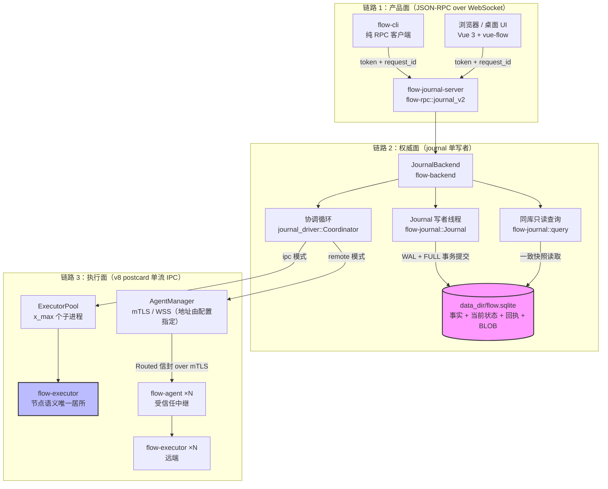

# 01 · 定位与总体架构（§1–§2）

> 本文是 [DESIGN.md](../DESIGN.md) 的分篇。章节编号与全文一致；总索引与核心抉择见 [DESIGN.md](../DESIGN.md)。

## 1. 定位、目标与非目标

flow 是一个**工作流执行引擎**：发布不可变的流程定义（DAG），以 run 为单位执行，
进程崩溃后从 SQLite 当前状态恢复。数据库损坏时隔离并报告错误，不猜测副作用。

**已实现的产品面**：`web/`（Vue 3 + @vue-flow 画布，直连本服务 JSON-RPC WebSocket）、
`flow-cli`（纯 RPC 命令行）、Tauri 桌面内嵌服务（进程内调用同一 RPC 模块）。

**明确的非目标**：

- 不做通用 DSL——表达式与脚本统一用 JavaScript（QuickJS 沙箱）。
- 不提供 master 高可用、日志复制、共享目录 fencing（C5）。多机只扩计算容量。
- 不多租户授权（C7）。
- 不把任意 HTTP 请求变成恰好一次执行（§11.4）。

---

## 2. 总体架构

### 2.1 crate 与二进制

```
crates/
  flow-dto        领域 DTO 与状态词汇表（无工作区依赖）：RunRecord / WorkflowSummary / …
  flow-config     统一配置（flow.toml，叶子 crate）：分层加载 + validate + 原子写回
  flow-journal    SQLite 写入 owner、事实分页、codec 预算、BLOB 值存储、离线维护;
                  query feature 承接同库只读执行与产品查询(原 flow-store 并入)
  flow-facts      事件、事务、值描述符及有界编码契约
  flow-domain     工作流定义、图规则、schema 校验与确定性状态折叠
  flow-policy     冻结策略、请求、授权及显式时间的权限裁决
  flow-application  托管运行的原子提交、状态发布与待调度集合，定义写入端口
  flow-workflow   独立内存工作流，默认特性装配 IPC Worker
  flow-dispatcher  IPC 协议、进程池与通用任务派发（v8 postcard 单流）
  flow-engine     节点执行共享库：日志、错误与超时常量
  flow-backend    journal 唯一权威后端：journal.rs（JournalBackend）+ journal_commands
                  （产品 CRUD，request_id 幂等）+ journal_views（物化读面）+
                  journal_driver（协调循环）+ journal_execution（Attempt 簿记）+
                  journal_import（legacy 只读保全）+ execution/（派发适配与远程中继）;
                  持有观测日志、环境和密钥存储
  flow-plugin-catalog  后端与 Worker 共用的 manifest 发现、诊断、节点归属与内容身份
  flow-plugin-sdk 插件 SDK：protocol（wire 契约）+ ipc（传输）单向分层;
                  跨语言契约本体是 docs/protocol/wire.md + vectors
  flow-plugin-runtime  受管理执行子进程（bin: flow-executor）：节点语义的唯一居所;
                  task 执行、插件注册表与会话、审计与传输
  flow-internal-plugins  内置节点实现库：Script/Condition 求值器等静态实现
  flow-agent      受信任远程执行中继（单条 mTLS/WSS 上联 + 本机执行器池）
  flow-rpc        jsonrpsee WebSocket 服务：journal_v2（产品 RPC 面）+
                  journal_triggers（cron + webhook HTTP）+ journal_download（值下载）
  flow-rpc-contract  RPC 方法目录、读写分类与客户端回执查询键
  flow-cli        命令行客户端（纯 RPC，不碰存储）

crates/flow-test/ 测试归组：test-support（共享基建）/ e2e（单机端到端，真起进程）/
                  e2e-remote（远程端到端）/ performance（性能压测）。

plugins/harness/  harness agent 运行时（protocol / agent-core / agent-host / plugin,
                  独立版本与进程,但共享根 workspace 与锁文件)+ 插件服务进程;
                  执行器 spawn 插件并经 plugin-proto 对话,不再链接 agent
                  运行时（见 plugins/harness/README.md）。plugins/llm/ 为
                  LLM 插件（独立版本与进程）。
```

产品二进制按职责分属各自 crate，**没有统一多路入口**：

| bin | 所属 crate | 职责 |
| --- | --- | --- |
| `flow-journal-server` | flow-rpc | SQLite 产品服务（WS RPC + cron + webhook + 下载） |
| `flow-cli` | flow-cli | 命令行客户端（纯 RPC） |
| `flow-dispatcher` / `flow-worker` | flow-dispatcher | 独立任务提交与基础 Worker |
| `flow-script-worker` | flow-internal-plugins | 独立 `script.v1` Worker |
| `flow-workflow` | flow-workflow | 内存 FSM 运行器，经 IPC 派发计算节点 |
| `flow-executor` | flow-plugin-runtime | 受管理执行子进程（通道 FD 经 argv `--channel-fd` 传递） |
| `flow-agent` | flow-agent | 受信任远程执行中继 |
| `flow-journal-tool` | flow-journal | journal 离线维护（verify/rebuild-index/backup） |
| `flow-journal-dev` | flow-backend | 开发运行器（run/resume/status/import-legacy），含 `check-projection` 事实重放校验 |
| `flow-journal-bench` | flow-journal | journal 写入基准 |

测试与压测面另有 `flow-e2e` 的 `flow-journal-server-e2e` 与 `flow-performance`
的压测二进制，不属于产品二进制。

依赖方向（与 Cargo.toml 对齐的现状）：

```
flow-rpc ──> flow-backend / flow-config / flow-domain / flow-dto / flow-facts / flow-rpc-contract
flow-application ──> flow-domain / flow-facts
flow-backend ──> flow-dispatcher / flow-journal / flow-engine / flow-dto / flow-config / flow-policy
              └─> flow-application / flow-domain / flow-facts / flow-plugin-catalog / flow-plugin-sdk
flow-engine ──> 无工作区依赖
flow-dispatcher ──> flow-facts
flow-workflow ──> flow-domain / flow-facts（默认 ipc feature 另外启用 flow-dispatcher）
flow-domain ──> flow-facts / flow-dto
flow-policy ──> flow-dto
flow-journal ──> flow-facts
flow-facts ──> 无 flow 依赖（叶子）
flow-dto / flow-rpc-contract ──> 无工作区依赖
flow-plugin-catalog ──> flow-config / flow-domain / flow-plugin-sdk
flow-plugin-runtime ──> flow-domain / flow-dispatcher / flow-dto / flow-engine / flow-facts / flow-internal-plugins
                    └─> flow-plugin-catalog / flow-plugin-sdk / flow-config / flow-harness-protocol（plugins feature）
flow-agent ──> flow-dispatcher / flow-config
flow-cli ──> flow-dto / flow-rpc-contract（自带 jsonrpsee/reqwest WS 客户端，运行期连 flow-journal-server，
            但不依赖任何服务 crate）
flow-cli ──✗> flow-journal  ✗（CLI 不碰存储与事件日志，没有第二条写入路径）
flow-e2e-remote ──> flow-agent   （flow-agent 只被 remote-e2e 套件依赖；backend 不依赖它）
```

本地派发基础设施在 `flow-dispatcher` 中，包含进程池、IPC 帧、会话握手与
进程回收。Dispatcher 与领域状态折叠均通过 `flow-facts` 共享事件和值契约。
SQLite 和磁盘读写由 `flow-journal` 提供。工作流
仍由 `flow-backend` 解释节点和持久化结果。`execution::workflow_task` 将已提交的
节点尝试和执行快照装配为工作流载荷，再走共用的进程池、发送及完成确认入口。
工作流现有 `Execute` 与 v8 帧索引保留，旧执行器和远程中继沿用这条路径。

`flow-backend` 为 `flow-application` 装配 Journal 写入，本地和远程派发由后端协调器装配。
提交端口保证事实、投影和暂存正文原子写入，应用层在落盘后发布状态。
远程派发先预留兼容容量，再提交本次尝试；预留随租约释放。
恢复已提交的工作流时按冻结定义解释节点类型，Worker 路由继续核对冻结的插件身份。
分页、订阅续读、观测日志读取和下载解析归 `journal_views`，RPC 负责鉴权和传输。
`flow-workflow` 关闭默认 feature 后可以用替身执行器验证应用逻辑。

独立任务只携带 `id`、带版本的 `handler` 和有界字节输入。Worker 握手广告
`job:<handler>` 后才会收到 `ExecuteJob`。`Accepted` 确认接收，`JobFinished`
上报结果，调用方提交至其权威状态后由 Dispatcher 发送 `ResultCommitted`。
调用方负责提交和重试，现阶段独立任务没有内置持久待办队列。工作流的审批、
副作用授权和结果屏障仍由原路径处理。

裸运行可执行 `cargo build -p flow-dispatcher --bins`，再运行
`flow-dispatcher WORKER RECEIPT_DIR TEXT [TEXT ...]`。`WORKER` 指向构建出的
`flow-worker`，`RECEIPT_DIR` 为已存在的目录。此入口最多使用两个进程，
将 `echo.v1` 结果写为单独的 JSON 回执。CI 单独运行 `cargo test -p flow-dispatcher`。

`script.v1` 的独立 Worker 可用 `cargo build -p flow-internal-plugins --bin flow-script-worker`
构建。用 `flow-dispatcher --handler script.v1 WORKER RECEIPT_DIR INPUT` 提交一条
已准备的 JSON 输入，例如 `'{"code":"return input.x * 2;","input":{"x":21},"nodes":{}}'`。
此入口要求 `job-transfer-v1` 能力，使用 `TransferChunk` 和 `InputReady` 传输输入与
输出，每一侧最多 8 MiB，并完整校验顺序、长度和摘要后才确认结果。

本地工作流 Script 可协商 `prepared-job-v1`。先通过 `PrepareJob` 装配输入，并提交或
复用 `InputPrepared`。Worker 报告 `JobPrepared` 后，Dispatcher 收到权威状态确认才发
通用 `ExecuteJob`。该命令用节点执行 ID 引用同一会话里已经装配的冻结值，不重复传输。
Worker 构造同一个 `ScriptTask`。完成后，沿用工作流审计流和 `ResultCommitted` 屏障。
本地 Condition 通过独立的 `prepared-condition-job-v1` 能力走同一握手。工作流节点适配
仍把表达式值转换成真假分支标记，协调器在结果提交后推进对应的后继。只支持 Script
扩展的执行器仍用原 v8 `Execute` 执行 Condition。

`flow-plugin-catalog` 向后端的发布校验和 Worker 的启动路由提供同一套发现规则。
目录扫描统一决定节点归属和冲突，默认注册复用同一份兼容表。内容授予与进程启动
使用同一哈希公式，Worker 仍在启动插件进程前重新核验。领域校验允许外部声明新类型，
内置节点保留原参数和图约束。Dispatcher 不依赖插件目录。

最小本地工作流可用同目录的 `flow-journal-dev` 与 `flow-executor` 运行。部署回归在
独立工作目录与 `FLOW_HOME` 下启动两份二进制，清除继承配置。没有插件清单、插件
二进制、remote agent 或 RPC 服务时，测试验证基础流程、缺失扩展时报错以及事实重放。
崩溃回归在节点结果提交后终止调度进程，再用同一部署的 `flow-journal-dev resume`
恢复。Script 后继与 Condition 选中分支都只推进一次。

本机可按 CI 顺序构建执行器与插件二进制，再运行工作区回归：

```sh
cargo build --workspace --bins --locked
cargo test --workspace --all-targets --locked --no-fail-fast
```

工作区回归包含本机 IPC、RPC、模拟服务和进程故障用例。CI 另行验证领域与
Dispatcher 的隔离构建，避免工作区合并 features 掩盖反向依赖。核心 crate 分别检查
正常和构建依赖的传递闭包，且关闭 Chrono 的取时特性。

#### 分层目标与独立运行

| 层 | 职责 | 最小验收 |
| --- | --- | --- |
| Dispatcher / Worker | IPC 会话、进程池、任务收发与结果确认 | 独立提交 Echo 或 Script，单个 Worker 退出后其余 Worker 继续处理。 |
| FSM 工作流 | 根据流程定义、当前状态和输入事件决定下一步 | 用内存状态和本地任务端口推进基础流程。分支、汇合与终态决策可脱离进程和 SQLite 验证。 |
| 托管运行 | Journal 权威提交与恢复，冻结环境，解析密钥引用，裁决权限 | 基础工作流从 SQLite 恢复。需要密钥或许可的任务由主进程按本次派发授权。 |
| Plugin | 注册节点类型、参数契约和执行实现 | 同一托管运行器可接入清单节点。移除插件后仍可执行基础流程。 |
| Remote Worker | 将派发、结果和回执通过远程会话转发 | 远端仅部署基础执行器也能跑内置节点。有插件任务时，目标 Worker 额外提供相应能力。 |

插件和远程执行是两条独立的扩展路径。本地 Worker 可以执行插件，远程 Worker
可以执行基础节点。远程进程处理派发和结果传输，主进程继续负责状态提交及授权。

`flow-workflow` 和 `flow-backend` 共用入边判定、终态判定和类型化节点结论。
内存运行器接纳节点结论后确认 IPC 结果。托管运行器复核审计封口并在 SQLite
提交后确认，同时提供等待、恢复、环境和权限能力。托管开发入口先准备执行端口，
新 run 提交后再启用协调器。远程端口在准备时绑定，启用后开始接收连接。

独立构建的 `flow-executor` 通过 `flow-facts` 使用值描述、编码和预算，
环境版本与密钥存储由主进程持有。本地与远程派发从同一个主进程凭证模块
取得冻结环境的密钥，权限获准并提交事实后按派发交付所需凭证。

`flow-policy` 根据请求、冻结策略、Run 授权和显式时间计算权限结论。
主进程负责读取插件清单、构造请求与提交审计事实。节点自动放行、人工批准和
重连补发都在同一决策锁下核对已提交的授权和派发身份，再将许可排入执行端口。
工具放行还要核对当前回合未收录结果。节点与工具的自动放行及询问在事实提交锁内
读取 Run 授权，因此先提交的撤销会参与后续请求的裁决。

`flow-executor` 默认启用 `plugins`。动态节点、LLM 和 Harness 的 agent 模式从
`task::plugins` 进入插件进程，Worker 仍负责输入准备、许可、审计和结果确认。
基础 Worker 用 `cargo build --locked -p flow-plugin-runtime --bin flow-executor --no-default-features`
构建，可由本地 Dispatcher 或远程 Agent 使用。它在请求许可前拒绝需要插件的任务，
Harness 的本地命令模式仍走内置执行路径。需要插件节点的部署使用默认构建。

远程上联可在主进程、Worker 和插件进程持续运行时重连。每个在飞派发在内存中保留
一条已提交的工具裁决，下一次串行工具请求到达后释放它。新链路完成全部 Resume 分页
后才恢复派发。工具放行补发仍按当前回合和取消事实检查，Worker 只交付一次与正在
等待的工具调用 ID 对应的回复。

启动远程 Agent 时，经本机 Worker 的 IPC 握手获取构建类型和插件清单，再通过
`AgentHello` 通告。主进程按 Run 冻结的节点类型、插件 ID 和内容哈希预留兼容槽位。
兼容槽位忙时，节点留在队列中。内置任务优先使用基础 Worker，空闲插件 Worker
也可执行内置任务。Agent 每次绑定核对实际构建类型，Worker 在申请许可和启动插件前
分别复核冻结身份以及文件内容。仅有旧 v8 Agent 的部署沿用原有构建类型路由。
共享插件目录的受管发布写入代际编号。本地池在下一次派发时换代，旧租约完成后回收。
远程 Agent 探测新代际，通过现有容量报告刷新清单，活动派发保留原有连接和进程。

内存入口支持 Start、Script、Condition、End、v1/v2 分支与输入输出 schema。
文件和单个中间 JSON 值采用 64 KiB 内联上限。合流任务按 Worker 输入预算校验。
输出报告包含运行终态、结果和已接纳的节点结论。需要持久等待、重试或权限的定义
由托管运行器处理。独立构建可直接运行以下命令。

```sh
cargo build --locked -p flow-workflow -p flow-internal-plugins --bins
target/debug/flow-workflow --worker target/debug/flow-script-worker \
  --definition workflow.json --input input.json
```

### 2.2 架构图：三条链路

协调器的锁序为 `workflow_metadata → decision → state`。`decision` 保持写决策、
持久化和状态发布的顺序；`state` 只保护同步内存访问，不跨 SQLite 查询或持久化等待。
运行中的状态读取可以取得上一个完整提交的快照。已接受的提交由后台任务持有决策锁，
调用方取消后仍会完成持久化、状态发布及调度通知；提交失败则停止后续决策。
派发通过提交通知观察取消，定时器只处理截止时间和排空，不再定时轮询状态锁。

Reducer 使用同一份类型化 `UndoLog` 保存受影响实体的变更前状态，按变更逆序恢复。
preview、后续事件失败和索引生成失败共用恢复路径；审计事件只保存计数与回执差量，
不复制累积历史。新增事件类型必须在穷尽匹配中选择恢复策略，存储与执行协议不变。

**三条链路，不是两条**。master ↔ executor 是同一种 IPC 协议；master 的身份取决于
部署形态（单机 = backend 直连，远程 = agent 中继），协议层与握手完全一致，只是
物理承载不同。



**焊死的规则**：

1. master↔executor 是同一种 IPC 协议；master = backend（单机）或 agent（远程中继）。
2. 节点执行语义只许存在于 `flow-executor`；master 只做裁决和调度。
3. 协议 v8 postcard 单流：控制与数据复用**同一条双向流、同一个 `Message` 枚举**，
   帧格式唯一——`u32 body_len(大端) | postcard(Message)`。没有独立的 data 通道、
   没有帧内 1 字节 `kind`：**postcard 的变体索引即帧类型**，`TransferChunk` 的
   二进制体由 postcard 原生承载（len varint + 原始字节，无 base64、无 JSON meta
   拼接）。control/data 的区分退化为**帧预算分类**：`frame_limit()` 把
   `TransferChunk`/`AuditBatch`/`ObservabilityBatch` 放宽到 `DATA_MAX_FRAME`
   （1 MiB），其余收紧到 `CONTROL_MAX_FRAME`（128 KiB）；`Routed` 递归取内层
   消息的预算（内层是 control 语义时按 128 KiB 受限）。v4 的 JSON 信封、三种帧
   kind、十进制字符串戒律与 `Channel` 概念已随 v4 删除。
4. 写响应在 SQLite COMMIT 后返回，状态与回执已同时可见，没有异步投影追赶。
5. 本地 IPC 承载按平台选择，对上层透明：unix 用 socketpair，通道 FD 原号经 argv
   `--channel-fd <N>` 传给执行器（`pre_exec` 只关闭其余继承 FD，不做 dup2 落位）；
   Windows 及其余平台用 **本地 socket 回连**（named pipe / 文件系统 socket，由
   interprocess 统一实现；不占网络栈、无端口抢连窗口），执行器按
   `FLOW_EXECUTOR_CONNECT_ADDR` 回连出单条连接。本地 socket 没有 FD 能力防串配，
   因此 spawn 时随机生成会话令牌经 `FLOW_EXECUTOR_SESSION_TOKEN` 注入、Hello 里回验。

### 2.3 执行模式矩阵

| 模式 | 平台 | 节点执行位置 | 备注 |
| --- | --- | --- | --- |
| `ipc` | 全平台（缺省） | `flow-executor` 子进程 | 执行器缺失/协议版本不符直接失败，不静默回退 |
| `remote` | 全平台 | 经 `flow-agent` 中继的远端执行器 | 单条 mTLS 或 WSS（v8 postcard 单流）；`mode=remote` 时 `[execution.remote]` 必填 |
| `in_process` | **已删除** | — | 全平台配置即报错；`ExecutionMode` enum 只剩 `Ipc` |

执行模式在**配置期与装配期双重把关**：`flow-config` 的 validate 在任何平台拒绝
`in_process`，`JournalBackend::start_execution_ipc` 在运行期再拒一次；两处都明确
报错，任何平台都不静默换模式。

**派发槽位语义**（`Coordinator.limit`）：

| 模式 | limit 来源 | 含义 |
| --- | --- | --- |
| `ipc` | `x_max.clamp(1, 16)` | 既是执行器池容量，也是全局在飞派发上限（协议 `A_MAX` = 16） |
| `remote` | 固定 `16` | 全局在飞派发上限 = `A_MAX`；每台 agent 的 `slots` 另行准入 |
