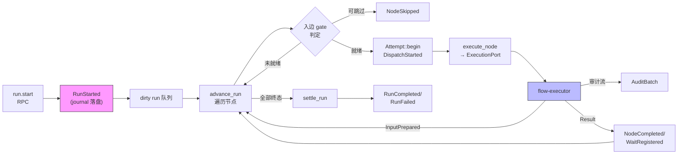
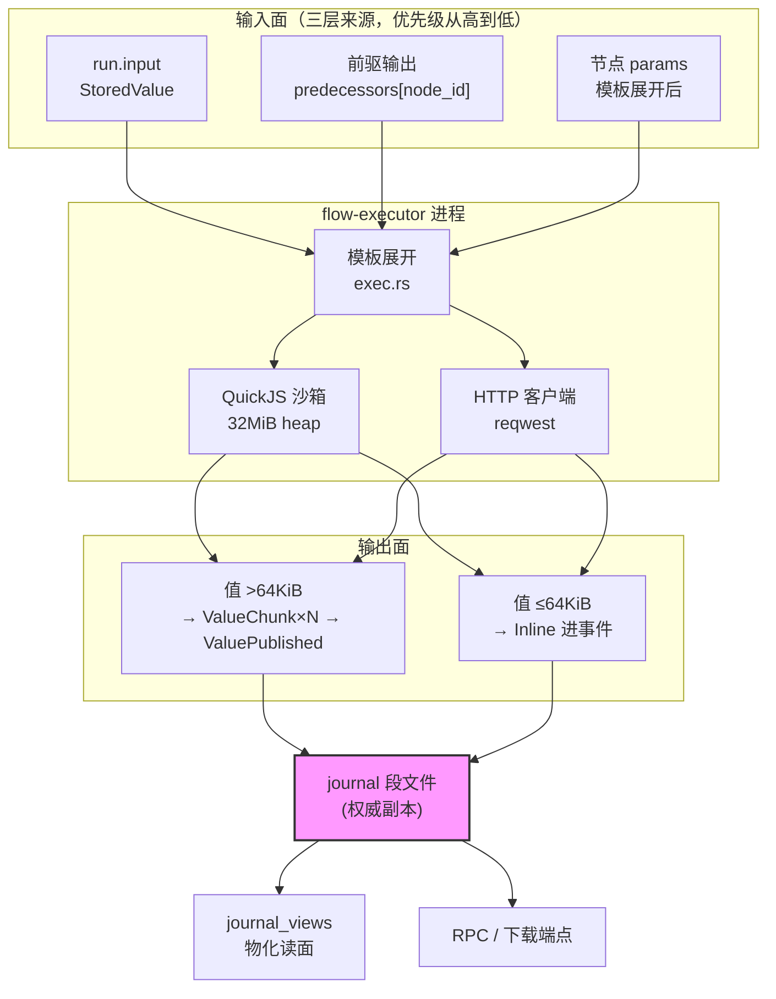
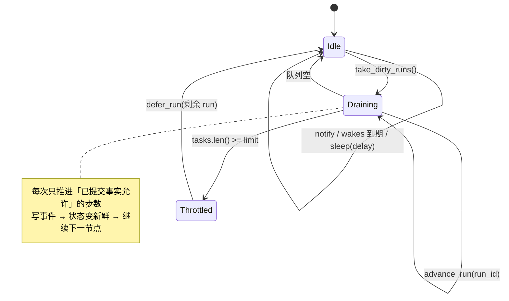
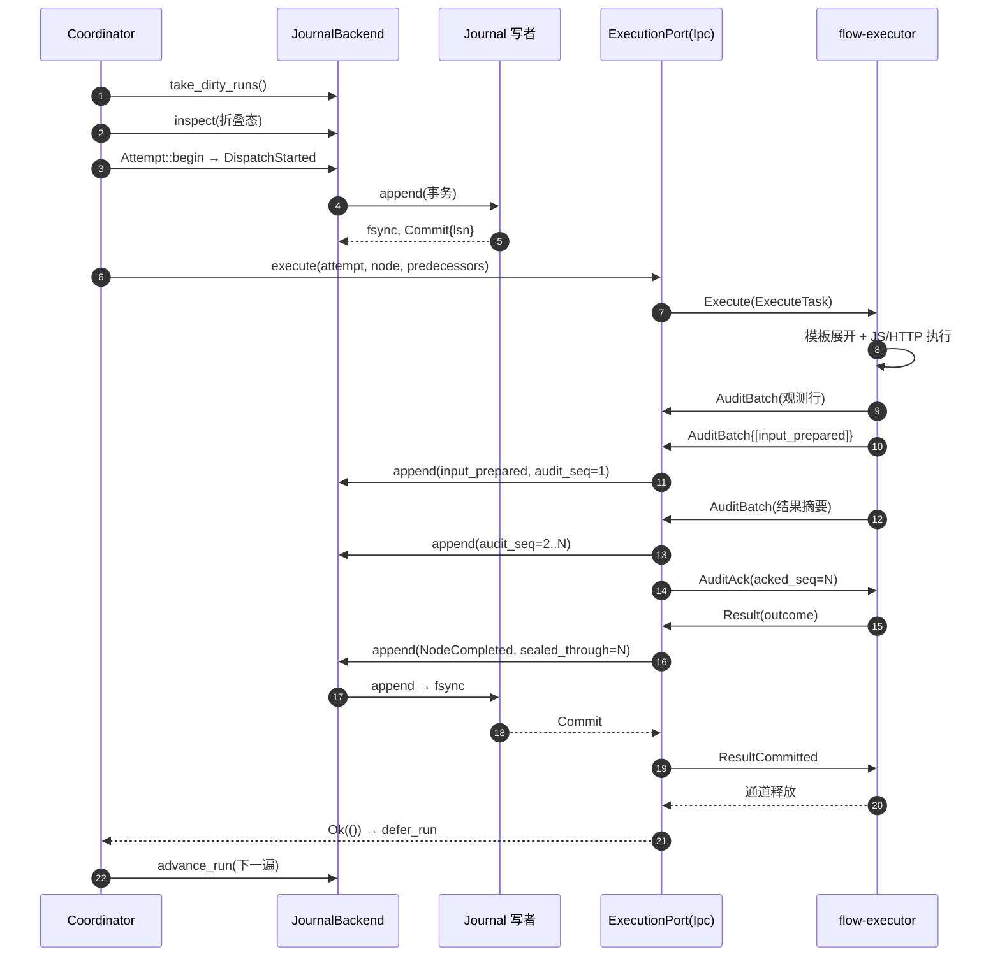
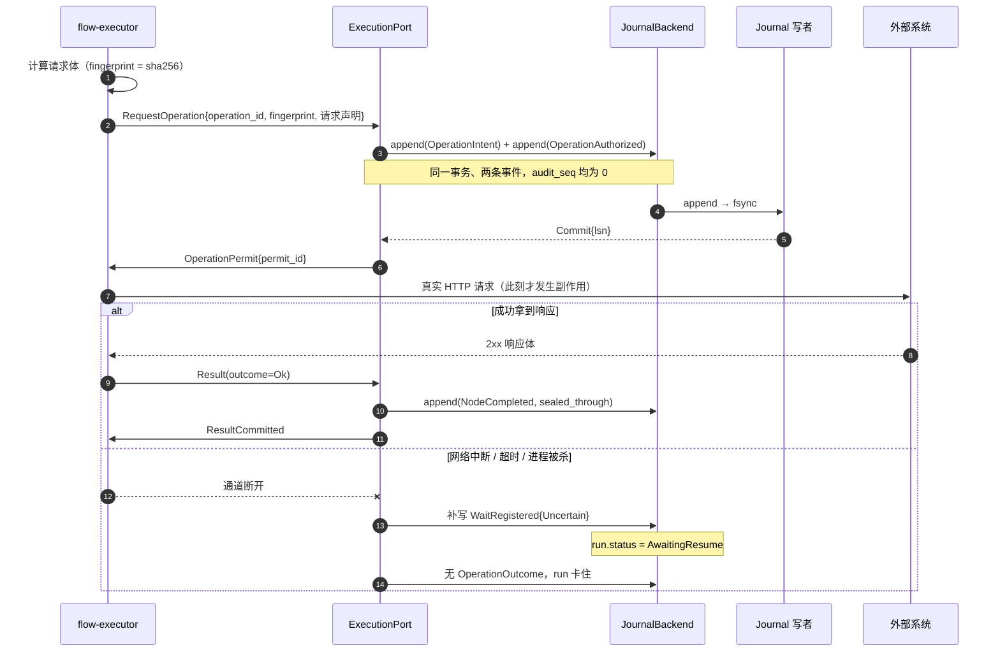
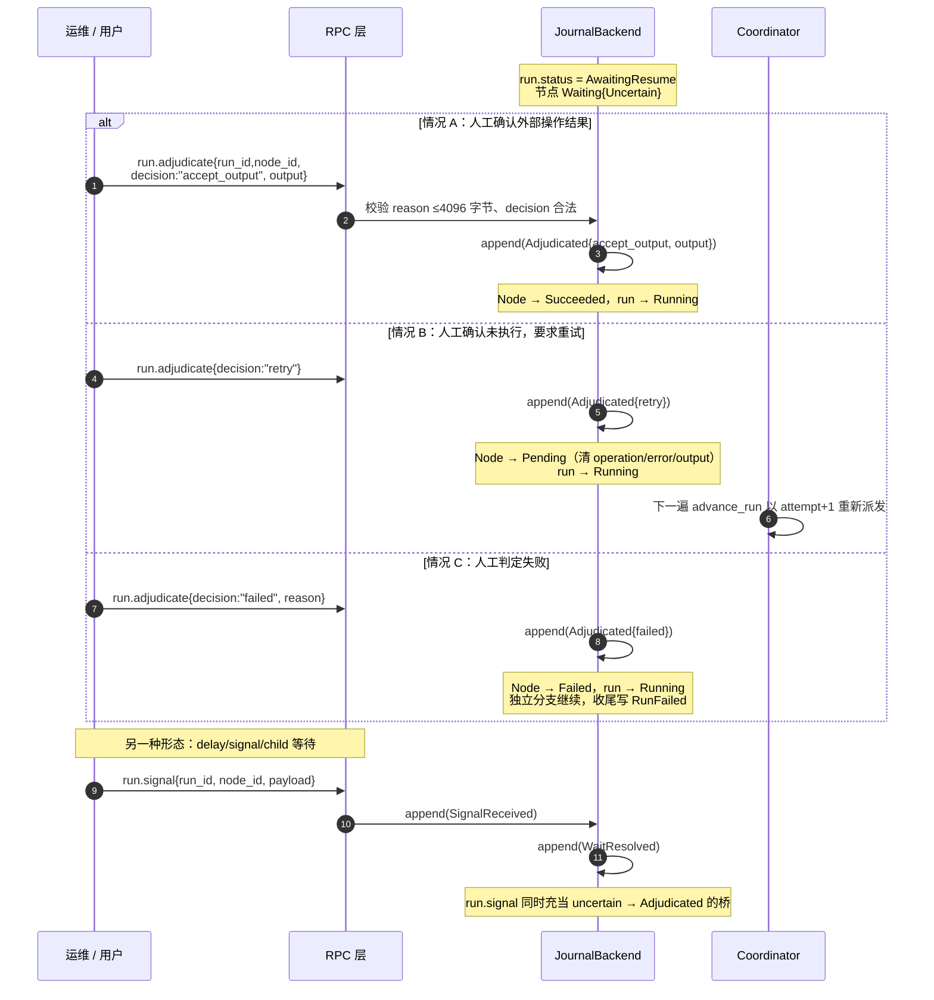
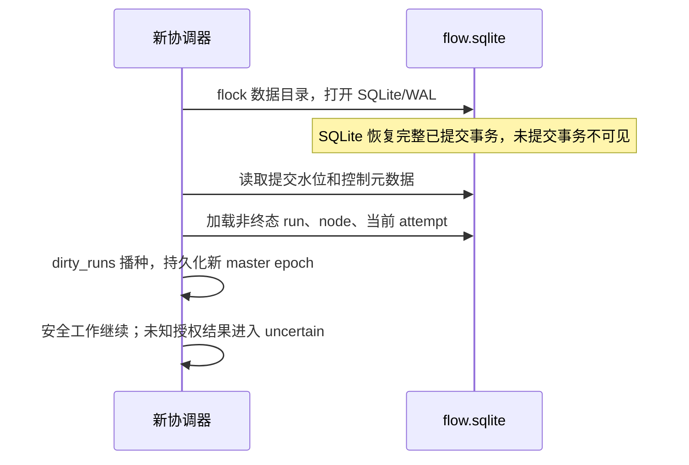
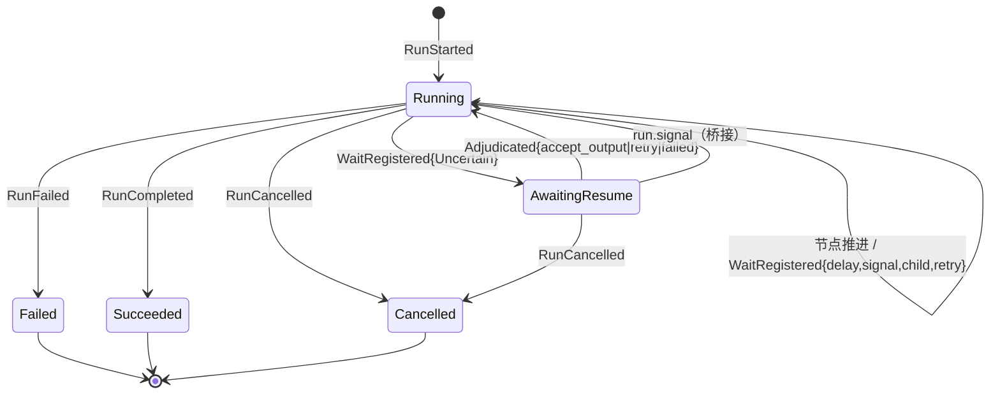
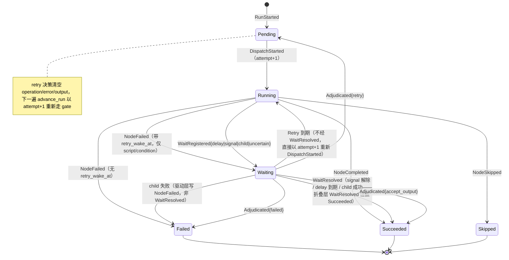
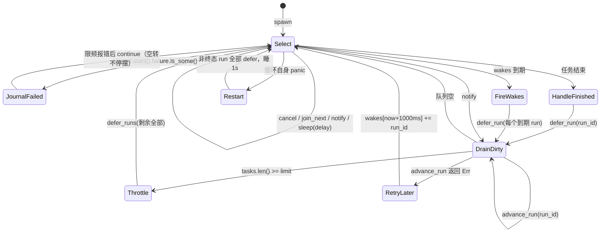

# 03 · 单机执行：数据流、时序与状态机（§4–§6）

> 本文是 [DESIGN.md](../DESIGN.md) 的分篇。章节编号与全文一致；总索引与核心抉择见 [DESIGN.md](../DESIGN.md)。

## 4. 单机数据流

### 4.1 一条 run 的生命周期

### 4.2 数据流动图：值从哪来，到哪去

**关键点**：`execute_node` 传给出站执行器的不是字节，是**引用**。
`predecessors` 是 `BTreeMap<String, StoredValue>`，其中 `StoredValue::Ref` 携带
`ValueRef{journal_id, output_id, codec, version, chunk_count, total_bytes, digest}`
——digest、总字节与值存储位置的语义载体。真正的字节由 `transfer_inputs` 从
journal 值存储读出、按 256 KiB 切块、经 data 帧送过去。执行器侧按
`INPUT_BUDGET = 8 MiB` 硬限聚合。

### 4.3 dirty-run 调度模型（不是工作窃取，不是线程池）

- 唤醒源共四个：`cancel.cancelled()`、`tasks.join_next()`、`notify.notified()`、
  `sleep(delay)`（`wakes` 里最近的到期时间）。
- `wakes: BTreeMap<i64, BTreeSet<String>>` 是**持久等待的定时器堆**：delay/retry
  到期时把 run 重新塞回 dirty 队列。
- 在飞任务数达到 `limit` 时，**整个剩余 dirty 队列被 defer 回去**（不是只跳过
  当前 run）——避免同一批里靠前的 run 反复抢占靠后 run 的机会。
- 失败与 panic 分三层处理：
  - **节点任务内 panic**：`execute_node` 用 `catch_unwind` 捕获并转成已提交证据
    （NodeFailed / WaitRegistered），run 随后经 finished → `defer_run` **立即**
    重回队列，不是延迟重试。
  - **任务被 abort / panic 逃出任务边界**（`join_next` 返回 Err）：放弃本轮
    协调器，整个循环重启。
  - **`advance_run` 自身 panic 或返回 Err**：外层 `catch_unwind` 捕获，run 以
    1000ms 延迟重试（`wakes[now+1000ms]`）。
  - **协调循环自身 panic**：整个循环重启，把所有非终态 run 重新 defer，从已提交
    证据重建（`inspect` 折叠态）后继续，睡 1s。

---

## 5. 时序图（单机）

### 5.1 一次普通节点派发（无外部操作）

**要点**：

- `ResultCommitted` 是**执行器退出的许可**。执行器在看到它之前不敢退出，否则
  「结果已算但未落盘」的窗口会让崩溃恢复无法判断该不该重算。
- `AuditAck` 之前执行器不会认为审计安全。**2s 超时后原序号原内容重传只是
  remote 中继模式的行为**（`--remote-relay` 启用的重放通道，`ACK_RETRANSMIT_MS`）；
  本地 IPC 只等待 ack 通知、不按超时重传。重传安全的前提是审计记录幂等
  （`audit_seq` 严格 +1 已在折叠层去重）。
- `InputPrepared` 的 `audit_seq` 从 1 开始。结果事件的 `audit_seq` 按 kind 区分：
  `NodeCompleted` 自身作为审计条目计费，`audit_seq = attempt.audit_seq + 1`
  （与 I17 一致）；`NodeFailed` / `WaitRegistered` 的 `audit_seq = 0`。屏障条件
  统一写「事件过账后 `sealed_through == attempt.audit_seq`」。

### 5.2 外部操作授权（C3/C4 的落点）

**为什么不能自动重发**：`OperationAuthorized` 落盘后，「请求可能已到达外部系统」
成为既成事实。此时任何重发都是把「至少一次」升级成「可能多次」。所以
`advance_committed_node` 看到节点携带 operation 时，唯一动作是写
`WaitRegistered{Uncertain}` 然后返回——**连 gate 都不再评估**。

触发条件是「**携带 operation 且本机没有已提交的结果**」，而不只 `outcome.is_none()`：
`OperationOutcome` 已捕获、但输出/结果未达完成形态的节点同样折入 Uncertain
（integrity 分别记 `unknown` / `outcome_retained`）。Uncertain 由 master 侧
（dispatch / driver）补写，不是执行器自报。

### 5.3 人工信号与裁决

**裁决三种决策的语义差异**：

| decision | 节点终态 | 是否重新派发 | 适用场景 |
| --- | --- | --- | --- |
| `accept_output` | `Succeeded` | 否 | 运维从外部系统查到了真实结果，手工补录 |
| `retry` | `Pending` | 是（attempt+1） | 确认外部操作**没有**产生副作用 |
| `failed` | `Failed` | 否 | 确认失败，放弃该分支 |

### 5.4 崩溃恢复时序

未发布值不能被业务引用；正文按需读取并核验。事实账本的全量检查属于显式 verify，
不是每次启动的前置扫描。损坏状态/正文报错，不自动以历史前缀冒充完整执行状态。

---

## 6. 状态图

### 6.1 run 状态机

**`AwaitingResume` 是全系统唯一的人工介入点**。它只由 `WaitKind::Uncertain` 触发，
而 `Uncertain` 只由「已授权外部操作结果不明」产生。看到这个状态，运维必须去外部
系统查明真相，然后用 `run.adjudicate` 明确告诉引擎发生了什么。

### 6.2 节点状态机

**WaitResolved 的折叠层语义只有一种终态**：非终态 run 上的 `WaitResolved` 一律把
节点置为 `Succeeded`（signal 解除、delay 到期、child 成功都走这里）。child 失败
不产生 `WaitResolved`——驱动层直接写 `NodeFailed`；Retry 等待到期也不经
`WaitResolved`，直接进入新一轮 `DispatchStarted`。「run 回到 Running」是事件之后
`refresh_status` 的效果，不是节点的 WaitResolved 转移。

### 6.3 等待类型

| WaitKind | 触发者 | run.status | 解除方式 | 可自动恢复 |
| --- | --- | --- | --- | --- |
| `Delay` | delay 节点 / 重试 backoff | Running | `wake_at` 到期 → `WaitResolved` | 是 |
| `Retry` | script/condition 失败 | Running | `wake_at` 到期 → 重新派发（不经 WaitResolved） | 是 |
| `Signal` | human_task / input 节点 | Running | `run.signal` → `WaitResolved` | 否（等外部） |
| `Child` | sub_workflow | Running | 子 run 成功 → `WaitResolved`；失败 → 驱动层写 `NodeFailed` | 是 |
| `Uncertain` | 外部操作结果不明 | **AwaitingResume** | `run.adjudicate` → `Adjudicated` | **否（C4）** |

### 6.4 协调循环状态机

