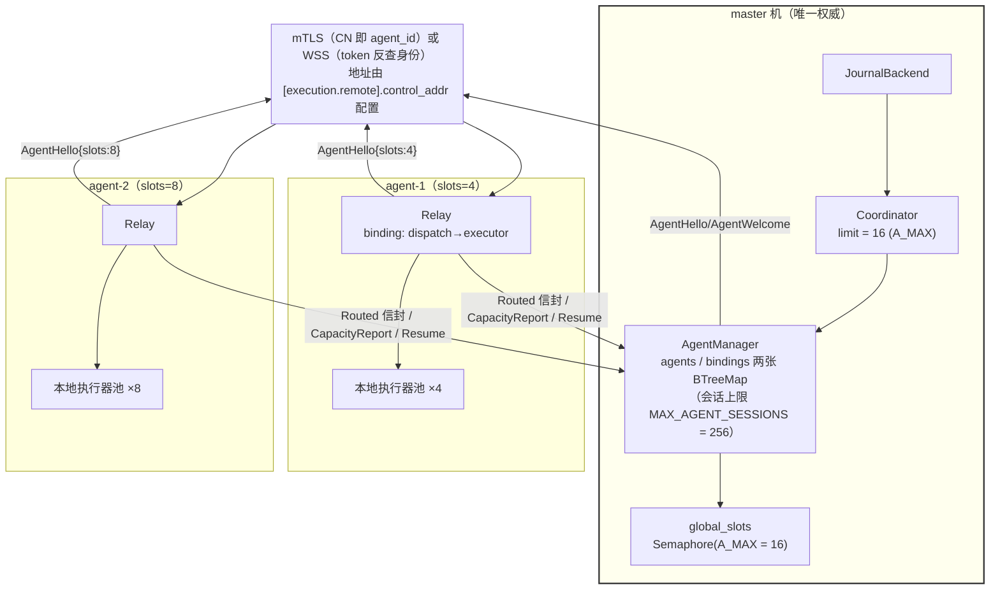
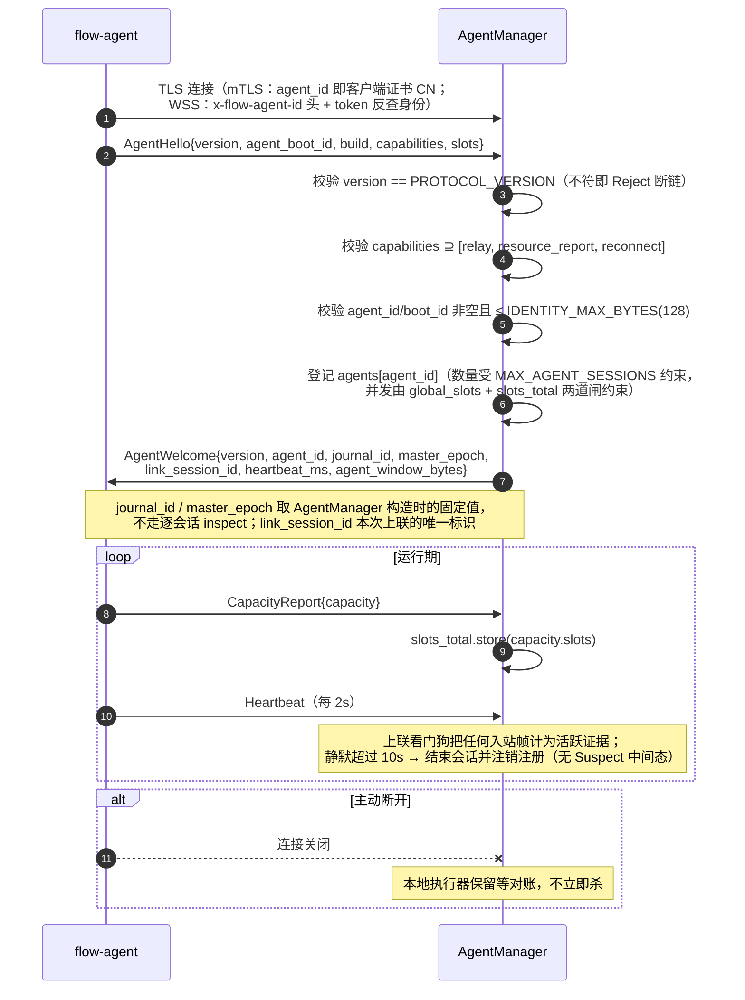
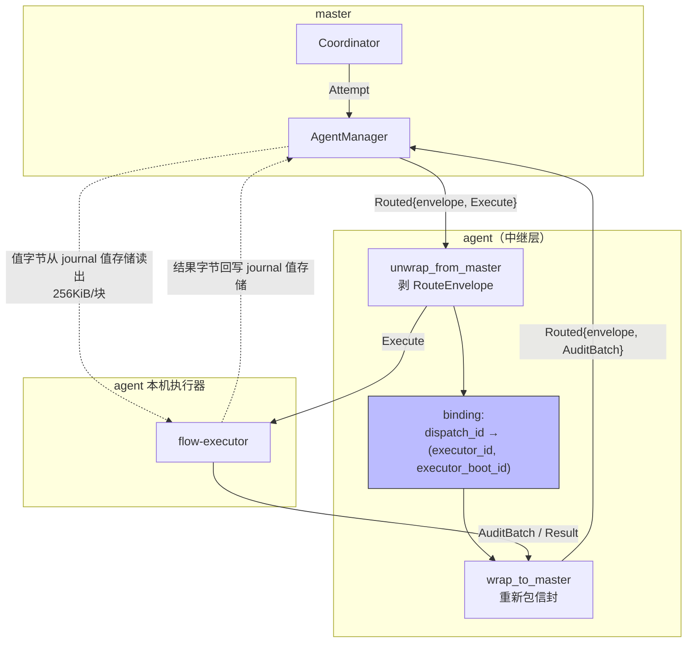
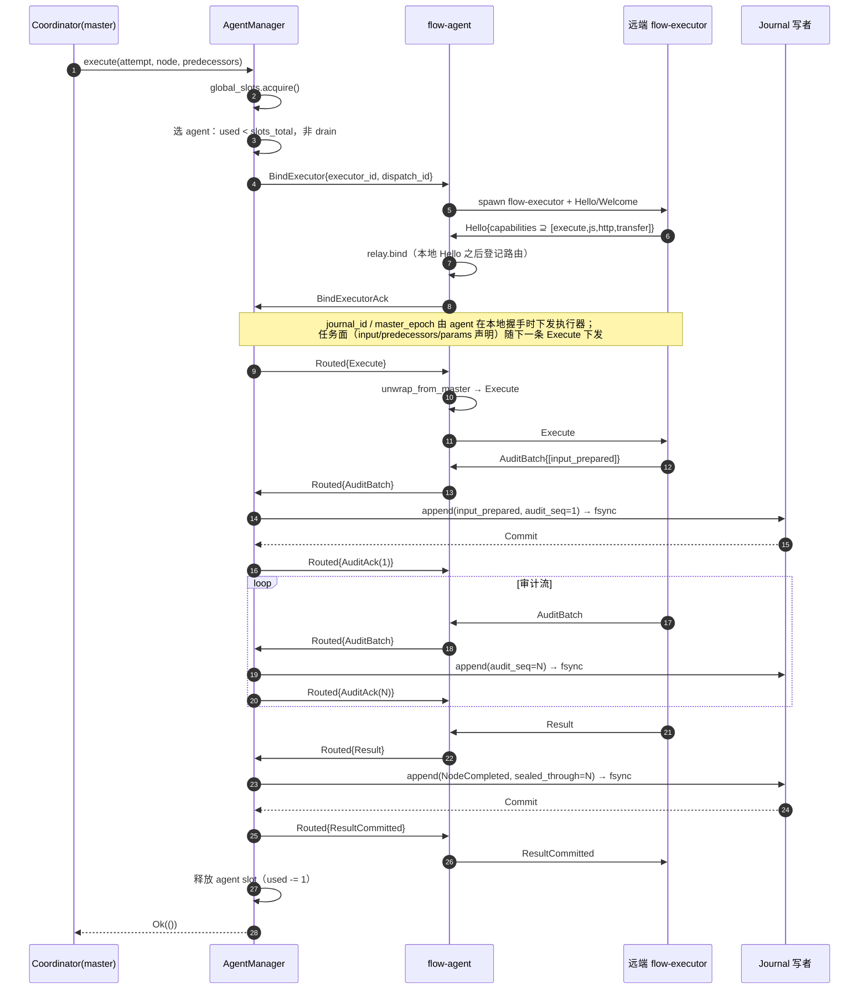
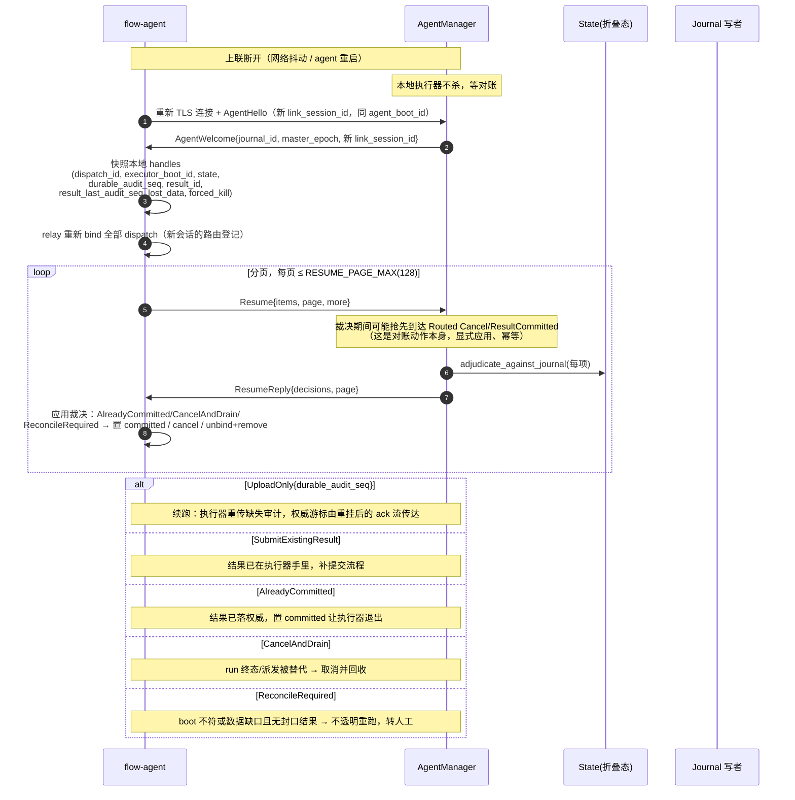
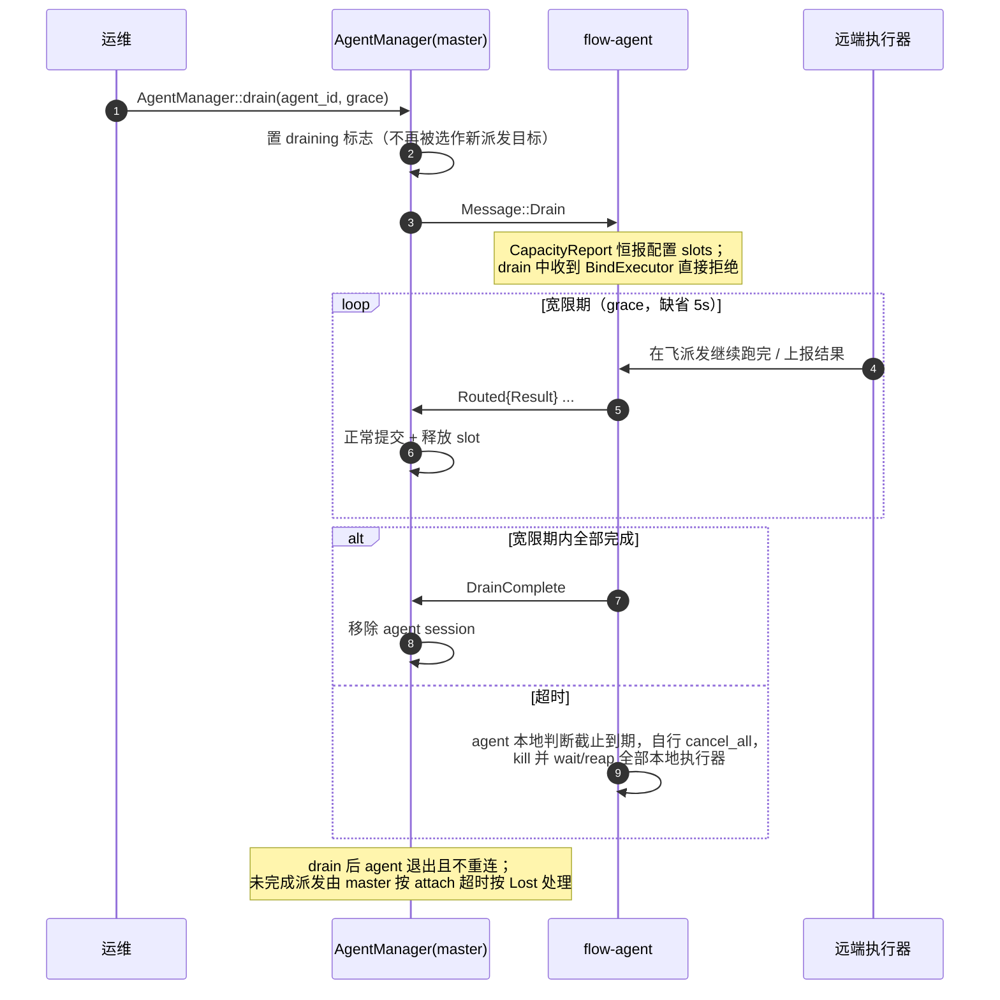

# 04 · 多 executor 与远程执行（§7）

> 本文是 [DESIGN.md](../DESIGN.md) 的分篇。章节编号与全文一致；总索引与核心抉择见 [DESIGN.md](../DESIGN.md)。

## 7. 多 executor 与远程执行

一个 master 管理一个 SQLite 数据目录，并通过本地 IPC 或远程 agent 扩展计算容量。
远程 agent 的连接、心跳、容量、drain 与断线对账继续保留；它们不承担 master 接管。
PG 节点注册中心及其配置、RPC、前端和租约准入已删除；后续有明确的多控制平面需求时另行设计。

### 7.1 remote 模式架构



**关键结构**：

- **单条上联，双向复用**。v7 postcard 单流：agent 到 master 只有一条物理连接，
  所有帧（控制语义与 data 语义）都在它上面跑，靠 `frame_limit()` 按消息类型分
  预算，不靠物理分通道。`FAIR_TURN_BYTES = 64 KiB` / `FAIR_TURN_FRAMES = 4` 做
  多个 dispatch 之间的公平轮转，防止一个大数据量 dispatch 饿死其他 dispatch。
- **有界积压，不用无界队列**。`PER_EXECUTOR_QUEUE = 8`（每执行器）、
  `UPLINK_OUT_QUEUE = 256` 帧、`UPLINK_OUT_BYTES = 8 MiB`。背压是**混合机制**：
  每执行器队列满是暂停读取该执行器（端到端背压）；上联字节预算满是挂起等待释放；
  master 侧 SendBacklog 溢出与 agent 侧积压超限才**退错误终止会话**——让上层
  感知故障，而不是把内存吃光。
- **准入是两级**：全局 `global_slots` 信号量（`A_MAX` 级）+ 每 agent 的
  `slots_total`（`CapacityReport` 动态上报）。`used < slots_total` 才允许 bind。
  会话数量另有 `MAX_AGENT_SESSIONS = 256` 上限（握手并发与已注册身份数量共用）。
- **drain 中的 agent 直接从候选中剔除**。master 收到 drain 请求先置 `draining`
  标志，选 agent 时直接跳过；agent 侧 drain 中收到 `BindExecutor` 也直接拒绝。
  agent 的 `CapacityReport` 恒报配置的 `slots`，不归零——早期「slots 回收为 0、
  used=0 排在最后」的方案反而会让 drain agent **最优先**被选中，已被代码否决。

### 7.2 agent 注册与会话生命周期



**`agent_boot_id` 与 `link_session_id` 的分工**：前者标识 agent 进程的一次启动
（跨重连不变），后者标识一条物理连接（每次重连都新）。Resume 对账用
`executor_boot_id` 判断「本地执行器是否还是原来那个」——boot 变了就必须对账，
不能假定续跑。「Suspect」一词只出现在 agent 侧（断线后保留执行器、停新绑定的
运行状态），master 侧只有「静默超时即断开会话」一种行为。

### 7.3 远程数据流动图



**agent 是哑中继，不是第二个决策点**。它的全部职责是：

1. 收到 `Routed` 信封，按 `dispatch_id` 找到本地绑定，剥掉信封转发给执行器；
2. 把执行器的上行消息按 `dispatch_id` 重新包上 `Routed` 信封发回 master；
3. 按字节/帧预算做公平轮转与有界退避。

**它不做**：gate 判定、审计屏障、授权决策、结果提交。所有裁决都在 master，
因为只有 master 持有 journal（C5）。

### 7.4 远程派发时序图



**与单机 IPC 的差异只有三处**：多一层 `Routed` 信封拆包、多一次 `BindExecutor`
握手、多一套 `CapacityReport` 准入。**协议消息集合完全相同**——同一套
`Message` enum，同一个握手顺序，同一组屏障条件。这正是「三条链路」设计的意义：
换部署形态不需要换执行语义。

### 7.5 断线重连与 Resume 对账（remote 模式的核心难点）

这是整个系统里最容易做错的地方，所以单独一节。**问题**：上联断了，master 不知道
远端执行器到底执行到哪一步——可能审计还没传完，可能结果已经算出来但没上报，
甚至可能外部操作的副作用已经发生。



**裁决决策树**（`adjudicate_against_journal`，严格按序）：

```
run 不存在                       → CancelAndDrain
run 已终态                       → CancelAndDrain
node 不存在                      → CancelAndDrain
node.dispatch_id != item 的       → CancelAndDrain   （派发已被替代）
attempt 不存在                   → CancelAndDrain
attempt.result.is_some()         → AlreadyCommitted
bound_boot != item.executor_boot_id → ReconcileRequired
item.lost_data && result_id.is_none() → ReconcileRequired
item.result_id.is_some()         → SubmitExistingResult
否则                             → UploadOnly{durable_audit_seq: attempt.audit_seq}
```

**为什么 `bound_boot` 不匹配就要对账**：执行器进程重启过，它的内存状态全部丢失。
此时既不能假定它记得自己算到哪，也不能假定它没算——只有显式核对（人去看外部系统）
才安全。这与 C4 是同一条规则：**不知道就不动**。

### 7.6 drain：优雅收工



**现状说明**：drain 的入口目前只有测试与 e2e（`AgentManager::drain` 在
remote-e2e 中调用），产品面尚无运维命令接线。超时被杀的派发与断线共用同一套
AttachOutcome 机制（master 派发方按 durable 等待超时放弃、按 Lost 处理并发起
Cancel），但**不会发生 §7.5 的 Resume 对账**——drain 后 agent 不再重连。
「drain 与崩溃走同一条对账路径」仅在机制同源的意义上成立。

### 7.7 控制平面范围

每个数据目录只由一个 master 持有，本地目录锁与 SQLite 单写者约束继续生效。
执行端的 master_epoch、dispatch 身份和结果对账保持原有规则。
当前没有跨 master 的节点注册、租约、接管或日志复制功能；不为未来需求保留注册表脚手架。
journal-cluster 注册中心已随 git 提交 `cdf593a` 裁剪：存量 `[journal.cluster]` 配置
显式报 unknown field 错误，`journal.cluster.*` RPC 方法返回 -32601。
