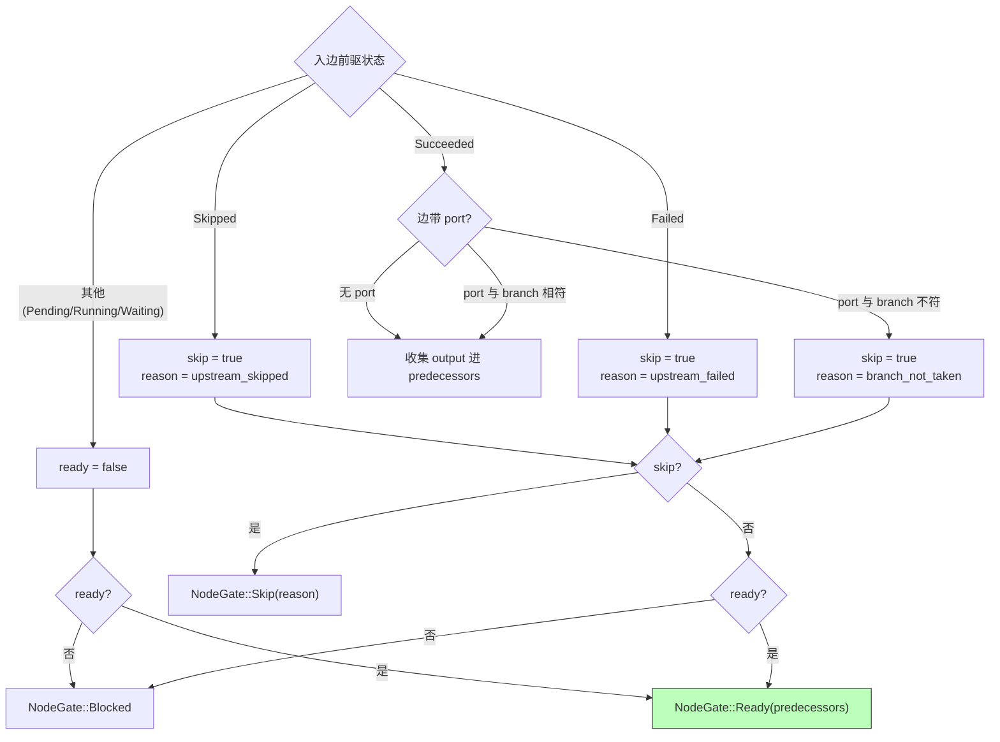
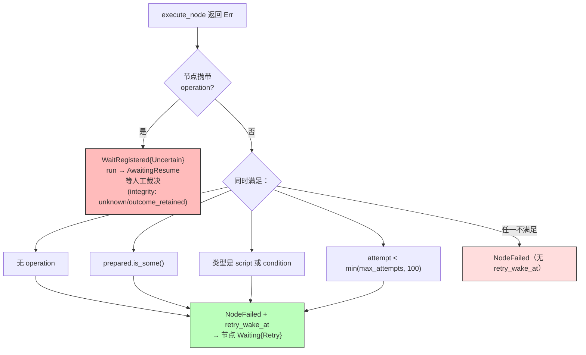

# 05 · 定义模型、执行语义与沙箱（§8–§10）

> 本文是 [DESIGN.md](../DESIGN.md) 的分篇。章节编号与全文一致；总索引与核心抉择见 [DESIGN.md](../DESIGN.md)。

## 8. 定义模型与校验

### 8.1 节点类型（12 种）

| 类型 | wire 名 | 外部副作用 | 崩溃后可安全重放 | 说明 |
| --- | --- | --- | --- | --- |
| `Start` | `start` | 否 | 是 | 入口，无操作 |
| `End` | `end` | 否 | 是 | 收口，输出计入 run output |
| `Script` | `script` | 否 | 是 | QuickJS 沙箱执行 |
| `Condition` | `condition` | 否 | 是 | 真值判定，产出 `branch: bool` |
| `Delay` | `delay` | 否 | 是 | 持久等待 `wake_at` |
| `HttpCall` | `http_call` | **是** | **否** | 任意出站 HTTP |
| `HumanTask` | `human_task` | 否 | 否（等 signal） | 人工任务，挂起等 `run.signal` |
| `Input` | `input` | 否 | 否（等 signal） | 表单收集，缺字段挂起 |
| `SubWorkflow` | `sub_workflow` | 间接 | 是 | 子 run，等终态透传输出 |
| `Harness` | `harness` | **是** | **否** | agent CLI/内置 runner：`mode=command` 跑外部 CLI（prompt 经 stdin，stdout 为输出）；`mode=agent` 由执行器内联驱动 conga-host 无头装配（typed 配置、密钥走参数、无独立 runner；配置冻结自 `[harness.agent]`；workdir 可选，缺省为每次派发的临时沙箱） |
| `Email` | `email` | **是** | **否** | Resend 兼容 HTTP API |
| `Llm` | `llm` | **是** | **否** | 一次持久录制的 HTTP JSON 模型调用；工具操作用独立节点 |

**`has_side_effect()` 是 C3/C4 的开关**：这四种外部类型会走
`OperationIntent`/`OperationAuthorized` 授权路径。其余类型失败后可以放心重试。

**节点类型表的单一来源原则**：`NODE_TYPE_TABLE` 是 `(NodeType, &str)` 的常量表，
`as_str` / `parse` 查表、`descriptor` 的 wire 名由它注入；`ALL` 与
`has_side_effect` 是手写实现，由穷尽匹配测试（`node_type_table_is_exhaustive` 等）
钉住与表一致。新增节点类型只改这张表和 enum——手写这些面时漏改的那几处不会
编译报错，只在运行期表现为「类型不认识」或前端面板少一项，测试会在 CI 拦住。

### 8.2 校验规则（`flow-engine/src/model.rs`）

- **DAG 完整性**：节点 id 唯一、边引用的节点存在、无环、恰好一个 `start`。
- **端口合法性**：`condition` 的出边可带 `port: "true" | "false"`，其他类型不可带。
- **参数 schema**：每类型的 `params` 有独立校验；`input` 节点的 `fields` 必须
  是数组（空数组目前不被拒绝，属已知宽松点）、每项含非空 `key`，`${...}` 模板
  值放行（运行期展开）。
- **密钥参数**：`x-secret` 标记的参数（目前有 `email.api_key` 与
  `harness.api_key`）永不落 journal 明文，只存引用（`flow-engine` 的 secret store）。
- **`sub_workflow` 深度**：`MAX_SUB_WORKFLOW_DEPTH = 16`（**不是**旧文档写的 8）。
- **不可变发布**：`WorkflowPublished` 后定义冻结；修改走新版本号，版本号必须连续。

---

## 9. 执行语义

### 9.1 汇合：按定义语义选择

v2 默认 `selected`：等待所有入边确定后，收集选中且成功的前驱；未选路径不阻断
汇合，全部路径 inactive 才传播 inactive，失败仍阻断下游。可用 `params.join: all`
显式要求全部前驱成功。它不在第一个前驱完成时提前启动。

以下图和优先级描述历史 v1 的 AND-join；v2 完整合同见 [EXECUTION.md](../EXECUTION.md)。

`incoming_gate`（纯函数，无 IO）对每条入边求值：



**优先级：`Skip` > `Blocked` > `Ready`**。任一条入边可跳过，整个节点就跳过——
不执行部分入边的「OR-join」。v2 `selected` 语义下另有 inactive 传播
（`branch_not_taken` / `inactive` 不阻断汇合，全部 inactive 才 `Skip("inactive")`），
见本节首段。

### 9.2 失败不立即终结 run

**v1 语义保留**：节点失败后 run 不立即终态。独立分支继续跑完，失败分支的下游被
跳过（`reason = upstream_failed`），全部节点终态后由 `settle_run` 收口：

```
全部节点终态？
  ├─ 存在任一 Failed → RunFailed（错误取定义序第一个 failed 节点）
  └─ 否则 → RunCompleted，output = join_values(end 节点输出)
       v2（semantics ≥ 2）：end 只收 Succeeded 的；一个都没有
       → RunFailed("no active end node completed")
```

`join_values` 的形状规则：单个 end → 直接取其输出；无 end 或全无输出 → `null`；
多个 end → 恒为 `map[end_id → output]`（**形状恒定**，不会因某个 end 被跳过
而从 map 退化成标量）。

### 9.3 重试：纯计算与显式 repeatable 外部操作

`execute_node` 的错误路径（全部转成已提交证据）：



**`retry_wake_at` 与 operation 互斥**（折叠层强制：`external operation cannot use
pure retry`）。这是 C4 的又一道闸门——有外部副作用的操作，永远不能用「等一会儿
再试」蒙混过去。

`RetryPolicy` 缺省 `max_attempts = 1`、`backoff_ms = 0`，即**缺省不重试**；
`from_params` 把 `max_attempts` clamp 到 `1..=u32::MAX`，100 的上限在使用点以
`min(max_attempts, 100)` 生效。

外部节点的描述器公开 `retry_scope=declared_repeatable_only`。默认 `effect_policy=manual` 不自动重发；只有显式声明重复调用始终安全且配置了剩余尝试次数时，协调器才能提交 `OperationRetryAuthorized`，清除当前未知操作并进入持久 backoff，再创建下一次尝试。有限有效期幂等协议不应使用此声明。详细边界见 [EXECUTION.md](../EXECUTION.md)。

### 9.4 输入节点：逐字段三级兜底

`input` 节点（最新加入的类型）按 `fields` 逐字段解析：

```
字段值 = run.input[key]      （run 级输入已提供）
      → params 默认值         （声明了 default）
      → 挂起等 run.signal 交付  （两者都没有）
```

字段齐则直接放行输出；缺字段则整节点进 `Waiting{Signal}`。这是 `AwaitingResume`
**之外**的另一类人工介入点，但它不是平台故障——是产品设计的正常等待，
`run.status` 保持 `Running`。

---

## 10. JS 沙箱与模板展开

### 10.1 QuickJS 沙箱边界

| 项 | 值 |
| --- | --- |
| 运行时 | rquickjs，`Runtime` + `Context::full`，**每次执行新建实例** |
| JS heap 上限 | 32 MiB（`set_memory_limit`） |
| 栈上限 | 512 KiB（`set_max_stack_size`） |
| 输入面预算 | 8 MiB（`input`/`nodes`/`tpl` 三者共享，逐个体积扣减） |
| 输出预算 | 8 MiB |
| JSON 深度 | 64 层（`validate_depth`，入参即校验） |
| 超时 | 缺省 2000 ms（descriptor 的 `timeout_ms` 缺省值；执行器读取参数时代码内另有 30s 上限 clamp），靠 `set_interrupt_handler` 轮询 deadline |
| **BigInt 边界** | 超过 JS 精确整数域的 i64/u64 使用 BigInt 无损进出；超出 i64/u64 的结果拒绝 |

`JsLimits` 是**单一定义处**（`flow-engine/src/expr.rs`），本地与远程执行共用同一组
数字——否则「本机能跑、远程 OOM」会成为一类无法复现的问题。

**没有的能力**（刻意不给）：文件系统、`require`、动态 `import`、`eval` 外部代码、
网络（网络只经 `http_call`/`email` 节点，且必须走授权路径）。

### 10.2 模板展开：整体值与插值

`flow-engine` 的模板展开区分两种形态，这是很多 bug 的来源：

```
"${expr}"     → 整体替换：结果保留原类型（number/number[]/object 都行）
"prefix${a}suffix${b}" → 插值：结果恒为 string
```

- 展开预算 2s：执行器调用 `expand_templates_recorded(..., Duration::from_secs(2))`
  ——模板递归/巨量展开不会卡死执行器。
- **不透明参数**：`NodeType::opaque_params` 列出的 key（如密钥参数）在展开前被
  移除、展开后原样插回，**永不参与模板求值**。
- 展开发生在执行器侧（`Task::prepare`），不是 master 侧——master 不运行用户代码
  （C2）。
