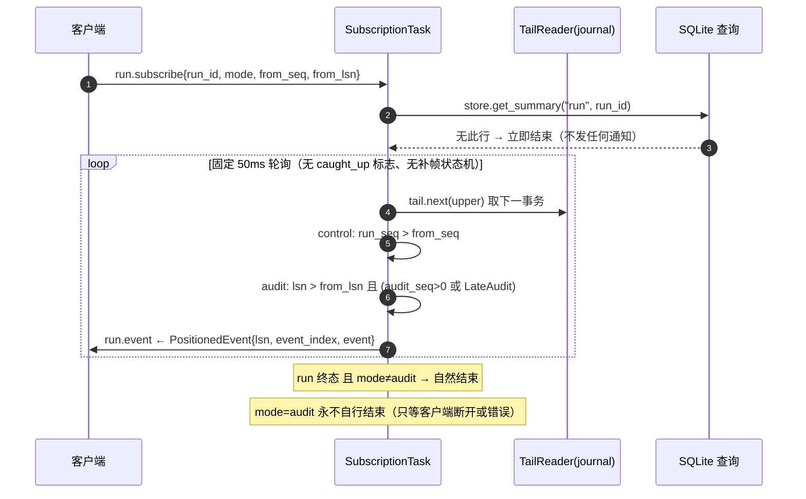

# 06 · RPC 层（§11）

> 本文是 [DESIGN.md](../DESIGN.md) 的分篇。章节编号与全文一致；总索引与核心抉择见 [DESIGN.md](../DESIGN.md)。

## 11. RPC 层

### 11.1 方法面

`flow-rpc/src/journal_v2.rs` 注册 **51 个方法** + 1 个订阅（`run.subscribe`）。
所有方法共用一个入口：`flow_dto::rpc::Method` 目录和 `admit_call` 准入门。

方法按访问性质分两张清单——`READ_METHODS` 27 项 / `WRITE_METHODS` 24 项。**注意
这两张表不做权限分级，也没有「暂停期」语义**（不存在维护窗口：没有 paused 标志，
读写在运行期同权）。它们只服务三件事：

1. **写命令必须带 `request_id`**（`is_write_method` → 空即 `-32602`）；
2. **写命令的返回要解包成 `CommandReceipt`**（读面直接返回值；例外：
   `config.update` / `secrets.set` / `secrets.delete` 三个写方法直接返回普通
   JSON，不落 Command 回执）；
3. `command_scope()` 由调用方（CLI）用来推 scope，**服务端自己从不调用它**。

分类的实际效果是「写面有幂等键与提交游标，读面没有」——因为只有写面会改变权威
状态、才需要重放保护。

### 11.2 幂等：`request_id`

每个写方法接受调用方提供的 `request_id`（1..=128 字节）：

1. `fingerprint = sha256(请求体, 上限 9 MiB)`；
2. 查永久 command 回执：同一 `(scope, request_id)` 已有记录且 fingerprint **相同**
   → 直接返回上次结果，**不重复执行**；
3. fingerprint **不同** → `-32012 conflict`（`same request identity with
   different arguments`）；
4. 新请求 → 执行 + 落 `Command` 事件（含 `result`，受 `INLINE_BYTES` 限制）。

**缓存窗口**：内存最多保留 `COMMAND_WINDOW = 8192` 条，超窗淘汰旧缓存。
永久回执仍在 current_entities；命令先查缓存再查库，缓存逐出和重启不会放行旧身份。
本次不引入回执 TTL。

### 11.3 订阅：`run.subscribe`

唯一订阅。`event_format` 必须恰好是 `"v2"`（否则 sink 被 `-32602` 拒绝），
`mode` 可选 `audit` 或 `control`（缺省 control），`from_seq` / `from_lsn` 是规范
十进制字符串、缺省 0。

通知体是**原样的 `PositionedEvent`**（`{lsn, event_index, event}`），没有包装
信封、没有裁剪。每批累积到 `MAX_LINE_BYTES`（1 MiB）即发送；单条超限时先发一帧
`{"type":"stream_error","code":"RESPONSE_TOO_LARGE"}` 再关闭。

**刻意的简单**：固定 50ms 轮询，**没有** `caught_up` 标志，**没有** gap-filling
状态机，**没有**首帧快照（直接从 `from_seq`/`from_lsn` 起 tail）。（旧文档描述的
`run_tail` 相位机已随 v1 删除。）代价是轮询开销与「从 0 开始要重放全程」，
收益是订阅路径没有第二个状态机需要维护——而订阅状态机一旦出错，表现为
「前端事件丢一半」这类极难复现的问题。

**control 与 audit 是两种不同的流**：control 按 `run_seq` 推进（业务事件序），
audit 按 `lsn` + `audit_seq` 推进（含执行器审计事实与迟到的 `LateAudit`）。这也
是为什么 audit 订阅对终态 run 不自行结束——迟到的审计记录理论上永远可能出现。

### 11.4 错误码词汇（v2 单一来源）

| 码 | 名称 | 含义 |
| --- | --- | --- |
| `-32001` | unauthorized | token 缺失/不符（恒定时间比较，`admit_call` 对所有方法生效） |
| `-32011` | not found | `flow_journal::Error::NotFound` 按类型映射、消息原样透传（journal 写面产生 `run`/`workflow`/`workflow version`/`schedule`/`webhook`/`template not found` 六个串；视图层的中文 not-found 消息同样落 -32011） |
| `-32012` | conflict | `flow_journal::Error::Conflict` / `ViewError::Conflict` / `Conflict("template name already taken")`（模板撞名）/ `request_id` 撞车 |
| `-32021` | limit | `flow_journal::Error::Limit`、`RESPONSE_TOO_LARGE` |
| `-32602` | invalid params | `invalid()` 助手 + jsonrpsee 参数解析失败 |
| `-32603` | internal | catch-all：journal 不可用、投影不可用、密钥 IO 失败 |

`-32011` 的映射是**按类型**的：任何 `Error::NotFound` 都会被认成 not-found、
消息串原样透传，没有消息串白名单；六个英文串只是 journal 写面当前会产生的集合。
新增一类「不存在」错误只要走 `Error::NotFound` 即可；串进 `Invalid` 的会被降级
为 `-32602`（如 `trigger not found` / `node not found`）。

**恰好一次对外部系统不成立**。`http_call` 在 `OperationPermit` 之后发生，此时
进程崩溃 → 恢复期只能判定「结果不明」→ 等人工裁决（C4）。**没有任何自动机制**
能把任意 HTTP 调用变成恰好一次；这是分布式系统的固有边界，不是实现缺陷。

### 11.5 触发器

**cron**（`journal_triggers::fire_due`）：20s tick；取
`previous_before(now + 1ns)`——向前挪 1 纳秒使恰好落在时隙边界的 now 本身被纳入
本次判定（不是时钟抖动容错）；去重键 = **该触发时隙**的 RFC3339 时刻字符串
（不是「下一次」触发时间——那只用于 schedule.list 的展示字段）。

**错过的时隙只补最近一次**：每次 tick 只判定「now 之前最近的一个时隙」，
服务停机跨越多个时隙时，中间的时隙**静默跳过**，不追补、不告警。这是有意的
策略（停机重启后一次性追补会造成触发雪崩），`active_since` 之前的历史时隙同理
不算触发。需要逐次补跑语义的场景应使用 webhook/invoke 外部驱动，而不是 cron。

**webhook**（`POST /hooks/{id}`）：Bearer token + `Idempotency-Key`（≤128 字节）、
body ≤ 8 MiB。

| 响应 | 含义 |
| --- | --- |
| `401` | Bearer 不符 |
| `400` | 载荷非法（含 Idempotency-Key 缺失/超长、hook 不存在） |
| `409` | `Idempotency-Key` 重复且载荷不同 |
| `429` | 触发限流（`Error::Limit`） |
| `200` | 旧 hook 已受理（run 已创建）；独立业务入口 `/invoke/{id}` 使用 202 |
| `503` | 存储或服务暂不可用 |
