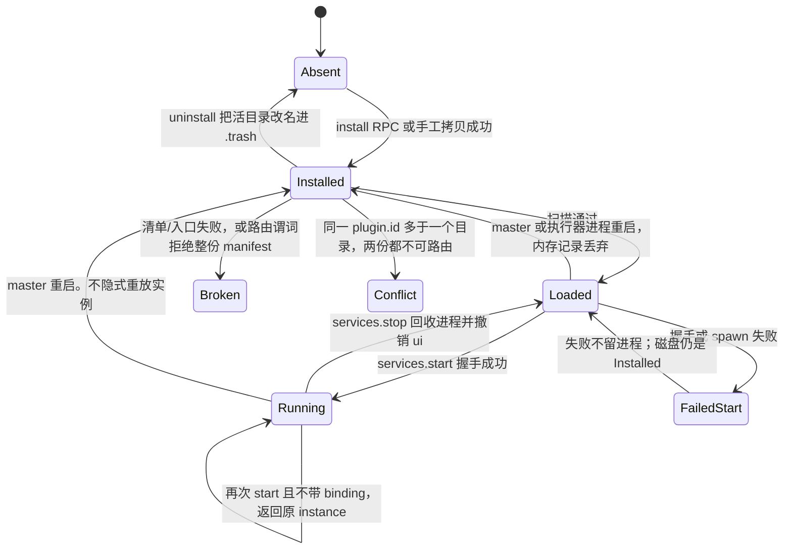
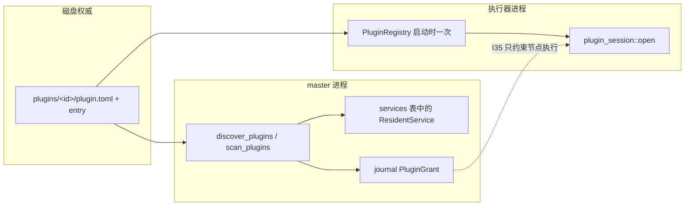
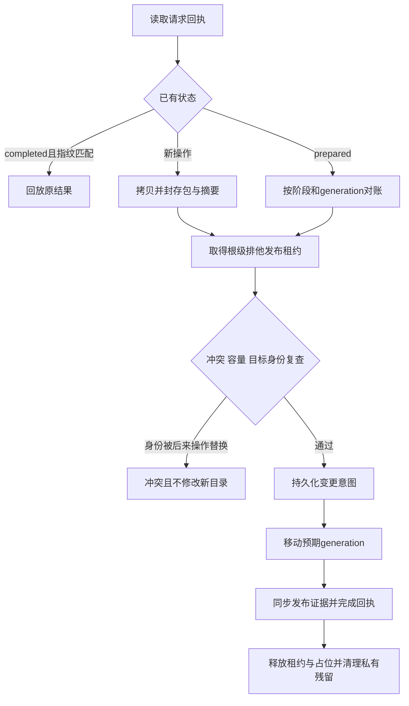

# Flow 插件安装、卸载与加载

| 项 | 值 |
| --- | --- |
| 作者 | （待填） |
| 日期 | 2026-11-14 |
| 状态 | 待 review |
| 受众 | 熟悉 flow-backend / flow-plugin-runtime / journal v2 的工程师 |
| 相关代码 | `crates/flow-backend/src/plugin_registry.rs`、`crates/flow-plugin-runtime/src/plugin_registry.rs`、`crates/flow-config/src/plugin_manifest.rs`、`crates/flow-rpc/src/journal_v2.rs`、`crates/flow-backend/src/resident_service.rs`、`crates/flow-backend/src/service_host.rs` |

审阅顺序：先看「为什么这样设计」和「优缺点」，再看「Proposed Design」到「兼容」里的实现规格，最后看文末「实现任务清单」。已决的产品问题在「Open Questions」。中间的伪代码、错误码和锁序是规格，不是背景。

## 为什么这样设计

安装、卸载、加载今天已经是三条不同的代码路径，只是没有被说成产品操作。master 用 `discover_plugins()` 扫一层目录；执行器用 `PluginRegistry::load()` 在进程启动时扫同一棵树；常驻服务在 `services.start` 里再起一个进程。授予已经在 journal 里，键是 `plugin_id:content_hash`（I35）。所以新设计不另造运行时，也不把「目录里有什么」再写进 journal。

### 目录是插件目录，journal 只存授予

样例的安装方式就是把构建产物拷进 `plugins/<id>/`。如果再引入 `PluginInstalled` 事件，就会有三份身份：目录、事件投影、I35 哈希。崩溃点正好落在「文件已经 rename、事件还没提交」。手工换二进制要么被投影无视，要么每次扫描都变成写命令。授予事件已经够用：节点执行看哈希，安装不需要再发一条「这个目录存在」的事实。

因此安装采用带恢复日志的目录发布：拷到 `.staging`，在副本上校验，在根级排他租约内以 rename 发布到 `plugins/<plugin-id>/`。每个 rename 原子，替换涉及的多个 rename 和回执写入依靠恢复协议完成，不是单次文件系统原子事务。失败不留下半截活目录。手工拷贝继续落到同一布局，只是没有回执、没有原子替换。

### 加载、recheck、启动不是一件事

- 执行器注册表在 `runtime.rs` 里只 `load()` 一次，注释写明不热加载。install 里杀执行器，或再加一条代际 RPC，都会把「节点进程已经 mmap 了旧 inode」和「master 看见了新文件」揉成一个假同步。
- `plugins.recheck` 今天只重跑动态类型和已发布定义的校验，不 spawn，不刷新执行器，也不查 grant。09 正文写「重检把待授予检出来」，代码没有这么做。待授予已经在 `plugins.list` 的 `grant_state`。把 recheck 改成授予检查，一个方法就会有两套语义。
- `services.start` 才创建常驻进程。已存活且不改绑定时返回原 instance。要换二进制必须先停再起。热替换会把「结果可能未知、不隐式重放」的会话模型重新发明一遍。

所以：扫描是加载；recheck 是重验已发布定义；start 是启动；执行器要重启才看得到新的节点类型。`executor_reload_required` 只活在 install/uninstall 的那一次响应里，设置页做一次性 toast。`plugins.list` 不假装知道执行器跟上了没有。

### 新安装比已经在盘上的目录更严

今天 `resolve_entry` 允许绝对路径，`is_file()` 跟随符号链接，`fs::read` 不设上限。如果 PR 1 把这些都标成不可路由，已经在跑的插件会在没有安装 RPC 的那次合并里消失。所以：

- 新 install 拒绝绝对入口、符号链接、逃出插件目录的路径、单文件 > 256 MiB、整树 > 512 MiB、文件数 > 4096。
- 已经在盘上的这些入口继续可执行，list 只加 `entry_symlink` / `entry_contained` / `entry_oversize`。
- 已经在盘上、并且会变成不可路由的，是另一张表：重复 id、协议主版本不符、异 id 重叠时的后一份、默认二进制真的存在时的第三方 `harness`/`llm`、内置类型名、大于 256 KiB 的 `plugin.toml`。这几条里，执行器本来就跳过其中大部分；收紧的是 master 与执行器不再各认各的。

### 同一个 id 的两份目录都不可路由

今天没有单一胜者。master 的 `services.start` 用字典序第一份路径。执行器在节点类型相交时让后一份覆盖 `by_node_type`。类型不相交时两份都留在路由表里，可以是两份不同的二进制。把「字典序第一份」写成唯一规则是错的。两份都 Conflict，是有意收紧，并且会让 `plugins.recheck` 把这些类型报成已下架。不同 id 抢同一个节点类型仍按 `load_manifest`：升序下先接受的留下，后一份整份不可路由。

### 占位必须盖住进程退出

`services.stop` 先把行从 `services` 表里拿掉，再 `shutdown().await`。如果 install 只看「表里还有没有 alive 行」，它会在进程还在退出时 `rename` 掉正在跑的目录。所以 start、公开 stop、内部 `stop_first`、install、uninstall 共用 per-id 占位，占位留到 `shutdown` 结束。`close` 先等占位排空，再取走服务表。磁盘 IO 和进程等待仍然不进 `services` 锁：占位 guard 跨 `.await`，mutex 本身只在插删 id 时拿着。

公开 stop 的句柄顺序保持今天的实现：先 `service_ui.retain`，再 `shutdown`。`close` 相反：先回收进程，再清空整张句柄表。内部 `stop_first` 抄前者，因为卸载没有调用方提供的 `instance`，不能去调要求 instance 的公开 RPC。

### 校验到 spawn 必须持有同一份读租约

连续读两遍只能发现部分并发变化，不能消除第二遍读取与 `Session::spawn` 之间的 TOCTOU。本方案改用插件根上的跨进程读写锁 `.publish.lock`：受管理的安装/卸载持排他发布租约；扫描及执行器/常驻服务的校验到实际进程创建持共享读租约。执行器必须参与，master 的内存占位不能代替它。

常驻 start 在读租约内重新读取 manifest、entry 和 web-ui，校验 I35 并固定 HTML 副本，然后按刚校验的路径创建进程。节点 `plugin_session::open` 同样从复核注册哈希到 `Session::spawn` 返回一直持读租约。释放后才做 initialize 握手；安装无法在校验与 spawn 之间换目录，已经启动的进程仍可继续运行。若 SDK 返回 Session 之前还需要通道回连，这段也在租约内，但不得等待插件业务响应。

这只保证遵守租约的 Flow 操作之间的一致性。手工拷贝、根外绝对入口及恶意同 uid 写入不参与租约，仍是未受管理的兼容入口；不能据此承诺任意文件修改都与 spawn 原子。OS 锁的获取和同步读盘在阻塞工作中进行；已取得的租约可以随 Session 创建 future 持有，但不能在异步 worker 上阻塞等待文件锁。锁描述符不继承给子进程。

### 回执放在 `.ops`，不进 journal，也不修剪

install/uninstall 不走 `JournalBackend::command`，所以 `command.status` 看不见。拷贝到一半再重试，比再写一次同名密钥更难靠人眼核对，因此需要一份持久身份。journal 的 `COMMAND_WINDOW`（8192）被逐出之后行还在库里；`.ops` 没有这张表。如果按 8192 删最老的回执，同一个 `request_id` 配上 `replace: true` 会在源目录变了之后再发布一次。所以不修剪。指纹不同一律 `-32012`，禁止掉进「哈希相同就算成功」。文件里不存 `source`：备份 `~/.flow` 不应从回执得知安装来源目录。人手删掉 `.ops` 会放掉身份，这是比 journal 弱的地方，写在运维说明里。

### 安装不授予，卸载不撤权，start 不查 grant

授予键含内容哈希。安装时写 grant，等于把「文件刚换过」自动认成已经审过的能力。卸载时撤权，会把还要用来拒绝旧哈希的记录删掉；同字节再装回来也应该仍是 `granted`。节点执行的闸在 master 的 `start_gate` / `verify_plugin_identity`，不在执行器。常驻 `services.start` 今天只认管理员，产品文档写明细粒度服务授予还没开放。这次加上会让已经能启动的服务突然 pending。

### 不在安装事务里跑插件代码

解析器只看文本和文件字节。要跑二进制才能完成的安装，等于在管理员点安装时执行不可信代码，而且失败模式会和握手、会话限额缠在一起。协议主版本和 `interaction_events_v1` 是两件事：安装只查主版本，常驻握手仍在 start 时做。

### 默认的 harness/llm 行必须跟着真正 spawn 的执行器

`default_sibling_binary` 跑在执行器进程里，用的是那个进程的 `current_exe()`，或者已设置的 `FLOW_*_PLUGIN_BIN`。master 若只调 `ExecutorInvocation::locate()`，会在 `flow-journal-server` 旁边找兄弟文件，而真正跑 `load_manifest` 的程序可能是 `[execution].executor_bin`。两边会对「第三方 id 能不能声明 `harness`/`llm`」得出相反结论。所以 master 用 `mode_from_config` 的那条程序路径：有 `executor_bin` 就用它，否则才 `locate()`。环境变量已设置但不是文件时没有默认行，不回落兄弟文件。`execution.mode=remote` 本机没有这份 `load()`，不造本机默认行。

## 优缺点

推荐方案是 **目录事务 + 现有双端发现**。下面是这个方案本身的账，不是三个方案的复述。方案 B（只写约定）和方案 C（journal 当目录权威）的取舍在「Alternatives Considered」。

| | 内容 |
| --- | --- |
| 优点 | 和 `discover_plugins`、I35、常驻 start、样例拷贝是同一条路。撤掉 RPC 之后已经装上的目录仍是合法插件，没有 migration 要倒。坏插件变得看得见、卸得掉，同时不进动态类型集，不拖垮宿主。卸载有一条可实现的不删到根外的规则：参数不是路径，`remove_dir_all` 只打在 `.trash` 里。占位修的是今天 stop 与 install 的竞态，不把 `shutdown` 放进 `services` 锁。每一步 PR 都可以单独合并：先扫描，再占位，再 RPC，再 CLI 和设置页。 |
| 缺点 | master 与执行器在节点插件安装后会分叉，直到执行器进程重启。设置页只能对那一次响应做 toast，刷新之后看不出执行器跟上了没有。`.ops` 不是 `CommandReceipt`，`command.status` 查不到，人手删文件会放掉 `request_id`。手工拷贝仍能绕过校验，这是有意保留的兼容入口。重复 id、协议主版本、内置类型名、大于 256 KiB 的清单会改变已经在盘上的路由，不是「只影响新安装」。list 缓存按 mtime+len，同一秒、同一长度的改写会暂时展示旧哈希。同 uid 的进程本来就能改 `~/.flow`，这套路径规则防的是误删和清单与二进制不一致，不是防恶意本机进程。 |
| 明确不付的成本 | 不做插件市场、自动更新、远程下载、跨主机推送、安装期执行插件、执行器热加载、把 web-ui 算进 I35 哈希、把常驻服务的 JSON-RPC 会话重写一遍、改 Tauri `frame-src`。远端节点仍要操作者自己把同一布局放到 agent 的插件根，并用那台机器上的真实哈希授予。 |

相对今天，审的时候要单独接受这几处行为变化：

1. 同一个 `plugin.id` 的两份目录都不可路由。recheck 会把这些节点类型报成已下架。
2. 协议主版本不是 0 的目录，master 也不再 start。执行器本来就跳过。
3. 不同 id 抢同一节点类型：先接受的留下，后一份整份不可路由。不是两份都禁用，也不是执行器今天的「后者覆盖」。
4. 内置类型名（`script` 等，`Harness` / `Llm` 除外）在 master 侧也不再可 start。
5. `plugin.toml` 大于 256 KiB 的已安装目录变为 Broken。入口大于 256 MiB 仍然可路由。
6. `services.start` 占位失败的字符串不变。stop、install、uninstall 撞上占位是新的 `-32012` `plugin operation in progress`。关闭中一律仍是 `host is shutting down`。

## Overview

今天「安装插件」不是产品操作，而是把一份已经构建好的目录放进 Flow 主目录的 `plugins/<目录>/`。master 侧 `discover_plugins()` 与执行器侧 `PluginRegistry::load()` 各自扫描同一目录、用同一份 `plugin.toml` 解析器和同一条内容哈希公式；常驻服务由 master 在 `services.start` 里另起进程，节点执行由执行器按启动时注册表 spawn。两套加载记录不共享内存，也没有安装事务、卸载边界或失败插件的可见状态。

本设计不新增插件运行时，不改 JSON-RPC 会话模型，不改 Tauri `frame-src`。安装与卸载是 **插件根目录上的文件系统事务**：校验后原子换入 `plugins/<plugin-id>/`，失败不留下半截活目录。加载仍是现有发现。`plugins.recheck` 仍是「已发布定义对当前 manifest 的重验」，不是重载，也不是启动服务。常驻进程只在显式 `services.stop` 之后被替换；执行器注册表仍是进程启动时加载一次，重启才重载。

## Background & Motivation

### 现状

插件根由 `FLOW_PLUGINS_DIR` 决定，否则是 `flow_home()/plugins`（`flow_config::flow_home()`：非空 `FLOW_HOME`，否则 `~/.flow`）。仓库里的 `plugins/harness/`、`plugins/llm/` 是构建工作区，不是运行时安装目录。内置兜底是执行器同目录的 `flow-agent-plugin` / `flow-llm-plugin`（或 `FLOW_AGENT_PLUGIN_BIN` / `FLOW_LLM_PLUGIN_BIN`），只服务节点路由，不出现在 `plugins.list`（`JournalBackend::plugins_view` 的注释写明了这一点）。

master 发现（`flow_backend::plugin_registry::discover_plugins`）：

- 只扫插件根的**一层**子目录；没有 `plugin.toml` 的目录跳过。
- `parse` 失败、入口不可读：`tracing::warn` 后**不进列表**。坏插件不拖垮宿主，但也看不见、卸不掉。
- 入口允许相对路径或绝对路径（`resolve_entry`）。不检查符号链接，不用 `canonicalize` 把入口关在插件目录内。
- 内容哈希是 `sha256(manifest 原文字节 ‖ entry 文件字节)`，与执行器 `content_hash` 同公式。这是 I35 的身份，不是整个目录的哈希。
- 同一 `plugin.id` 出现在两个目录时，**两条都进入** `plugins.list`。master 与执行器的胜者不是同一个，今天有三种结果，不能写成「字典序第一份」：
  1. **master start**：`discover_plugins` 把目录路径升序排好后 `services.start` 用 `find`，**字典序靠前的路径**被拉起。
  2. **执行器、节点类型相交**：`load_manifest` 只在 `existing.plugin_id != manifest.plugin.id` 时拒绝重叠。同一 id 会覆盖 `by_node_type`。目录同样升序扫描，所以**后一个路径**留下，成为该节点类型的注册。这和 master 的第一份相反。
  3. **执行器、节点类型不相交**：两份都留在路由表里，可以是两份不同的二进制和两份不同的哈希。
- 执行器另外会**整份**跳过一份 manifest（`load_manifest` 里 `return`，不是只丢掉冲突的那一个类型）：协议主版本不符、入口缺失、`node_types` 含仍由编译期处理器承载的类型（`Harness` / `Llm` 除外）。与**另一个**插件 id 的节点类型重叠时，被跳过的是扫描顺序里**后**遇到的那一份；已经注册的那一份留着，包括它自己的其余节点类型。默认行来自 `default_sibling_binary`，它跑在**执行器进程**里：`FLOW_AGENT_PLUGIN_BIN` / `FLOW_LLM_PLUGIN_BIN` **已设置**时只看这个路径，`is_file()` 为假就返回 `None`，**不**再找兄弟文件。环境变量未设置时，才用该进程 `current_exe()` 的父目录加上 `flow-agent-plugin` / `flow-llm-plugin`。返回 `None` 就不插入行（warn 文案写成「未设且同目录无」，在变量已设但不是文件时并不准确；以返回值为准）。于是没有默认行时，后到的异 id manifest 可以声明 `harness` 或 `llm`。master 的 `discover_plugins` **今天不做**协议主版本和这道重叠检查。

执行器发现（`flow_plugin_runtime::plugin_registry::PluginRegistry::load`）：

- 进程启动调用一次（`runtime.rs` 里「不热加载」）。上面的拒绝都是 warn 并跳过，执行器会话继续。
- `node_types` 为空的 service-only 插件不会进入路由表（注册循环无元素）。这是正确行为，不是漏加载。同一 id 的显式部署可以替换**已经插入**的默认注册（「显式部署胜过隐式默认」）。第三方 id 声明 `harness` 或 `llm`，只有默认行已经存在时才整份被拒；默认二进制不在时执行器接受这份 manifest。
- spawn 前 `RegisteredPlugin::recheck_content_hash`（`plugin_session::open`）复核的是 `sha256(manifest 字节 ‖ entry 字节)`。常驻服务路径**没有**对等复核：`services.start` 在发现时读过入口，握手前不再读 manifest 和 entry。
- 授予不在执行器里。执行器把 `plugin_id` 与 `content_hash` 放进 `plugin_invoke`（`task.rs`）。允许与否在 master：`policy::start_gate`（未授予则拒）、以 `PluginGrant::key`（`"{plugin_id}:{content_hash}"`）为键的 ceiling，以及 `policy::verify_plugin_identity` 把上报哈希与冻结授予比较。`flow-plugin-runtime` 里没有授予表。

常驻服务（当前工作树已修行为，本设计不回退）：

- `services` 锁只做表的查找、插入、删除。发现、读 web-ui、spawn、握手都在锁外。`reserve_service_start` 用 `service_starts` 按插件 id 占位，占位 guard 在 drop 时释放；二次 start 返回 `service start already in progress`。
- 同一 id 已存活且请求不带 `binding`：返回原 `instance`，不新起进程。带 `binding` 则 `service already running; stop before rebinding`。上限是 `services.len() >= 32`：算的是表里的行，**包括** `alive()` 已经为 false、还没被替换或删除的行。不是「同时存活的进程数」。错误字符串是现有的 `-32602` `service limit reached`，不要改成 `-32021`，也不要改成只数 `alive()`。
- 公开的 `services.stop` 今天**不**看 `service_starts`。它在 `services` 锁里核对调用方传来的 `instance`，不匹配则 `-32602` `stale service instance`；匹配则 `remove`，放下 `services`，**先** `service_ui.retain` 掉该 instance，**然后** `shutdown().await`。`JournalBackend::close` 相反：先对每个服务 `shutdown().await`，再 `service_ui.clear()`。两条路径不要写成同一句。
- 握手超时 10 秒；调用超时 30 秒；在途调用通道 64；事件历史 128 条；反向宿主请求最多 16 个，第 17 个返回错误且不拆会话；订阅最多 16。
- `services.events`：`after = "0"` 时窗口外的旧事件用 `gap: true` 交还现存窗口；非零游标掉出窗口才 `resync_required`。
- `services.list` 的 `ui` 只在 `permission_admin` 时填入。句柄是 `instance` 加 `resource_token`，不是 RPC 凭据。web-ui 在 start 时读入并固定，单文件 ≤ 256 KiB（262144），`canonicalize` 后必须落在插件目录内。
- 页面桥：`PluginServiceFrame` 的 `attached` 只绑定一次，再次 `load` 关闭页面。不改 iframe CSP，不改 Tauri `frame-src`。
- 进程退出不重放实例。`JournalBackend::close` 先 `shutdown.cancel()`，取走 `services` 表并 `shutdown().await`，再清空 `service_ui`。

权限（09 §7，I35）：

- manifest 没有 `[permissions]` → `ManifestPermissions::Legacy`，不是空能力。新 run 要 `permissions.grant` 且 `legacy_confirm = true`。
- 有声明时，授予是声明的子集，只写 journal 事件 `PluginGrantUpserted`，不回写 `plugin.toml`。键是 `plugin_id:content_hash`。
- `harness-agent` 与 `llm` 在启动时 `ensure_bundled_grants` 自动授予；其他插件不自动授予。
- 节点执行被授予闸门卡住。常驻 `services.start` **不**查授予，只要求管理员（`permission_admin`）。产品文档写明尚未开放按服务的细粒度授予。本设计保持这个分裂。

调用面：

- `plugins.list` / `plugins.recheck` 是读方法。list 每次都重新发现并对照内存里的 grant。recheck 只跑 `dynamic_node_types` + `validate_dynamic_params`，外加「类型已不在编译枚举里且当前动态集也没有」的下架检测。它不查 grant，不 spawn，不刷新执行器。
- 09 正文写「升级重检把待授予检出来」。代码没有这么做。待授予只在 `plugins.list` 的 `grant_state`（`granted` / `hash_changed` / `pending`）。本设计不把 recheck 改成授予检查，避免一个方法两套语义。
- 没有 `plugins.install` / `plugins.uninstall`。CLI 没有插件子命令。设置页只展示列表和「重校验发布定义」。常驻面板用手工输入的 `plugin_id` 调 `services.start`。
- 样例 `examples/resident-echo/`：构建 `resident_echo` 后，把 `plugin.toml`、`web-ui/` 和 `bin/resident_echo` 拷进插件目录。这就是今天的安装。

### 痛点

1. 拷贝没有校验事务。拷到一半、id 与目录名不一致、绝对入口、符号链接，发现函数要么悄悄用，要么整条消失。
2. 卸载没有安全边界。`remove_dir_all` 会跟随符号链接；按「猜到的路径」删会删到插件根外面。
3. 加载、重验、启动被说成一件事。执行器注册表与 master 发现会分叉：master 已经承认的新节点类型，正在跑的执行器路由不到。
4. 替换正在运行的常驻进程或执行器进程没有规则。热替换会把「结果可能未知」的会话模型重新发明一遍。

## Goals & Non-Goals

### Goals

- 定义单用户本机宿主上的安装、卸载、加载。规模是几十个插件，不是多租户插件平台。
- 安装来源只有本机已构建目录。校验清单、入口、web-ui、协议主版本、id 冲突与大小上限。落点仍是现有插件根。
- 卸载只删除插件根下那个已证明的子目录。运行中的服务、在飞节点、授予、UI 句柄各自有明确结局。
- 把发现、校验、缓存、`plugins.recheck`、`services.start`、执行器启动加载拆开，并写明失败是否拖垮宿主、热加载是否替换已运行进程。
- 状态哪些在磁盘、哪些只在内存、重启后还在不在。
- 并发复用现有锁序：`services` 锁内不做磁盘 IO、不等待进程。
- RPC / CLI 形状和错误码沿用 journal v2。写方法仍要 `request_id`。install / uninstall 的持久身份是 `.ops` 的 prepared/completed 文件，**不是** `CommandReceipt`，也不走 `JournalBackend::command`。和 journal 共用的只有 `flow_journal::codec::fingerprint` 以及冲突字符串 `same request identity with different arguments`。管理员才能安装和卸载。授予仍走 `permissions.grant`。
- 兼容已在 `plugins/` 里的旧目录、空 `node_types` 的 service-only 插件、同时有节点类型和 `[service]` 的插件。

### Non-Goals

明确不做：

| 项 | 决定 |
| --- | --- |
| 插件市场、签名索引、评分、远程 URL 下载 | 拒绝。安装参数是本机目录，不是 URL，也不是包字节 |
| 自动更新、后台拉新版本 | 拒绝。升级 = 管理员再次 install 且 `replace: true`，或手工换目录 |
| 跨主机分发、把 master 的插件推到 remote agent | 拒绝。远端执行器用它自己的 `FLOW_PLUGINS_DIR`。09 已规定按执行端真实哈希授予，不能用本机同名授权代替 |
| 在安装事务里 spawn、握手、跑插件代码做「自注册」 | 拒绝。解析器只看文本和文件字节。跑代码才能完成的安装不存在 |
| 重写常驻服务 JSON-RPC 会话、`duplex::pump`、事件窗、反向请求限额、iframe 绑定 | 拒绝。这些是已修行为 |
| 把执行器注册表改成热加载，或在 install 里重启执行器 | 拒绝。节点插件的生效边界是执行器进程重启 |
| 安装时写入或撤销 `PluginGrantUpserted` | 拒绝。授予仍是独立的 admin 写命令 |
| 把 web-ui 字节算进 I35 哈希 | 拒绝。公式保持 `manifest ‖ entry`，否则只改 HTML 就会使节点授予失效 |
| 第二份插件目录、第二套 manifest 解析、把常驻服务挪进执行器 | 拒绝 |
| 改 Tauri `frame-src`、把插件目录变成静态文件服务器、外置 JS/CSS 包 | 拒绝。web-ui 仍是 start 时固定的单份 HTML |
| 多租户、每用户插件根 | 拒绝。C7 仍是单用户凭据 |
| 用 journal 事件当插件目录的权威目录 | 拒绝。见方案 C |

手工把样例拷进 `plugins/<plugin-id>/` **继续有效**。它和 RPC 安装落到同一布局，不另建索引。

## Proposed Design

### 方案选择

推荐 **方案 A：插件根上的目录事务 + 现有双端发现**。增量落地见文末 PR Plan。方案 B、C 的取舍在「Alternatives Considered」。

### 磁盘布局

```text
<plugins_root>/                      # FLOW_PLUGINS_DIR 或 <flow_home>/plugins
  <plugin-id>/                       # 唯一活目录。目录名必须等于 plugin.id 才可被 RPC 卸载
    plugin.toml
    bin/<entry>                      # 新安装的 entry 必须是相对路径、普通文件
    web-ui/index.html                # 可选；[service].web_ui 指向的那个文件
  .staging/<uuid>/<plugin-id>/      # 安装副本。发现不看以 . 开头的子目录
  .trash/<plugin-id>-<uuid>/        # 替换/卸载的移出目录。删除在锁外做
  .ops/<sha256(method ‖ request_id)> # 带恢复阶段与对象身份的操作回执
  .publish.lock                    # 不 rename、不删除的跨进程读写锁文件
  .ops.lock                        # 回执身份读写的短时跨进程互斥
  <plugin-id>/.flow-install.json    # 宿主管理的 generation UUID；不属于 I35 内容
```

`plugins_root()` 只有一处实现。`discover_plugins`、执行器 `PluginRegistry::load`、以及 `plugin_config::harness_agent_manifest`（它今天自己拼 `FLOW_PLUGINS_DIR` 或 `flow_home()/plugins`，再拼 `harness-agent/plugin.toml`）都调用它。`flow_home()` 仍是非空 `FLOW_HOME`，否则 `~/.flow`。

发现继续只扫一层。目录名以 `.` 开头的条目直接跳过（今天靠「下面没有 `plugin.toml`」碰巧安全，要变成显式规则）。`.staging` 里的清单因此不可见。

### 状态机

磁盘只有三种持久形态：不存在、活目录、`.trash` / `.staging` 残留。后两种不是插件。内存状态挂在扫描结果和 `services` 表上，重启即失。



| 状态 | 磁盘 | master 内存 | 执行器内存 | 重启后 |
| --- | --- | --- | --- | --- |
| Absent | 无活目录 | 无 | 无 | 仍无 |
| Installed | `plugins/<id>/` | 无，直到下次扫描 | 无，直到该进程启动时的 `load()` | 目录还在 |
| Loaded | 同上 | 扫描结果。list 可用 mtime+len 缓存，但那是尽力而为，见加载一节 | 仅当 `node_types` 非空且路由谓词通过：`RegisteredPlugin`。service-only 不进路由表 | master 缓存丢；执行器重新 `load()` |
| Broken / Conflict | 目录还在 | `plugins.list` 可见，`discover_plugins()` **不**返回它。不能当节点类型，不能 start | 同样不注册，warn | 目录还在，故状态还在 |
| Running | 同上 | `services` 表一项 + 可选 `service_ui` 句柄 | 无。常驻进程不是执行器子进程 | **不在**。不重放。新 start 是新 instance |
| FailedStart | 同上 | 无进程。可选一条内存 `last_error`，重启丢 | 无 | 不在 |
| Uninstalled | 活目录已进 `.trash` 或已删除 | 扫描不到 | 下次 `open` 读不到注册表里的旧路径，该次派发 setup 失败 | 不复活。`.trash` 删不掉只是垃圾，不是插件 |

`grant_state` 不是第五种生命周期，它是 Loaded 插件上的投影：`pending` / `hash_changed` / `granted`。授予记录在 journal，卸载不删。同一哈希再装回去仍是 `granted`。

节点执行用的插件和常驻服务**不是**同一份内存记录：

- 同一活目录、同一 `plugin.toml`、同一 `content_hash`。
- master 扫描服务角色；执行器扫描节点角色。
- 兼具两者的插件：执行器路由 `node_types`，master 在 `services.start` 另起**另一个**进程。不把常驻会话并进节点 invoke，也不让节点 invoke 复用常驻 instance。



### 加载

三件不同的事：

| 动作 | 何时 | 读盘 | spawn | 失败时宿主 |
| --- | --- | --- | --- | --- |
| 执行器 `PluginRegistry::load` | 执行器进程启动 | 是，一次 | 否 | 坏插件 warn 并跳过，会话继续 |
| master 扫描 | `plugins.list`、`nodetypes.list`、发布期动态参数、`plugins.recheck`、`services.start` 之前、`bundled_or_discovered` | 是，且在 `spawn_blocking` 里做完一次快照 | 否 | Broken / Conflict 只出现在 list，不进入这一次快照的动态类型集 |
| `plugins.recheck` | 管理员显式调用 | **一次** `scan_plugins()` 快照，类型集和表单都从它派生 | 否 | 不加载插件。返回已发布定义的违规列表，形状不变。不先调 `dynamic_node_types()` 再调 `dynamic_params_forms()`，那是两次发现，中间的 `rename` 会把新类型配上旧表单 |
| `services.start` | 管理员显式调用 | 持共享读租约读取 manifest、entry 与 web-ui | 校验到 Session 创建完成均持租约；握手在释放后进行 | 字节与预期不符则不 spawn；创建后任一发布检查失败都回收进程、不插表 |
| 节点 invoke | 执行器收到派发 | 在跨进程读租约内 `recheck_content_hash` | 租约覆盖到 Session 创建返回，一次性节点进程 | 设置失败是该次派发失败，不是执行器退出 |

热加载**不**替换已运行进程。

- 常驻进程：已存活的 start 返回原 instance。要换二进制必须先走「并发与锁」里的 stop（先撤该 instance 的 UI 句柄，再等进程回收），再 start。start 持跨进程共享读租约完成新鲜读取、校验与进程创建，见下面伪代码。
- 执行器：注册表不刷新。`executor_reload_required` **只**出现在 install / uninstall 的这一次响应里（`node_types` 非空则为 `true`，service-only 为 `false`）。它不是 `plugins.list` 的字段，master 也不知道正在跑的执行器是哪一代。`nodetypes.list` 下次扫描就会看见新类型；执行器要等进程重启。不在 install 里重启执行器，也不加「查询执行器代际」的 RPC。
- 只改 web-ui：哈希不变，授予不变。已运行实例的 HTML 是 start 时的副本，要停掉再开才换页。共享读租约使受管理的目录发布不能插入 HTML/入口读取与进程创建之间；手工原位写入不在这个保证内。

缓存：

- master 的 **list / recheck** 可以有进程内缓存：`(manifest 路径, mtime, len, entry 路径, mtime, len) → content_hash + 解析结果`。mtime 与长度都没变就不必重读。这是尽力而为：同一秒、同一长度的改写（`cp` 保留时间戳，或时间戳分辨率粗）会命中旧哈希。缓存**不是** start 或 install 的输入。
- install 成功发布后递增 `plugin_generation`，并对新目录再 `stat` 一次，使下一轮 list 不会沿用替换前的缓存项。uninstall 同样递增。手工拷贝不经过 RPC，generation 不动；list 仍靠 stat。stat 漏掉的内容变化要等下一次 start/install 的强制重读，或等 mtime/len 变化。不把 list 缓存说成强一致。
- `services.start` 与 `plugins.install` 在 `spawn_blocking` 里重新读它们即将 spawn 或发布的那份 manifest、entry 与（start 还有）web-ui。不查这层缓存。
- 执行器不共享这份缓存，也不提供刷新 RPC。`plugins.list` 不能表示执行器已经跟上。
- 离开 `services` 锁不等于离开异步运行时。`discover_plugins` 今天在 RPC 任务上直接 `fs::read` manifest 和整个入口。冷扫描 64 个插件、入口合计可达数百 MiB，会占住 worker，而常驻握手的 10 秒超时跑在同一个运行时上。因此凡是 RPC 或发布路径触发的扫描、哈希、web-ui 读取，都进 `spawn_blocking`（或同一个阻塞快照函数）。缓存命中时 list 只做 stat，仍放在阻塞快照里，避免以后有人把「未命中就在 worker 上哈希」写回去。

失败插件不拖垮宿主：这条保持，并补上可见性。`discover_plugins()` 只返回路由谓词判定为可路由的插件。`scan_plugins()` 额外返回 Broken / Conflict，供 `plugins.list` 和卸载。符号链接和超大入口**不是** Broken，见兼容。

### 安装

#### 包从哪来

只接受 master 能读的本机目录，目录里有 `plugin.toml`。这覆盖两件事：

1. 已构建产物：`plugin.toml` + 相对入口 + 可选 `web-ui`。`examples/resident-echo` 拷进插件根之前，也可以先被 `plugins.install` 从样例目录装进来。
2. 已经按插件布局放好的目录。源目录名不必等于 `plugin.id`；发布位置一律是 `plugins_root/<plugin.id>/`。

不接受 URL、压缩包、RPC 里的文件字节。压缩包会引入 zip-slip，本设计不处理。源目录的 canonical 路径不得位于 `plugins_root` 之内，避免把活目录拷到自己身上。

手工拷贝仍然是同一终态，步骤与 `examples/resident-echo/README.md` 一致：构建产物放进 `bin/resident_echo`，整个样例目录成为 `plugins/resident-echo/`。下一次扫描看见它，没有 `.ops` 回执，`grant_state` 按哈希现算。

#### 校验

在副本上做，不在源目录上做最终判定（源目录在拷贝期间可能被改）。顺序：

1. 源路径：`symlink_metadata` 是目录且不是符号链接；`canonicalize` 成功；不在插件根内。
2. 读 `plugin.toml`，硬上限 256 KiB。`flow_config::plugin_manifest::parse` 失败即拒绝，不猜字段。
3. `plugin.id` 是现有 kebab 规则，且长度 1..=64。新安装目录名等于该 id。
4. `plugin.entry` 非空、相对、每个分量都是 `Normal`（拒绝绝对路径、`..`、前缀 `/`）。这比发现函数更严。发现函数对**已经在盘上的旧插件**仍允许绝对入口，见兼容。
5. 路由谓词与执行器 `load_manifest` 同一扫描顺序，master 的 `scan_plugins` 用同一份。失败的那一份不进 `discover_plugins()`，因而 `services.start` 也拉不起它。**不要把「两边都重叠」读成两份都 Broken。** 顺序是：
   1. 目录路径升序，与今天 `discover` 的 `dirs.sort()` 相同。
   2. 先放默认行，并且只模拟**这次真正 spawn 的那个执行器进程**里的 `default_sibling_binary`。程序路径不是单独再调一次 `ExecutorInvocation::locate()`。`locate()` 不读 `[execution].executor_bin`；配置加载时 `FLOW_EXECUTOR_BIN` 只是写进这个字段。本地 ipc 的召唤路径就是 `mode_from_config` 用的那个：`config.execution.executor_bin` 有值则 `ExecutorInvocation::explicit`，否则才 `locate()`。兄弟文件放在这条 `program` 旁边，不要放在 `flow-journal-server` 旁边。环境变量按函数原文，不要做成回落：
      - `FLOW_AGENT_PLUGIN_BIN` / `FLOW_LLM_PLUGIN_BIN` 已设置：该路径 `is_file()` 才是默认行。设了但不是文件 → 这一行不存在，**不**再看兄弟文件。
      - 未设置：才看 `<executor.program 的父目录>/flow-agent-plugin` 或 `flow-llm-plugin`，且必须 `is_file()`。
      - `execution.mode=remote`：本机没有执行器跑 `PluginRegistry::load()`。**不**用本机的 `flow-executor` 造默认行。远端进程自己的 `load()` 不在这条谓词里；master 因此不会因为本机碰巧有兄弟二进制就把第三方 `harness` / `llm` 标成 Broken。节点在远端是否路由得到，以那台机器的扫描为准。
      没有默认行时，后面的 manifest 可以声明 `harness` / `llm`。这和执行器「`None` 就不插入」一致，不是「凡是第三方 id 都拒绝」。
   3. 然后逐个 manifest。协议主版本不符（`plugin.protocol >> 16 != PROTOCOL_VERSION >> 16`；今天版本 `2`，主版本是 `0`，所以 `protocol = 1` 和 `2` 都通过）→ 整份 Broken，安装 `-32602`。`NodeType::parse` 命中且种类不是 `Harness` / `Llm` → 整份 Broken，安装 `-32602`。入口缺失 → Broken。这三步不过的 manifest 不占节点类型。
   4. **异 id 重叠**：某个 `node_type` 已经属于另一个已接受的插件 id（含上一步真正插入的默认行）→ **后一份整份** Broken，不注册、不可 start，服务角色和其他类型一起丢。先接受的那一份保持 Loaded。安装一份会撞上已接受 id 的新树：`-32012` `node type overlaps plugin {id}`，不发布，也不把已经在路由里的胜者打成 Broken。
   5. 同 id 替换默认行：manifest 的 id 就是 `harness-agent` 或 `llm`，且只碰自己那条默认注册 → 允许，显式部署胜过默认。不是 Broken。
6. **同 id 两份目录**不是上一条的异 id 重叠。安装时另一活目录已经解析出同一个 `plugin.id`，且不是即将 `replace` 的 `plugins_root/<id>` → `-32012`。扫描侧两份都是 Conflict，都不可路由。这是相对 `load_manifest`（同 id 后者覆盖）的有意收紧，只适用于重复 id，不适用于不同 id 抢同一个节点类型。
7. 有 `[service]` 时沿用解析器已有上限：`peers` ≤ 32 且每个都是 kebab；`methods` 1..=64、每项非空 ≤ 128、不是 `initialize`、无控制字符、不重复；`web_ui` 相对、长度 ≤ 256、分量全是 `Normal`。
8. 空 `node_types` 且没有 `[service]`：解析器已经拒绝。service-only（`node_types = []` 且有 `[service]`，`methods.invoke` 可空）允许。兼具节点类型时 `methods.invoke` 仍必填。
9. 走树：只允许普通目录和普通文件。任何符号链接、设备、套接字拒绝。文件数 ≤ 4096，单文件 ≤ 256 MiB，树合计 ≤ 512 MiB。超限 `-32021`。这是**新安装**的上限，不回溯把已经在盘上的更大入口标成不可路由。
10. 若声明了 `web_ui`，副本里该路径必须是普通文件且 ≤ 256 KiB。这与 start 的上限同一数字，避免装进去却永远开不了界面。
11. 拷到 `.staging/<uuid>/<id>/` 之后，从**副本**重读清单和入口，计算 `content_hash = sha256(manifest 字节 ‖ entry 字节)`。入口必须仍是插件目录内的普通文件。
12. 不修改 `plugin.toml`，不写入授予，不 chmod 之外的权限修补。Unix 上 `fs::copy` 保留 mode；结果里带 `entry_executable`（Unix 看 owner 执行位，其他平台为 `true`）。缺执行位不使安装失败，start 会在 spawn 失败。

`[permissions]` 原样留在拷贝来的清单里。缺段仍是 legacy。安装成功后的 `grant_state` 只是读现有 journal：同哈希已有授予就是 `granted`，同 id 只有旧哈希就是 `hash_changed`，否则 `pending`。

#### 发布与失败残留

新请求的重复安装与 Resume 分开：Fresh 且 replace=false 时，只有目标完整 bundle_digest 相同才可作为无变更成功；I35 相同但 web-ui/附属文件不同仍返回 plugin already installed，要求显式 replace。Resume 则只按已封存的 operation_id/generation 恢复，不能把另一代同字节目录认成本操作已经发布。

同一文件系统内 `rename` 才原子。staging 放在插件根下，保证与活目录同盘。

```text
begin_receipt(method, request_id, fingerprint)  # Fresh 或按恢复表处理；不能盲目重跑
reserve(plugin_id)
拷到本 operation_id 的 staging；校验后封存 bundle_digest 和阶段 sealed
短锁 services：alive 行存在则拒绝；进程等待不在根级租约内
取得根级排他发布租约
重新扫描并裁决冲突、容量、目标 generation；分配并保存预期成功 result
若替换：持久化移出意图，再将预期旧 generation rename 到本操作 trash
持久化发布意图，再 rename 已 sealed 的 staging 到活目录
依操作身份核对发布结果，持久化 completed（先于释放排他租约和占位）
释放根级租约与 per-id 占位；清理本操作拥有的残留
```

失败时磁盘上留下什么：

| 失败点 | 活目录 | 残留 |
| --- | --- | --- |
| 校验失败，尚未拷贝 | 不动 | 无 |
| 拷贝或副本校验失败 | 不动 | 删除该次 `.staging/<uuid>`。删不掉则留在点目录下，发现忽略，错误里带路径 |
| replace 的第一步 rename 失败 | 仍是旧目录 | staging 删除 |
| 新目录 rename 失败且 trash 已回滚 | 旧目录已回位 | staging 删除 |
| 回滚也失败 | **缺失** | 字节在 `.trash/<id>-<uuid>`。list 看不到插件。管理员可从 trash 改回，或重新 install。错误是 `-32603` |
| 已写 prepared 回执，rename 之前崩溃 | 旧目录或仍 Absent | 同指纹按记录阶段 Resume；sealed 后只使用原副本，缺失证据拒绝恢复。异指纹即使字节相同也是 `-32012` |
| rename 成功，completed 回执没写上 | 新目录 | prepared 回执还在。同指纹重试按 operation_id、generation 和 bundle_digest 对账；仅本操作的发布证据允许补 completed。异指纹仍是 `-32012`，不走哈希短路 |

安装不取消在飞 run，不重启执行器。已经 `mmap` 了旧 inode 的在飞节点进程继续跑，卸载和替换都一样。下一次 `plugin_session::open` 分两种 setup 失败，不要合成「文件不见」：

- **卸载**：注册表里的旧路径读不到（入口缺失）。
- **替换**：旧路径现在指到新目录，`recheck_content_hash` 读到**新字节**，与注册时的哈希不同，错误是现有的「内容已变化」，不是 `NotFound`。只在 `NotFound` 上失败关闭的实现会在跳过哈希复核时把新二进制跑起来，并用旧授予当成同一个人。两条都拒绝该次派发，都不在 install 里杀进程。

### 卸载

`plugins.uninstall` 的参数是 `plugin_id`，**不是路径**。

允许卸的条件：

1. 调用者是管理员。
2. `plugin_id` 是单个路径分量：非空、≤ 128 字节、不是 `.` 或 `..`、不含分隔符、不以 `.` 开头。不要求它一定能通过 kebab 解析——坏清单的目录也要卸得掉。
3. 目标只可能是 `plugins_root.join(plugin_id)` 这一个路径。先 `symlink_metadata`：不存在 → 成功 `{removed: false, already_absent: true}`（幂等）。是符号链接 → `-32602`，不 `unlink`、不 `remove_dir_all`。
4. `canonicalize` 之后必须仍是插件根的直接子目录。不是则 `-32602`，停止。
5. 若 `plugin.toml` 能解析，其 `plugin.id` 必须等于这个目录名，也必须等于参数。不相等就拒绝，**不**去别的目录里找同名 id。legacy「目录名 ≠ id」的插件因此不能被 RPC 卸掉。路径写在 `-32602` 的 **message** 里，例如 `plugin id does not match directory: source=/abs/plugins/other-name`。`ErrorObjectOwned` 的 data 保持 `None`，与今天所有 journal v2 错误一样，不新增 error data。管理员自己移动或删除。
6. 清单解析失败：仍允许删除这个已经被困住的直接子目录。没有第二候选。
7. `services` 表中该 id 有 `alive()` 为 true 的行：默认拒绝 `-32012` `service running`。`stop_first: true` 时走下面的**内部** stop，不调用公开的 `services.stop` RPC。公开 RPC 要求调用方提供 `instance`，不匹配则 `stale service instance`；卸载没有 instance 参数。停不掉就不删目录。
8. 不扫描、不取消在飞节点。卸载响应带 `in_flight_runs_unaffected: true` 与一次性的 `executor_reload_required`（该插件有过节点类型，或清单坏到看不出来时为 `true`）。正在跑的节点进程握着已打开的 inode。活目录改名后，下次 `open` 是「读不到旧路径」，不是「哈希不符」。见安装一节对替换的区分。
9. 不删除 journal 里的 `PluginGrant`。卸载不是撤销授予。旧哈希的授予留着，只是没有目录可匹配。同字节再装回来仍算授予。要停掉新 run 对旧哈希的权利，仍走现有授予模型（改授予只影响新 run）；本设计不加 `permissions.revoke`。
10. UI 句柄：内部 stop 与公开 `services.stop` 一样，在 `shutdown` **之前** `retain` 掉被摘下的那一行的 instance。默认卸载在服务仍运行时失败，故句柄还在。`stop_first` 成功之后句柄已撤，然后才改名目录。这和 `close`（先 shutdown 全部进程，再 `clear` 整张表）不是同一顺序。

卸的是改名，不是在原位 `remove_dir_all`。`stop_first` 的内部 stop 已经持有该 id 的占位，并一直持有到 `shutdown().await` 结束：

```text
begin_receipt；reserve(id)
按原公开 stop 规则摘实例、撤 UI 句柄、shutdown；期间不持根级租约
取得根级排他发布租约
复查目标 generation，持久化 remove 意图和预期成功 result
仅将该 generation rename 到本 operation_id 的 trash
核对 trash 与目标身份，持久化 completed
释放租约和占位；仅清理本操作拥有的 trash
```

`remove_dir_all` 只作用于刚刚改名出来、并且 canonical 路径仍在 `.trash` 内的那一棵。活目录上的符号链接根本走不到这一步。trash 本身若在复查时是符号链接，留下它并返回 `-32603`，不跟随。

部分成功：

| 情况 | 结果 |
| --- | --- |
| stop 成功，rename 失败 | 服务已不在表里（与今天 `services.stop` 相同），目录还在。返回 `-32603`。管理员可再卸。进程若已回收，这不是半删 |
| stop 的 `shutdown` 一直不返回 | 与今天 `services.stop` 一样会挂住。不新加更短的超时，避免两套回收语义。目录不动 |
| rename 成功，trash 删除失败 | 逻辑卸载成功，回放预存 result；响应中的 cleanup 目标只代表本操作可能残留的位置，不保证调用返回时仍存在。垃圾不构成插件 |
| 崩溃在 rename 之后、completed 回执之前 | prepared 回执还在。同指纹重试按本操作 trash 与移出证据恢复；不得删除后来同 ID 的新 generation，证据不足返回恢复冲突。异指纹是 `-32012` |

### 根级发布裁决与扫描边界

`.publish.lock` 是同一插件根的一把 OS 跨进程读写锁；该文件从不被替换或删除，拒绝符号链接，所有参与者解析同一 canonical 根。默认可写根可自动创建；只读旧根需管理员预建可共享加锁的锁文件，否则明确诊断，不能无锁执行后继续宣称受管理发布安全。不能只用 master 的 tokio Mutex。安装的拷贝、哈希、服务 shutdown 保持并行并在排他租约外进行。最终发布在排他租约内重新扫描并裁决：重复 id、节点类型重叠、64 行容量、目标 generation 与操作阶段；随后执行 rename 并持久化阶段。不同 id 的发布也必须串行。两个新 id 争同一节点类型时至多一个成功；第 64/65 行容量也在这里决定。

受管理的 master/执行器扫描持共享读租约，整次目录枚举和读取完成后释放；所以不会观察替换的两次 rename 之间的空窗，也不会拼出跨版本类型/表单。不得持租约等待服务退出或握手。远端 agent 对其自己的插件根遵守同样的锁契约，本方案仍不提供跨主机发布。

锁顺序：先完成并释放 `ops_log` 的身份检查，再取得 per-id `plugin_ops` 占位；之后才取得根级租约。需要写回执阶段时，在根级租约内短持 `ops_log`，禁止反向持 `ops_log` 或 `.ops.lock` 等待根级发布租约。`services` / `service_ui` 只短持，绝不持它们等待根级租约、磁盘或子进程。发布复查可以在根级租约内短读 `services`，反向顺序禁止。共享租约不升级成排他租约；安装副本完成后单独申请排他租约并重新裁决。

### 并发与锁

现有锁序不动：

- `workflow_metadata → decision → state`。持有 `state` 时不做 SQLite 之外的等待，也不做插件磁盘 IO。
- `services` 然后才是 `service_ui`。`services.list` 在管理员路径上是这个顺序（先 `services`，再 `service_ui`）。start 插入表之后才写 `service_ui`，并且只有 `accepts_services()` 时才发布句柄。
- `service_starts` 是 `std::sync::Mutex<BTreeSet<String>>`，临界区里只插删 id，guard 跨 `.await` 表示占位，不表示握着 mutex。

per-id 内存占位与根级 OS 租约职责不同，二者都必须实现。`plugin_ops: Mutex<BTreeSet<String>>` 覆盖 **start、公开 stop、内部 stop、install、uninstall**。`reserve_service_start` 改为占用这张表。同一 id 全流程互斥；不同 id 的准备工作并行，最终发布由根级排他租约串行。磁盘 IO 和 `shutdown` / 握手发生在占位期间（guard 跨 `.await`），但 **`services` 锁不跨这些等待**。mutex 本身只在插删 id 时拿着。

`ops_log` 在进程内用短时 Mutex、跨进程用根上的 `.ops.lock` 排他文件锁，串行化 `.ops` 回执身份的读取、创建和改名。不能假设不同 journal 的 master 不会配置成同一插件根；只有内存 Mutex 不能保护这些请求身份。它与 `plugin_ops` 不是同一把锁。拷贝、哈希、`shutdown` 期间不拿 `ops_log`。操作 worker 持有占位和租约直到实际 IO 结束；RPC 取消不能提前释放 guard、留下后台 spawn_blocking 仍在修改目录。两笔安装不能互相删掉对方刚写的回执，因为本设计不修剪回执；这把锁仍要串行化「读到不存在 → 写 prepared」这段，避免两个相同 `request_id` 各写一份。

锁获取顺序：

1. 回执身份先看 `ops_log`（仅 install/uninstall）。指纹冲突在任何哈希短路之前返回。
2. 然后 `plugin_ops` 占位。失败码只有下面这一张表，install、uninstall、start、stop 的伪代码都指向它，不要在注释里另写一套：

| 先看 | 然后 | 码与字符串 |
| --- | --- | --- |
| `close` 已置关闭标志 | start、stop、install、uninstall 都一样 | `-32602` `host is shutting down` |
| 未关闭，id 已被占 | 调用方是 `services.start` | `-32602` `service start already in progress`（占位者是另一次 start、stop 或 install 都用这一句） |
| 未关闭，id 已被占 | 调用方是 stop、install 或 uninstall | `-32012` `plugin operation in progress` |

关闭标志优先于「已被占」。start 若已经通过 `accepts_services()` 又在 `reserve` 时输掉和 `close` 的竞赛，返回的是 `host is shutting down`，不是 `service start already in progress`。
3. 需要看服务表时短拿 `services`，随后才是 `service_ui`，马上放下。禁止在持有 `plugin_ops` 的 **mutex** 时去等 `services`（占位 guard 不算拿着 mutex）。
4. 禁止在持有 `services` 时做 `discover_plugins`、读文件、`spawn_blocking`、握手或 `shutdown`。
5. `close` **先**等 `plugin_ops` 排空，**再**取走 `services` 表。等待期间不拿 `services`。

公开 `services.stop`（有 `instance` 参数）在占位之后的顺序与今天的句柄时机相同，只是多了占位，并且占位一直留到 `shutdown` 结束：

```text
plugin_ops 占位该 id    # 失败码见「占位失败矩阵」
services 锁：instance 不匹配 → 放锁、放占位，-32602 "stale service instance"
remove 该行，放锁
service_ui.retain 该 instance
shutdown().await
放占位
```

`JournalBackend::close` 不改「先回收进程，再清空 `service_ui`」：

```text
shutdown.cancel()                         # accepts_services() 变为 false
置 closing，之后的 reserve 都失败
等待 plugin_ops 变空                      # 不拿 services。进行中的 stop 会把 shutdown 跑完
然后才 mem::take(services)，逐个 shutdown().await
然后 service_ui.clear()
```

这样 install 不能在 stop 已经摘表、进程还在退出时通过「表里不是 alive」的检查：stop 的占位还在，install 的 `reserve` 失败。即便如此，rename 前仍要再短锁看一眼「没有 alive 行」。`close` 也不会在别人正 `rename` 时把表提走。

`services.start` 的占位失败走「占位失败矩阵」：未关闭且 id 已被占时，字符串仍是今天的 `-32602` `service start already in progress`，不改成 `-32012`。已经关闭则是 `host is shutting down`，与锁内的 `accepts_services()` 检查同一句。`services.len() >= 32` 仍算全部行，含死行。

```text
services 短锁预检；取得 per-id plugin_ops 占位
阻塞工作取得根级共享读租约
重新扫描可路由目标，读 manifest、entry、web-ui，校验预期身份
保持同一读租约调用 Session::spawn，直到实际进程创建/通道建立完成
释放读租约；再执行 initialize 握手（10 秒）
services 短锁复查关闭、存活和容量，发布实例；失败则锁外回收进程
按现有规则发布 UI 句柄；占位覆盖所有失败回收路径
```

install 与 uninstall 在知道 id 之后立刻占位。install 的源目录解析可以在占位前做，占位后必须从副本重新校验。

`plugins.list` 不占 per-id 位，但整次扫描持根级共享读租约；对受管理发布只能看到完整的发布前或发布后目录，看不见两次 rename 的中间态。手工拷贝不具备这个保证。`plugins.recheck` 同样不占位，但必须消费**同一次**快照里的类型集和表单，不能用两次发现拼出「新类型 + 旧表单」。

与 journal 写命令的关系：安装不进 `decision` / `state`。它不和 `workflow.publish` 争 `state` 锁。发布校验在 `spawn_blocking` 里做自己的那一次快照。

### 谁能做

| 操作 | 主体 | scope |
| --- | --- | --- |
| `plugins.list`、`plugins.recheck` | 任何通过 `admit_call` 的读凭据 | `read` |
| `plugins.install`、`plugins.uninstall` | `FLOW_JOURNAL_TOKEN`（隐式 `LocalAdmin`）或带 `admin` scope 的 API key | `admin`。在 `resolve_caller` 里与 `permissions.grant` 并列，缺 scope 为 `-32020` |
| `permissions.grant` | 同上，已实现 | `admin`。安装不调用它 |
| `services.start` / `stop` / `call` / `events` | 今天的 `permission_admin` 检查 | 保持。start 的错误文本仍是现有的 `-32602` "service start requires admin"，本设计不改这条已发布字符串 |
| 节点执行 | master 按 I35 核对 | 执行器只在 `plugin_invoke` 里上报 `plugin_id` 与 `content_hash`，并在 `plugin_session::open` 里复核字节。允许与否是 `policy::start_gate` 和 `verify_plugin_identity`，对照冻结的 `PluginGrant::key`。不要在 `flow-plugin-runtime` 里再查一遍授予表 |
| 常驻服务 | 不查 grant | 保持。`services.start` 不调用 `start_gate`。不在本设计里加一道授予 |

`plugins.list` 继续对读凭据返回 `source` 路径（今天已经返回）。安装不扩大这个暴露面。`ui` 句柄仍不对非管理员出现。

同 uid 的插件进程不是安全边界（09 §1.3）。下面的路径规则防的是误删、误替换和「清单写一个路径、实际跑另一个文件」，不是防已经能写插件目录的恶意本机进程。那样的进程本来就能改 journal 同用户下的任何文件。

## API / Interface Changes

### 方法

在 `flow_dto::rpc` 的 `methods!` 写集合增加：

```rust
PluginsInstall => "plugins.install",
PluginsUninstall => "plugins.uninstall",
```

二者是写方法：`admit_call` 要求 `request_id`（1..=128 字节，空则 `-32602` `request_id required for write commands`）。它们**不**走 `JournalBackend::command`，**不**产生 `CommandReceipt`，`command.status` 查不到。与 `secrets.set` 同类，但比 secrets 多一份插件根下的回执，因为「拷贝了一半再重试」比「再写一次同名密钥」更难靠人眼核对。

`resolve_caller`：

```rust
"permissions.grant" | "plugins.install" | "plugins.uninstall" => "admin",
```

浏览器的 `web/src/rpc/methods.ts` 是手抄写集合。桌面 Tauri 用服务端 `is_write_method` 注入 `request_id`（`web/src-tauri/src/service.rs`）。浏览器漏登记时，客户端会在「缺 request_id」上补一次再试；仍应把这两个名字写进 `WRITE_METHODS`，让第一次就带上稳定键。不改 `frame-src`。

### `plugins.install`

请求：

```json
{
  "request_id": "01H...",
  "source": "/abs/path/to/built-plugin-dir",
  "replace": false
}
```

`source` 必填字符串，按 master 进程的路径解释，不展开 `~`（展开取决于用户 shell，服务端不做）。`replace` 缺省 `false`。

成功（普通 JSON，不是回执信封）：

```json
{
  "plugin_id": "resident-echo",
  "version": "0.1.0",
  "content_hash": "<64 lowercase hex>",
  "node_types": [],
  "service": true,
  "grant_state": "pending",
  "entry_executable": true,
  "executor_reload_required": false,
  "replaced": false,
  "idempotent": false
}
```

`executor_reload_required` 只存在于这一次响应：`node_types` 非空时为 `true`，service-only 为 `false`（下一次 `services.start` 会自己扫盘）。刷新设置页之后这个布尔不在 `plugins.list` 里，master 也无法知道执行器进程是否已重启。UI 只能拿这次响应做一次性提示，不能当成卡片上的持久状态。

### `plugins.uninstall`

```json
{
  "request_id": "01H...",
  "plugin_id": "resident-echo",
  "stop_first": false
}
```

`stop_first` 缺省 `false`。

成功：

```json
{
  "plugin_id": "resident-echo",
  "removed": true,
  "already_absent": false,
  "stopped_instance": null,
  "in_flight_runs_unaffected": true,
  "executor_reload_required": false,
  "grants_retained": true,
  "trash": null
}
```

`stop_first` 且摘下过行：`stopped_instance` 是那一行的 `instance`，不是调用方传入的值（卸载没有这个参数）。trash 没删干净时 `trash` 是该目录路径，`removed` 仍为 `true`。`executor_reload_required` 同样只在这次响应里，含义与 install 相同。

### `plugins.list` 增量字段

现有字段保持：`id`、`name`、`version`、`node_types`、`invoke`、`protocol`、`config_fields`、`ui`、`source`、`content_hash`、`permissions`、`grant`、`grant_state`。

可路由插件追加：

```json
{
  "load_state": "loaded",
  "directory_name": "resident-echo",
  "id_matches_directory": true,
  "entry_contained": true,
  "entry_symlink": false,
  "entry_oversize": false,
  "running": false,
  "service": true
}
```

`entry_symlink` / `entry_contained=false` / `entry_oversize` 是注解。它们**不**把插件赶出 `discover_plugins()`。已经能跑的相对符号链接和大于 256 MiB 的入口继续可路由。没有 `executor_reload_required`：list 不知道执行器赶上了没有。

不可路由但目录还在：

```json
{
  "id": "resident-echo",
  "load_state": "broken",
  "load_error": "manifest 解析失败：...",
  "directory_name": "resident-echo",
  "source": "/.../plugins/resident-echo",
  "running": false
}
```

`load_state`：`loaded` | `broken` | `conflict`。没有 `blocked`。`running` 在放下扫描之后用一次 `services` 锁标注，扫描期间不拿这把锁。旧前端忽略未知字段。`plugins.recheck` 在重复 id 被标成 Conflict 之后，这些节点类型会从动态集消失，已发布定义得到现有原因「节点类型的插件已不存在（manifest 下架）」，即使目录还在。这是相对今天「第一份或后一份仍在路由里」的行为变化。

`plugins.recheck` 的请求与 `{violations:[...]}` 响应不变。

### 错误码

| 情况 | 码 | 文本风格 |
| --- | --- | --- |
| token 不对 | `-32001` | `unauthorized` |
| API key 无 `admin` | `-32020` | 现有 `api key {id} lacks 'admin' scope` |
| 参数类型、新安装的相对路径/符号链接/入口逃逸、清单非法、协议主版本、内置类型名（`script` 等仍由编译期承载的类型）、目录名与 id 不符、卸载目标不是直接子目录、start 受管理发布插入校验到 spawn 之间 | `-32602` | 英文短句，`invalid()`，data 为 `None`。协议：`protocol major mismatch`。内置名：`node_types contains builtin type`。目录不符时路径在 message 里：`plugin id does not match directory: source=/abs/plugins/other-name`。start 内容变化：`plugin content changed during start`。占位失败见矩阵：关闭中一律 `host is shutting down`；未关闭时 **start** 被占是 `service start already in progress`。服务表满：`service limit reached`（`services.len()`，含死行） |
| 异 id 的节点类型重叠；已安装且哈希不同又没 `replace`；回执指纹不同、恢复证据缺失或目标已被后续 generation 取代；未关闭时 stop/install/uninstall 占位冲突；服务还在跑 | `-32012` | `node type overlaps plugin {id}`、`plugin already installed`、`same request identity with different arguments`、`plugin operation in progress`、`service already running; stop before replace`、`service running`。指纹冲突优先于「哈希相同则成功」。异 id 重叠不把已接受的那一份打成 Broken |
| 超过 64 个扫描行、清单 > 256 KiB、新安装的树 > 512 MiB、单文件 > 256 MiB、文件数 > 4096 | `-32021` | `plugin limit reached` 等。64 不是服务表的 32，32 仍走上一行的 `-32602` |
| rename 回滚失败、trash 是符号链接 | `-32603` | message 带 trash 或 staging 路径，data 为 `None`，不带文件内容 |
| 卸载时目录已不存在 | 成功 | `removed: false`。不用 `-32011`，否则重试被当成失败 |

不新增错误码。

### 幂等

回执文件仍为 `.ops/<sha256(method + "\0" + request_id)>`，参数指纹仍排除 request_id 和 _token，不存 source 或参数原文，不修剪，不进入 journal。

但 prepared 不能只有指纹。它还必须持久化 `operation_id`、`plugin_id`、`phase`、目标旧 `generation`（或明确 Absent）、封存后的 `bundle_digest`、staging/trash 的根内相对路径、新 generation，以及**事先确定的成功 result**。I35 `content_hash` 保持 manifest‖entry；`bundle_digest` 独立覆盖有序相对路径、文件/目录类型、执行权限和全部包字节（包括 web-ui），排除宿主 marker。不能靠 I35 判断 UI 是否已经发布。

新安装目录带 `.flow-install.json` generation UUID，与同内容重装的另一代区分。源包不得自带宿主保留的 `.flow-install.json`；新 generation 由宿主在封存后写入并同步。操作旧目录时，先在排他租约下为无 marker 的 legacy 目录补 generation；不能写 marker 就返回明确 IO 错误，不降低身份检查。generation 是目录对象的恢复标识，不是第二份插件目录权威，不改变加载与授予。保留 marker 的手工原位修改不受管理，应被 bundle_digest 复查发现并冲突，不能自动回滚覆盖。

`status` 为 prepared/completed；prepared 的 phase 为 capturing、sealed、move_old_intent、publish_intent、remove_intent。每个变更意图必须先以临时文件+rename 持久化，再改目录；恢复通过 operation_id、generation、bundle_digest 和约定路径对账，不能仅凭「同名目录存在/不存在」或「哈希相同」决定成功。

| 恢复证据 | 动作 |
| --- | --- |
| completed + 同参数指纹 | 原样回放 result，不碰目录或源 |
| 不同参数指纹 | -32012 same request identity with different arguments |
| capturing，尚无封存副本且从未修改活目录 | 可从重试参数提供的源重做拷贝；plugin_id 必须仍匹配。此阶段尚未固定包内容 |
| sealed 或更晚阶段 | 只使用记录的副本和摘要，不再读取 source 决定内容；副本丢失且未有本操作发布证据则报恢复冲突，不从已变化的源补造 |
| 活目录是本操作的新 generation 且 bundle_digest 相同 | 发布已发生，补 completed，返回预存 result |
| 预期旧 generation 在本操作 trash，且发布尚未完成 | 只按已记录意图完成本操作，或将同一旧 generation 恢复到仍为空的目标；禁止覆盖其他 generation |
| 卸载目标已移入本操作 trash（或阶段已有已移出证据） | 补 completed，即使后来同 ID 被重新安装也不能再删新目录 |
| 目标出现其他 generation，或 marker/内容与记录不符 | -32012 plugin operation superseded；不删除、不覆盖、不自动回滚后来安装 |
| 证据不足，例如目标消失且本操作 trash 和已移出证据都缺失 | -32012 plugin recovery evidence missing；不把猜测写成 completed |

prepared 的 trash 在 completed 持久化前不清理，staging 也不能被其他操作的清理器删掉。成功 result 在变更前固定，包含可选 cleanup 目标与 pending 提示；completed 回放不重新推断垃圾是否还在，清理结果不改变已经持久化的逻辑成功结果。进程重启必须先在根级排他租约下对账未完成意图；发现同 id 的旧 prepared 未解决时阻止该 id 的新变更，并返回可操作的恢复错误，不能靠内存占位丢失后继续发布。即使外部修改或未来运维操作使后来一代已经存在，恢复也只能完成旧回执或报告冲突，绝不能对后来一代重放旧动作。

文件和回执内容、rename 涉及的父目录必须按阶段执行 flush/fsync（或平台等价操作），确保意图先于目录变化、completed 后于发布证据。首次操作前确认目标平台/文件系统支持所需持久化顺序，不支持则明确拒绝受管理变更；不能一边将 fsync 视为可选，一边承诺掉电恢复。手工目录仍可扫描、运行。测试分别覆盖进程崩溃和持久化故障注入。

CLI 网络错误仍保留 request_id，不指向 command.status。重试使用原参数；封存后源目录即使变化也不改变这次操作。

### CLI

`flow journal plugins` 是薄封装，不自己拷文件：

```text
flow journal plugins list
flow journal plugins recheck
flow journal plugins install --source <dir> [--replace]
flow journal plugins uninstall <plugin-id> [--stop-first]
```

不给子命令再加一个 `--request-id`。全局 `--request-id` 就是 `cli.rs` 放进任务本地 `REQUEST_ID` 的那一个，不是另一步。`journal::call` 的实际顺序是：参数对象里已经有 `request_id` 就留着（`entry("request_id").or_insert_with`），否则用 `REQUEST_ID`，否则新的 UUID。函数上面的注释写成「`--request-id` 优先于文件」，和代码相反；新子命令以代码为准，走同一个 helper。子命令自己组参数时不要预填 `request_id`，这样全局 flag 会赢过临时 UUID。`journal call` 的 JSON 文件里若写了 `request_id`，它赢过全局 flag。重试必须沿用这一次发出去的那把键。换一把新键会再发布一次。

### 调用方不走 RPC 时怎么装

与今天相同，也是受支持的路径：

```sh
cargo build --offline -p flow-plugin-sdk --example resident_echo
dest="${FLOW_HOME:-$HOME/.flow}/plugins/resident-echo"
mkdir -p "$dest/bin"
cp examples/resident-echo/plugin.toml "$dest/plugin.toml"
cp -R examples/resident-echo/web-ui "$dest/web-ui"
cp target/debug/examples/resident_echo "$dest/bin/resident_echo"
```

然后 `plugins.list` 应看到 `load_state=loaded`。节点插件还要重启执行器。常驻插件接着由管理员 `services.start`。授予单独 `permissions.grant`。这条路径没有回执、没有原子替换；人可以拷坏。RPC 是同一布局的受检版本，不是另一套插件。

## Data Model Changes

无 SQLite migration，无新事件种类。

- 插件身份继续是目录 + `PluginGrant` 的 `(plugin_id, content_hash)`。
- 新增宿主 generation marker、带阶段的 .ops 记录及两个固定跨进程锁文件；它们服务于发布恢复与同步，不替代目录发现。旧目录补 marker 和只读根预建锁要求属于明确的运维兼容变化。
- `content_hash` 算法不改，两侧实现保持一份公式（可以抽到 `flow-config`，但不改变字节定义）。
- web-ui、`peers`、清单以外的资源文件不进入哈希。
- `.ops` 回执不是目录权威，也不是 journal 行。删光 `.ops` 不改变已经装上的字节，但会放掉 `request_id` 身份。实现不自动删。
- 卸载不折叠、不删除 `plugin_grants`。

`plugins.list` 的新字段是 RPC JSON，不是存储 schema。

## Alternatives Considered

### 方案 A — 目录事务 + 现有发现（推荐）

插件根是唯一目录。install/uninstall 是受检的 `rename`。加载仍是两次扫描（master 每次 stat，执行器每进程一次）。授予仍在 journal。

- 优点：和 `discover_plugins`、I35、常驻 start、样例拷贝是同一条路。回滚 RPC 不会留下必须迁移的事件。坏插件不需要新运行时就能被看见和删除。
- 缺点：master 与执行器会短暂分叉，直到执行器重启。回执不在 `command.status`。手工拷贝仍能绕过校验（有意保留）。
- 增量：先收紧扫描的可见性与占位，再加 RPC，再加 CLI 和设置页。每步都不要求执行器热加载。

### 方案 B — 只写约定，不加 RPC

把「拷到 `plugins/<id>/`、然后 recheck、然后 start」写成运维步骤。卸载写成「先 stop，再由人删除该目录」。

- 优点：零协议面，没有回执存储，和今天的代码距离最小。
- 缺点：卸载安全做不到。人用 `rm -rf` 跟随符号链接的问题和没有 API 时一样；服务还在跑时删目录没有统一错误；重复 id 继续是三套现有胜者（master 第一份路径、执行器后一份路径、类型不相交则两份都在）。管理员身份只存在于「谁能登录这台机器」，API key 的 `admin` scope 管不到这件事。设置页也无法做受检安装。
- 为什么不作为主方案：用户要的是能按文档实现的安装/卸载/加载，包含谁能做、失败残留和并发。约定解决不了「不删到根外面」。约定作为 **A 的兼容入口**保留，不作为唯一接口。

### 方案 C — journal 里的插件目录为权威，目录只是缓存

新增 `PluginInstalled` / `PluginRemoved` 事件，blob 或路径记在 journal 里，`command()` 白拿幂等。发现改为「先读投影，再对磁盘」。

- 优点：`request_id` 与 `command.status` 完全是现成的。审计和插件列表在同一个事务模型里。
- 缺点：出现第二份真相。手工拷贝（样例、升级二进制）要么被投影无视，要么每次扫描都要写事件，扫描就变成写命令。崩溃在「文件已 rename、事件未提交」时，投影和目录分叉，而 I35 的哈希又是第三份身份。这正是要避免的平行目录。授予事件已经在 journal；再放一份安装事件不会变成加载记录，只会多一次对账。
- 拒绝。

## Security & Privacy Considerations

威胁模型与 09 §1.3 相同：单用户、同 uid、防意外与误删，不防已经能写 `~/.flow` 的进程。

| 威胁 | 严重性 | 处理 |
| --- | --- | --- |
| 卸载跟随符号链接删到插件根外 | 高 | 参数不是路径。只对 `plugins_root/<单分量>` 做 `symlink_metadata`。符号链接拒绝。`remove_dir_all` 只作用于 canonical 仍在 `.trash` 下的改名结果 |
| `entry` 或 `web_ui` 用 `..` / 绝对路径读到根外 | 高 | 新安装拒绝非相对 `Normal` 分量。start 对相对 web-ui 保持今天的 canonicalize 围栏。已经在盘上的相对符号链接或逃出目录的入口仍按今天的 `is_file()` 可执行，list 标 `entry_symlink` / `entry_contained=false`，不改成不可路由。新安装造不出这种树 |
| 旧插件绝对入口（测试与部署布局，runtime 明确允许） | 中 | 继续可执行，`entry_contained=false`。卸载不删那个绝对目标。新安装造不出这种清单 |
| 安装过程中替换入口（TOCTOU） | 中 | 哈希与发布都以 staging 副本为准。start 与执行器 open 持跨进程共享租约覆盖校验到实际进程创建；发布持排他租约 |
| 清单 id 与目录名不一致，卸载删错目录 | 高 | 能解析则 id、目录名、参数三者必须相同，否则 `-32602`，message 里带 `source=` 路径，data 为 `None`。不按 id 全局搜索后删除 |
| 同一 id 两份目录 | 中 | 今天 master 用第一份路径，执行器用后一份（类型相交）或两份都留（类型不相交）。本设计两份都 Conflict，`discover_plugins` 都不返回。recheck 会把这些类型报成已下架。只影响本来就歧义的部署，但这是三处行为一起变，不是只改 start |
| 安装时执行插件二进制 | 高 | 不做。没有自注册钩子 |
| 用安装绕过授予 | 高 | 安装不写 grant。节点执行仍看 I35。legacy 仍要 `legacy_confirm` |
| 读凭据看到 `source` 路径 | 低 | `plugins.list` 仍返回已安装目录的 `source`。`.ops` 不存安装来源路径，也不把回执或入口字节返回给客户端 |
| web-ui 把宿主 token 带进 iframe | 高 | 不改桥。句柄仍无 RPC 权，CSP / sandbox 仍是现有实现。不把插件目录挂成静态服务器 |
| 替换正在跑的服务以换一份没人看过的二进制 | 中 | 公开 stop、内部 stop 都占住该 id，直到 `shutdown().await` 结束。install 在这之前 `reserve` 失败，不能看到「表里已经不是 alive」就 `rename`。rename 前再短锁确认没有 alive 行。`close` 先把 `plugin_ops` 排空再取表。`stop_first` 是内部摘行，不是调用要求 `instance` 的公开 RPC |
| 崩溃留下 `.staging` / `.trash` | 低 | 点目录不被发现。错误与成功响应带路径。不自动删除看不懂的 trash（只删本次操作自己改出来的那份） |

权限默认：**不**因为装上了就授予。缺 `[permissions]` 继续是 legacy-unrestricted 的声明，执行默认拒绝，直到管理员 grant。这不是「默认允许」。

## Observability

不引入新的指标后端。沿用 `tracing`。

| 事件 | 级别 | 字段 |
| --- | --- | --- |
| 安装发布成功 | info | `plugin_id`、`content_hash` 前 8 位、`replaced`、`service`、`node_types` 数量、耗时毫秒。不打绝对入口以外的文件字节 |
| 安装拒绝 | warn | `plugin_id`（若已解析）、`error` 短句 |
| 卸载 | info | `plugin_id`、`removed`、`stopped` |
| 扫描到 broken/conflict | warn | `source`、`load_state`、`error`。与今天「解析失败不进列表」同一条日志，list 里也能看见。符号链接和超大入口是 info 注解，不是这条 warn |
| start 前哈希不符 | warn | `plugin_id`、两边哈希前 8 位 |
| 回滚失败 | error | trash 路径 |

`plugins.list` 是 UI 的状态面：`load_state`、`grant_state`、`running`。不另做健康 RPC。

耗时：安装的拷贝时间由磁盘决定，不设虚假 SLO。扫描缓存命中时，64 个插件的 list 目标是一次 stat 加内存拼装，小于 50 ms（不含 journal grant 读取；grant 读取保持今天 `inspect` 的开销）。冷哈希在 mtime 或长度变化时发生，并且在 `spawn_blocking` 上，不在异步 worker 上，也不在 `services` 锁里。一个 64 MiB 入口的 SHA-256 按本机 SSD 估在数百毫秒。mtime 与长度相同不保证内容相同，list 可能暂时展示旧哈希；start 不使用这份缓存。

## Rollout Plan

没有独立功能开关。旧目录继续被扫描；新 RPC 不存在时，手工拷贝就是全部安装方式。

1. 先合并扫描谓词、跨进程根级读写租约及校验到 spawn 的保护。PR 3 开启受管理发布前必须停下并升级所有访问该根的旧 master/执行器；不得让未实现租约的旧进程继续访问可被 RPC 替换的目录。首次启用需执行运维确认，不能把“二进制已更新”当成旧进程已经退出。没有新方法。对**已经在盘上的目录**，路由会变的是这些，不是「只有」前三条：
   - 重复 id：两份都不可路由，recheck 报类型已下架。
   - 协议主版本不符：master 不再 start（执行器本来就跳过）。
   - 异 id 抢同一节点类型：升序下**先接受的留下**，后一份整份 Broken、master 不再 start。不是两份都禁用。
   - 默认行只模拟实际 spawn 的执行器（`config.execution.executor_bin`，否则 `locate()`）。`FLOW_*_PLUGIN_BIN` 已设置但不是文件时没有默认行，不回落到兄弟文件。`execution.mode=remote` 不插入本机默认行。有默认行时，第三方 id 的 `harness` / `llm` 整份 Broken；没有时继续可路由。
   - 内置类型名（`script` 等，`Harness` / `Llm` 除外）：整份 Broken。执行器今天已经跳过；master 今天仍可能 start 它的服务角色，这一步关掉。
   - `plugin.toml` 大于 256 KiB：扫描标 Broken，不进 `discover_plugins()`。这是新的路由禁令，和入口体积上限不同。入口大于 256 MiB 仍然可路由。
   绝对入口、已有的相对符号链接、大于 256 MiB 的旧入口保持可执行，只多注解。不要把安装的单文件 / 整树上限做成回溯的路由禁令。
2. 再合并 install/uninstall RPC。不调用就不影响。
3. CLI 与设置页可后上。设置页未上线时用 `journal call` 或 CLI。
4. 文档最后改 `docs/features/resident-plugin-services.md` 的「放入插件目录」一节，加上 RPC 是受检路径、手工拷贝仍合法。不把 09 的授予章节改成「recheck 会报待授予」。

回滚：

- 撤掉 RPC 后，已经装上的目录仍是合法插件，执行器与 master 按扫描工作。没有 migration 要倒。
- `.ops` 可以留下。旧二进制忽略点目录。
- 不回滚「坏插件不进动态类型集」。那是失败隔离，回滚会让坏清单重新消失而不是重新生效。

桌面与本机 journal 共用这个 master。remote agent 的插件目录不在这次 RPC 的写入范围内。要让远端节点跑新插件，操作者自己把同一布局放到 agent 的插件根，并用 agent 上的真实哈希授予。本设计不提供该拷贝。

## Open Questions

下列五项已由产品决定，不再悬置。实现按这里写，不要再留开关。

1. **重复 id。已决：两份都不可路由。** 同一个 `plugin.id` 的两份目录都是 Conflict，recheck 把这些节点类型报成已下架。今天没有单一胜者（master 用字典序第一份路径，执行器在类型相交时用后一份，类型不相交时两份都留），这个差异到此为止，不因「也许有部署依赖其中一种」而推迟。不同 id 抢同一节点类型仍是另一条规则：先接受的留下，后一份 Broken。
2. **常驻服务与授予。已决：这次不查 grant。** `services.start` 保持管理员门闩。不把 `policy::start_gate` 复制进执行器，也不让 start 在未授予时变成 pending。节点执行的授予闸仍只在 master。
3. **执行器何时重载。已决：不杀进程，不加代际 RPC。** `executor_reload_required` 只出现在 install / uninstall 这一次响应里。设置页用它做一次性 toast。`plugins.list` 不表示执行器已经跟上。
4. **回执放哪。已决：留在插件根 `.ops`。** 文件只存指纹哈希和成功 `result`，没有 `source`，也没有参数原文。它不是 journal 事实，`command.status` 看不见，实现不修剪。备份 `~/.flow` 不会从回执得知安装来源目录。`plugins.list` 的 `source` 仍是安装后的插件目录。不加 `params` 字段。
5. **`plugins.recheck` 与待授予。已决：不加字段。** 待授予留在 `plugins.list` 的 `grant_state`。不把 09 正文里「重检把待授予检出来」补进 `violations`，也不另开只读字段。`violations` 的含义不变。

## 量化与现有上限

按单用户桌面 / 本机宿主：设计容量 **64** 行扫描结果。计数是 `scan_plugins` 产出了行的直接子目录，含 Broken、Conflict、目录名与 id 不符的行。不含 `.staging`、`.trash`、`.ops`，也不含没有清单、因而没有行的空目录。这高于服务表上限，因为多数插件不会同时放进 `services`。排他发布租约下复查后，新增第 65 行的 **install** 返回 `-32021`；替换已有一行不消耗新名额。扫描对已经超过 64 的旧目录仍全部列出，不隐瞒；只是拒绝再装。

| 上限 | 值 | 来源 |
| --- | --- | --- |
| 服务表行数 | 32，**含** `alive()==false` 且尚未被替换或删除的行 | `journal_v2` `services.len() >= 32`。错误仍是 `-32602` `service limit reached`。不要改成只数存活进程，也不要改成 `-32021` |
| 服务方法数 | 1..=64，名字 ≤ 128 | `plugin_manifest` `validate` |
| `peers` | ≤ 32 | 同上 |
| web-ui 路径长度 | ≤ 256，相对 `Normal` 分量 | 同上 |
| web-ui 文件 | ≤ 256 KiB | start 时 `262144`；安装用同一上限 |
| 调用 payload | ≤ 64 KiB | `ResidentService::call` |
| 调用超时 / 握手超时 | 30 s / 10 s | `resident_service` |
| 在途调用队列 / 事件历史 | 64 / 128 | 同上 |
| 反向宿主请求 / 订阅 | 16 / 16 | 同上。第 17 个反向请求报错且不拆会话 |
| 页面桥 | 每秒 32、在途 8 | `PluginServiceFrame` |
| `request_id` | 1..=128 字节 | `admit_call` |
| 回执 | 不设删除上限 | `.ops` 是这些方法唯一的持久身份。删文件等于放掉 `request_id`。不要用 `COMMAND_WINDOW = 8192` 当修剪阈值；那扇窗逐出之后 journal 行还在 |
| 清单 | ≤ 256 KiB | **新**。今天 `fs::read` 无上限。安装与扫描共用，避免一份巨大 toml 被装上后再把宿主读爆 |
| 单文件 / 整树 / 文件数 | 256 MiB / 512 MiB / 4096 | **新**，只约束 install 的走树。已经在盘上的更大入口仍然可路由，list 标 `entry_oversize=true`，并在 `spawn_blocking` 里照常哈希。不把它们标成不可路由 |
| 插件 id（新安装） | 1..=64 | **新**。发现不拒绝更长的旧 id |
| 冷扫描目标 | 64 个插件、入口合计约 512 MiB 的首次哈希：本机 SSD 上以数秒为上限 | 必须在 `spawn_blocking`，不能占异步 worker（握手超时 10 秒在同一运行时）。缓存命中后 list < 50 ms 量级。mtime+len 相同是尽力而为 |
| 安装 RPC 本身 | 一次拷贝 + 两次 rename。32 MiB 树的拷贝时间即磁盘时间；校验与解析应 < 100 ms（不含拷贝） | 不在安装时握手，所以不被 10 s 握手预算占用 |

不另造一套与 32、256 KiB、64 KiB、16、128 冲突的服务侧数字。

## 兼容

| 已有形态 | 行为 |
| --- | --- |
| 手工放进 `plugins/<正确 id>/` 的旧插件，相对普通文件入口 | 继续 Loaded。无回执。授予规则不变 |
| 相对入口是符号链接，或 canonicalize 后在插件目录外；入口大于 256 MiB | **继续可执行**（今天 `is_file()` 跟随符号链接，`fs::read` 不设上限）。list 增加 `entry_symlink` / `entry_contained=false` / `entry_oversize`。新 install 拒绝这些树。这不是 PR 1 的路由破坏 |
| service-only：`node_types = []` 且有 `[service]`（`resident-echo`） | 执行器不注册节点。master 可 list、可 start，除非路由谓词把它标成 Broken（例如协议主版本不符）。install 在谓词通过时接受 |
| 同时有 `node_types` 与 `[service]` | 同一目录、同一哈希。节点走执行器，服务走 master，两个进程。授予只在 master 闸节点 |
| 绝对 `entry` | 旧目录仍可执行，`entry_contained=false`。新 install 拒绝。卸载不删绝对目标 |
| 目录名 ≠ `plugin.id` | 仍扫描、仍可路由（谓词不看目录名）。RPC 卸载拒绝，`-32602` message 含 `source=`。不自动改名 |
| 重复 id | 已决：两份都 Conflict，都不可 start、不可做节点。这只针对同一个 `plugin.id`。不同 id 抢同一节点类型不在此行：先接受的留下，后一份 Broken |
| 第三方 manifest 声明节点类型 `harness` 或 `llm` | **不是**今天一律整份拒绝。执行器里 `default_sibling_binary`：对应 `FLOW_*_PLUGIN_BIN` 已设置则只认该路径（不是文件就没有默认行，不找兄弟）；未设置才认执行器 `current_exe()` 旁的兄弟文件。master 用同一次 ipc 召唤的 `program`（`executor_bin`，否则 `locate()`），不用 journal 旁的文件，也不在 `remote` 模式下造本机默认行。有默认行时后到的异 id 整份 Broken，安装 `-32012`；没有则接受。id 为 `harness-agent` / `llm` 的显式部署仍替换对应默认行 |
| 内置 harness/llm 兄弟二进制 | 不在插件根里，install 碰不到。`ensure_bundled_grants` 不变。`harness_agent_manifest` 与两个扫描器共用 `plugins_root()`，不再各写一遍 `FLOW_PLUGINS_DIR` / `flow_home()/plugins` |
| 坏 `plugin.toml` | 今天从 list 消失。改成 `load_state=broken` 可见，且当目录名是直接子目录时能卸载。仍不进入动态类型集 |
| 协议 1 与协议 2 | 主版本都是 0，谓词通过。主版本不是 0 的旧目录从「master 能 start、执行器不路由」变成两边都不路由。常驻握手仍要求 `interaction_events_v1`；安装不模拟握手 |
| `services.start` 占位冲突 | 保持 `-32602` `service start already in progress`。不改成 `-32012` |
| 已运行服务、在飞 run、已有 grant、已发出的 ui 句柄 | 见卸载一节。不隐式重放，不改 iframe 一次绑定，不把 `ui` 发给非管理员。公开 stop 仍先撤句柄再 `shutdown`；`close` 仍先回收进程再清空句柄表 |

## 已修行为（不回退）

下列行为来自当前工作树，设计把它当作基线：

- 事件游标：`after = "0"` 可以 `gap: true`；非零游标掉出 128 条窗口才 `resync_required`。
- 反向宿主请求满 16 个之后，新请求得到错误，会话保持。
- start 的发现、进程和握手不在 `services` 锁里。本设计把占位扩大到公开 stop 和 `close` 的排空，但不把 `shutdown` 放进 `services` 锁。
- 公开 `ServicesStop` 的顺序是：锁内 `remove`、放锁、`service_ui.retain`、然后 `shutdown().await`。`close` 是先 `shutdown` 再 `service_ui.clear()`。内部 `stop_first` 抄前者，不抄后者。
- iframe 只 `attach` 一次；再次加载关闭页面。
- `services.list` 的 `ui` 仅管理员可见。
- 运行中禁止改绑定；关闭页面不停止服务；停止才撤资源句柄。
- start 占位失败的字符串保持 `service start already in progress`。

## References

- `crates/flow-backend/src/plugin_registry.rs`：`discover_plugins`、`content_hash`、`plugin_list_entry_with_grant`、`bundled_or_discovered`
- `crates/flow-backend/src/plugin_config.rs`：`harness_agent_manifest` 自己拼了一遍插件根，要改为 `plugins_root()`
- `crates/flow-backend/src/policy.rs`：`start_gate`、`verify_plugin_identity`
- `crates/flow-plugin-runtime/src/plugin_registry.rs`：`PluginRegistry::load`、`load_manifest` 的同 id 覆盖与异 id 拒绝；`runtime.rs` 启动时加载一次
- `crates/flow-plugin-runtime/src/plugin_session.rs`：`open` 在 spawn 前复核哈希
- `crates/flow-plugin-runtime/src/task.rs`：`plugin_invoke` 携带 `plugin.id` 与 `content_hash`
- `crates/flow-config/src/plugin_manifest.rs`：`parse` / `validate`、`[service]`、legacy 权限
- `crates/flow-rpc/src/journal_v2.rs`：`plugins_recheck`、`ServicesStart` / `Stop` / `List`、`resolve_caller`
- `crates/flow-backend/src/journal.rs`：`services`、`service_ui`、`service_starts`、`accepts_services`、锁序注释
- `crates/flow-backend/src/journal_permissions.rs`：`plugins_view`、`plugin_grant`、`BUNDLED_PLUGIN_IDS`
- `crates/flow-backend/src/resident_service.rs`、`service_host.rs`
- `crates/flow-engine/src/journal_state.rs`：`PluginGrant::key`
- `docs/features/resident-plugin-services.md`
- `docs/design/06-rpc.md` §11.1–11.4、§11.9
- `docs/design/08-invariants-and-limits.md` I35
- `docs/design/09-permission-model.md` §1.3、§7
- `docs/plans/2026-11-06-plugin-system.md`：执行器是节点插件宿主；该文「master 从不 spawn」已被常驻服务取代，仅对**节点执行**仍成立
- `examples/resident-echo/`
- `crates/flow-cli/src/cli.rs` 与 `journal.rs`：全局 `--request-id` 写入 `REQUEST_ID`；`call` 用 `entry("request_id").or_insert_with`
- `web/src/views/SettingsView.vue`、`web/src/components/ResidentServicesPanel.vue`、`web/src/components/PluginServiceFrame.vue`

## Key Decisions

1. **目录是插件目录，journal 只保存授予。** 安装不写 `PluginInstalled`。避免和第二份真相对账。手工拷贝与 RPC 安装是同一布局。
2. **加载不是启动，recheck 不是重载。** 执行器一次加载；master 按扫描；常驻进程只在 stop 之后换新。热加载不替换已运行进程，也不重写会话模型。
3. **新安装比旧发现更严，旧树不因符号链接或入口体积被摘掉路由。** 新包拒绝绝对入口、符号链接和超过 256 MiB 的文件。已经在盘上的这些入口保持可执行。已经在盘上、并且会变成不可路由的是：重复 id（两份都不可用）、协议主版本不符、异 id 重叠时的**后一份**、仅当默认二进制真的存在时的第三方 `harness`/`llm`、内置类型名、以及大于 256 KiB 的 `plugin.toml`。不要把这几条缩成「只有重复 id、协议和重叠」。
4. **卸载键是插件 id 对应的那一个直接子目录，不是搜索结果。** 符号链接与根外 canonical 路径一律拒绝。`remove_dir_all` 只打在 `.trash` 里那份。路径写在错误 message 里，data 保持 `None`。
5. **安装不授予、卸载不撤权。** 节点执行的授予闸在 master（`start_gate` / `verify_plugin_identity`），不在执行器。常驻服务仍只认管理员。
6. **start、公开 stop、内部 stop、install、uninstall 共用 per-id 占位，占位盖住 `shutdown`。** `close` 先排空占位再取 `services` 表。磁盘和进程等待不进 `services` 锁。内部 stop 的句柄顺序抄公开 `ServicesStop`（先 `retain` 再 `shutdown`），不抄 `close`。
7. **`.ops` 保存请求身份和可恢复意图，不修剪。** generation、完整包摘要和操作私有路径用于恢复，不能从目录存在性或 I35 相同推断完成；恢复先于新变更。
8. **坏插件与路由谓词失败可见但不可路由。重复 id 两份都不可路由。异 id 重叠只禁后一份。** 符号链接和超大入口不是这一类。`discover_plugins()` 只返回谓词通过的插件。默认行跟随实际 spawn 的执行器程序（`executor_bin`，否则 `locate()`），并按 `default_sibling_binary` 的原文处理已设置但不存在的 `FLOW_*_PLUGIN_BIN`。`remote` 模式不造本机默认行。
9. **64 是扫描行数，32 是 `services.len()`（含死行）。** 新的体积上限只加在安装走树和清单读取上，不改服务会话的 16 / 64 / 128，也不把 32 改成 `-32021`。
10. **不做市场、自动更新、跨主机推送、安装期执行插件，也不做执行器代际 RPC。** `executor_reload_required` 只出现在安装或卸载的那一次响应里。远端节点仍按执行端自己的文件和哈希工作。

## PR Plan

### PR 1 — Scan states without a new RPC

- PR title: `Report broken and conflicting plugins without routing them`
- Files/components affected: `crates/flow-backend/src/plugin_registry.rs`，`crates/flow-plugin-runtime/src/plugin_registry.rs`，`crates/flow-backend/src/plugin_config.rs` 的 `harness_agent_manifest`，`plugins_root()`（`flow-config` 或 backend 一处，三份拼接都改掉），`JournalBackend::plugins_view`，发布/`plugins.recheck` 改为消费一次 `spawn_blocking` 快照，`web/src/types.ts` 的 `PluginInfo` 可选字段，对应单测。
- Dependencies: 无。
- Description: 增加 `scan_plugins()`，顺序与 `load_manifest` 相同：升序目录；默认行只模拟实际 spawn 的执行器。程序路径取 `mode_from_config` 的 ipc 结果（`config.execution.executor_bin` 优先于 `ExecutorInvocation::locate()`），再按 `default_sibling_binary` 原文：`FLOW_*_PLUGIN_BIN` 已设置但不是文件则没有默认行，不回落兄弟文件；未设置才看该 `program` 旁的 `flow-agent-plugin` / `flow-llm-plugin`。`execution.mode=remote` 不插入本机默认行。单测要覆盖 `executor_bin` 与 journal 二进制不在同一目录，以及变量已设但路径不存在。协议主版本、内置类型名、入口缺失：整份 Broken。异 id 重叠：先接受的留下，后一份整份 Broken。同 id 两份目录仍是两份 Conflict。没有默认行时第三方 id 可以声明 `harness` / `llm`。`plugin.toml` 大于 256 KiB 的已安装目录也是 Broken。跳过点目录。绝对入口、已有符号链接、超过 256 MiB 的入口保持可路由。list 缓存按 mtime+len。不改 `services.start` 的进程模型。行为变化以 Rollout 第 1 步为准。

### PR 2 — Lifecycle reservations and cross-process verification-to-spawn leases

- PR title: `Hold lifecycle reservations and protect verification through spawn`
- Files/components affected: journal.rs 占位与关闭；共享根级文件锁模块；执行器 plugin_session::open 与常驻启动路径；测试覆盖校验/spawn 间替换、锁描述符不继承、服务回收和容量。
- Dependencies: PR 1 的共享根级锁模块；必须在 PR 3 之前合并。依赖 PR 1 的共用根级锁模块，不再按无依赖并行合并。扫描若还在 RPC worker 上读入口，这支 PR 把 start 路径的读与哈希放进 `spawn_blocking`。
- Description: 公开 stop 的占位覆盖回收；实现根级跨进程读写租约，执行器与常驻服务从校验到实际 spawn 持共享租约，握手与 shutdown 均在租约外。不同 id 的发布按排他租约裁决；不以重复读取代替租约。

### PR 3 — `plugins.install` and `plugins.uninstall`

- PR title: `Add admin plugin install and uninstall as directory transactions`
- Files/components affected: 新模块 `crates/flow-backend/src/plugin_lifecycle.rs` 并在 `lib.rs` 导出；`crates/flow-dto/src/rpc.rs` 的方法目录；`crates/flow-rpc/src/journal_v2.rs` 的 `resolve_caller` 与分发；`flow-dto` 的 `command_scope` 不必特殊分支（方法名本身即可）；backend 单测用临时 `FLOW_HOME` 或把根作为参数传入（测试不要写真实 `~/.flow`）。
- Dependencies: PR 1（扫描分类与 `plugins_root`）、PR 2（占位表）。
- Description: 实现 staging、校验、rename、trash、带恢复阶段和目标 generation 的 `.ops` 回执和 `ops_log`。不修剪回执。指纹冲突先于哈希短路。安装不 spawn、不写 grant。卸载默认在 alive 行存在时 `-32012`。`stop_first` 是内部摘行：不核对 instance，先 `retain` 再 `shutdown`，占位盖住等待，然后才 rename。`stopped_instance` 来自被摘下的行。id 不符的 `-32602` message 含 `source=`，data 为 `None`。走树与拷贝在 `spawn_blocking`。不改执行器热加载，不改 Tauri。

### PR 4 — CLI

- PR title: `Add flow journal plugins list, recheck, install, and uninstall`
- Files/components affected: `crates/flow-cli/src/journal.rs`（`Command` 与 `dispatch`），`call()` 里对网络错误的恢复文案：把 `plugins.install` / `plugins.uninstall` 从「去 command.status」里划出。
- Dependencies: PR 3。list/recheck 子命令可以更早，但同一支 CLI PR 一起做更省事。
- Description: 薄 RPC 封装，走现有 `journal::call`。不要新增会压过参数体的子命令 `--request-id`。键的顺序是参数里的 `request_id`，否则任务本地 `REQUEST_ID`（全局 flag），否则新 UUID。网络错误提示保留这把键，让人看 `plugins.list` 的 `content_hash` 再重放；不要指向 `command.status`。不在 CLI 里复制校验逻辑。

### PR 5 — Settings UI

- PR title: `Show plugin load state and install or uninstall from Settings`
- Files/components affected: `web/src/views/SettingsView.vue`，`web/src/api/flow.ts`，`web/src/types.ts`，`web/src/rpc/methods.ts`，相关组件测试。不改 `PluginServiceFrame.vue` 的绑定次数，不改 `src-tauri` 的 CSP / `frame-src`。
- Dependencies: PR 3。PR 1 的字段可以先只读展示，安装按钮依赖 PR 3。
- Description: 插件卡片显示 `load_state`、`grant_state`、`running`、`entry_contained`、`entry_symlink`、`entry_oversize`。不显示持久的 `executor_reload_required`；安装或卸载响应为 true 时做一次性 toast，说明节点类型要等执行器重启，list 无法证明已经重启。安装是一个本机目录路径输入（桌面与浏览器都把路径交给 master，不上传目录）。卸载按钮在 `running` 时要求确认 `stop_first`，否则先提示去常驻面板停止。不在这个页面里做授予编辑器的重写；授予仍走现有权限页。`WRITE_METHODS` 加入两个新方法。

### PR 6 — Docs

- PR title: `Document plugin install, uninstall, and load beside resident services`
- Files/components affected: `docs/features/resident-plugin-services.md`，必要时在 `docs/design/06-rpc.md` 的方法表加两行。不改 I35 的定义，不把 09 §7 的「recheck 检出待授予」改成已实现。
- Dependencies: PR 3 的最终错误字符串，避免文档先于实现写死尚未落地的句子。可以与 PR 4、PR 5 并行。
- Description: 写明手工拷贝与 RPC 的关系、加载与 start 的区别、执行器需要重启、卸载不撤 grant、服务存活时不能换目录。样例 README 加一句「也可以对样例目录调用 `plugins.install`」，保留原来的拷贝步骤。

## 实现任务清单

上面的 PR 是合并顺序。下面是实现时要勾的任务。每一项做完的标准写在「完成」里。不要把后面 PR 的行为提前塞进前面的任务。测试不要写真实 `~/.flow`。

依赖：T2 依赖 T1 的共用跨进程锁与扫描接口，不再与 T1 独立合并。T3 依赖 T1 和 T2。T4、T5 依赖 T3。T6 依赖 T3 里已经落地的错误字符串，可以和 T4、T5 并行。

### T1 — 扫描状态，不加 RPC

对应 PR 1。这一步会改变已经在盘上的路由，范围以「Rollout Plan」第 1 步为准。绝对入口、已有符号链接、大于 256 MiB 的入口保持可执行。

- [ ] **T1.1 插件根与根级租约只留一处实现。** 先提供 master/执行器共用的跨进程锁模块，读取扫描持共享租约；锁文件兼容要求见根级发布裁决。 `plugins_root()` 供 `discover_plugins`、执行器 `PluginRegistry::load`、`plugin_config::harness_agent_manifest` 共用。删掉后两者各自拼接 `FLOW_PLUGINS_DIR` / `flow_home()/plugins` 的副本。完成：三处解析出的根相同；`FLOW_HOME` 非空时用它，否则 `~/.flow`。
- [ ] **T1.2 `scan_plugins()` 与可路由子集。** 一层子目录，跳过以 `.` 开头的名字。`discover_plugins()` 只返回谓词通过的插件。`scan_plugins()` 额外返回 `broken` / `conflict`，给 list 和以后的卸载。完成：坏 `plugin.toml` 出现在 list，`load_state=broken`，且不进动态类型集。
- [ ] **T1.3 路由谓词与 `load_manifest` 对齐，重复 id 除外。** 目录升序。默认行用 `mode_from_config` 真正 spawn 的程序：`config.execution.executor_bin` 优先，否则 `ExecutorInvocation::locate()`。`FLOW_*_PLUGIN_BIN` 已设置但不是文件则没有默认行，不找兄弟文件。`execution.mode=remote` 不插入本机默认行。协议主版本不符、内置类型名（`Harness` / `Llm` 除外）、入口缺失：整份 Broken。异 id 重叠：先接受的留下，后一份整份 Broken。同 id 两份目录：两份都 Conflict，不采用 `load_manifest` 的后者覆盖。没有默认行时，第三方 id 可以声明 `harness` / `llm`。`plugin.toml` > 256 KiB 为 Broken。完成：单测覆盖 `executor_bin` 与 journal 二进制不在同一目录；变量已设但路径不存在；重复 id 两份都不可 start；异 id 重叠时先接受的那份仍可路由。
- [ ] **T1.4 旧树注解，不摘路由。** 相对符号链接、canonicalize 后在插件目录外、入口 > 256 MiB：仍可路由，list 带 `entry_symlink` / `entry_contained=false` / `entry_oversize`。完成：这种旧插件 `services.start` 仍能发现它。
- [ ] **T1.5 list 缓存与一次快照。** 全部枚举与读取持根级共享租约，不把“同一次函数调用”当成原子文件系统快照。 list / recheck 的缓存键是 manifest 与 entry 的路径、mtime、len。mtime+len 相同视为尽力而为，文档和注释写明同一秒同长度会漏。`plugins.recheck` 和发布校验消费同一次 `spawn_blocking` 快照，类型集和表单都从它派生，不再各调一次 `discover_plugins()`。完成：快照中间发生 rename 时，不会出现「新类型 + 旧表单」。冷扫描不在异步 worker 上 `fs::read` 整个入口。
- [ ] **T1.6 `plugins.list` 增量字段。** 可路由插件增加 `load_state`、`directory_name`、`id_matches_directory`、`entry_contained`、`entry_symlink`、`entry_oversize`、`running`、`service`。没有 `executor_reload_required`。`running` 在扫描结束、放下扫描所用的阻塞调用之后，用一次 `services` 锁标注。`web/src/types.ts` 的 `PluginInfo` 把新字段标成可选。完成：旧前端忽略未知字段仍能列出插件；非管理员仍拿不到 `services.list` 的 `ui`。

### T2 — 占位盖住停止，租约覆盖校验到 spawn

对应 PR 2。不删除插件目录，不改 32 的比较对象，不改握手 10 秒、绑定、`ui` 仅管理员、gap/resync、反向请求 16。

- [ ] **T2.1 `service_starts` 改成 `plugin_ops`。** 同一张 `Mutex<BTreeSet<String>>` 覆盖 start、公开 stop、以后的 install/uninstall。mutex 只在插删 id 时拿着，guard 跨 `.await`。完成：占位期间第二次 `services.start` 仍是 `-32602` `service start already in progress`，不是 `-32012`。`close` 已取消时，start/stop 的占位失败是 `host is shutting down`。
- [ ] **T2.2 公开 stop 占位到进程回收结束。** 顺序：占位、锁内核对 `instance` 并 `remove`、放锁、`service_ui.retain`、`shutdown().await`、放占位。instance 不匹配仍是 `stale service instance`，并释放占位。完成：stop 已经摘表、`shutdown` 还没返回时，同 id 的 start 进不了占位。
- [ ] **T2.3 `close` 先排空占位。** `shutdown.cancel()` 之后等 `plugin_ops` 变空，再 `mem::take(services)`，逐个 `shutdown`，然后才 `service_ui.clear()`。等待期间不拿 `services`。完成：`close` 的句柄清空仍在全部进程回收之后，不改成 stop 的顺序。
- [ ] **T2.4 跨进程执行租约。** master start 和执行器 plugin_session::open 从新鲜校验到 Session::spawn 返回持同一根级共享租约，握手在释放后做；安装/卸载排他发布。完成：校验后暂停执行器并发 replace，必须等 spawn 返回后才发布，绝不以旧身份执行新字节；显式路径、默认二进制、remote 本地根边界分别测试。

### T3 — `plugins.install` / `plugins.uninstall`

对应 PR 3。依赖 T1、T2。新模块 `crates/flow-backend/src/plugin_lifecycle.rs`。方法进 `flow_dto::rpc` 的写集合。`resolve_caller` 把这两个名字和 `permissions.grant` 放在一起，缺 `admin` 为 `-32020`。

- [ ] **T3.1 可恢复回执。** 实现「幂等」节完整字段、阶段、generation marker、独立 bundle_digest 和持久化顺序。完成：发布后源变化不再读源；旧卸载遇同 ID 新 generation 不动新目录；缺失证据报冲突；completed 原样回放；副本/回执/父目录持久化故障均覆盖。
- [ ] **T3.2 安装校验与发布。** 只接受本机目录，不接受 URL 和压缩包。源目录不是符号链接，canonical 不在插件根内。副本上做清单、相对 `Normal` 入口、路由谓词、`[service]` 上限、走树（4096 文件、单文件 256 MiB、整树 512 MiB）、web-ui ≤ 256 KiB。`plugin.id` 长度 1..=64，发布位置是 `plugins_root/<id>/`。同盘 `rename`。`replace: false` 且哈希不同：`-32012` `plugin already installed`。alive 行存在：`-32012` `service already running; stop before replace`，不杀进程。死行不阻止替换。安装不 spawn，不写 grant。完成：校验失败不留下活目录；新目录 rename 失败且 trash 回滚也失败时 `-32603`，message 带 trash 路径，data 为 `None`；成功响应含 `content_hash`、`grant_state`、`executor_reload_required`（仅 `node_types` 非空为 true）、`idempotent`。
- [ ] **T3.3 根级发布和执行边界。** 拷贝并行，排他发布租约内重新检查跨 id 类型冲突、容量及 generation，并完成意图/rename/回执。完成：两个 id 争同类型至多一成功，第64/65行不超限；替换双 rename 期间扫描被阻塞；执行器校验到 spawn 租约保持。安装不杀已启动节点、不热加载。
- [ ] **T3.4 卸载。** 参数是 `plugin_id`，不是路径。目标只可能是 `plugins_root.join(plugin_id)`。符号链接或 canonical 不在插件根的直接子目录：`-32602`，不 `remove_dir_all`。能解析的清单必须 id、目录名、参数三者相同，否则 message 含 `source=`。清单坏掉仍允许删这个直接子目录。目录已不存在：成功 `{removed:false, already_absent:true}`，不用 `-32011`。默认有 alive 行则 `-32012` `service running`。完成：`remove_dir_all` 只发生在 canonical 仍位于 `plugins_root/.trash` 之下的那一棵；trash 本身是符号链接时留下并 `-32603`。
- [ ] **T3.5 `stop_first`。** 不调用公开 `services.stop`。占位内 `remove` 当前行，不核对调用方 instance；先 `service_ui.retain`，再 `shutdown().await`，占位留到回收结束；然后再短锁确认该 id 不在表里，然后才 rename。`stopped_instance` 来自被摘下的行。shutdown 不返回则目录不动，不另加更短超时。完成：stop 成功但 rename 失败时，服务已不在表里，目录还在，返回 `-32603`。
- [ ] **T3.6 上限与错误码表。** 第 65 个扫描行的 install 返回 `-32021`。已经超过 64 的旧目录仍全部列出。服务表满仍是 `-32602` `service limit reached`，按 `services.len()` 含死行。不新增错误码。完成：错误表里的每一句都有一条单测或现有测试钉住，data 字段保持 `None`。

### T4 — CLI

对应 PR 4。依赖 T3。

- [ ] **T4.1 子命令。** `flow journal plugins list|recheck|install|uninstall`。install 只有 `--source` 和可选 `--replace`。uninstall 是位置参数 `plugin-id` 加可选 `--stop-first`。不新增子命令级 `--request-id`。完成：参数对象里已有 `request_id` 时它赢过全局 flag；否则用 `REQUEST_ID`；否则新 UUID。子命令组参数时不预填 `request_id`。
- [ ] **T4.2 失败提示。** 网络错误不要指向 `command.status`。提示保留这一次的 `request_id`，让人看 `plugins.list` 的 `content_hash` 再重放。完成：`plugins.install` / `plugins.uninstall` 不在「去 command.status」的文案里。CLI 不复制校验逻辑。

### T5 — 设置页

对应 PR 5。依赖 T3。PR 1 的字段可以先只读展示。

- [ ] **T5.1 卡片。** 显示 `load_state`、`grant_state`、`running`、`entry_contained`、`entry_symlink`、`entry_oversize`。不把 `executor_reload_required` 存成卡片状态。完成：刷新列表后 toast 消失，卡片不显示「执行器待重启」。
- [ ] **T5.2 安装与卸载。** 安装输入是本机目录路径，交给 master，不上传目录。`node_types` 非空时，用这一次响应做一次性 toast。`running` 时卸载要求确认 `stop_first`，否则提示去常驻面板停止。`WRITE_METHODS` 加入 `plugins.install` 和 `plugins.uninstall`。完成：不改 `PluginServiceFrame.vue` 的一次绑定，不改 Tauri `frame-src`，不重写权限页的授予编辑器。

### T6 — 文档

对应 PR 6。依赖 T3 的最终错误字符串。

- [ ] **T6.1 常驻服务文档。** `docs/features/resident-plugin-services.md` 写明：手工拷贝仍合法；RPC 是受检路径；加载、recheck、start 不是一件事；节点插件要重启执行器；卸载不撤 grant；服务存活时不能换目录。
- [ ] **T6.2 不改已经写错的承诺。** `docs/design/06-rpc.md` 只在方法表加 `plugins.install` / `plugins.uninstall` 两行。不改 I35 的定义；独立 bundle_digest 仅用于目录恢复。不把 09 §7「recheck 检出待授予」改成已实现。`examples/resident-echo/README.md` 保留拷贝步骤，加一句可以对样例目录调用 `plugins.install`。

### 明确不做

这些不进任务，review 时如果 diff 里出现了就打回去：

- 插件市场、URL 下载、压缩包、自动更新、把插件推到 remote agent。
- 安装事务里 spawn、握手或跑插件代码。
- 执行器热加载，或 install 里重启执行器，或代际查询 RPC。
- 安装时写入或撤销 `PluginGrantUpserted`。`services.start` 调用 `start_gate`。
- 把 web-ui 算进 `content_hash`。
- 按 8192 修剪 `.ops`。把 install/uninstall 接进 `JournalBackend::command`。
- 把已经在盘上的符号链接或大于 256 MiB 的入口标成不可路由。
- 改 Tauri `frame-src`，或把插件目录挂成静态文件服务器。

## Review 修复验收（必需）

| 阻断点 | 故障注入 / 并发步骤 | 通过条件 |
| --- | --- | --- |
| 旧卸载误删新安装 | 卸载 rename 后、completed 前崩溃；模拟后来一代已安装，再 Resume | 新 generation 完整保留；旧操作只补原回执或报 superseded |
| 源目录变更导致重放 | 安装发布后、completed 前崩溃；改源目录/UI，再用原参数 Resume | 不读取源来决定新内容；只认原 sealed 包与 operation_id；不二次发布 |
| 相同 I35 不同包 | 两包 manifest/entry 相同、web-ui 不同，注入发布崩溃 | bundle_digest 区分包；不以 I35 相同误判 Resume 成功 |
| 跨 id 路由冲突 | 两个 id 同时完成准备，竞争同一节点类型 | 最终裁决串行，至多一个成功，另一个 -32012 |
| 容量竞争 | 已63行，两个不同 id 同时安装 | 最多到64行；替换已有行不误占新名额 |
| 扫描一致性 | 替换的两次 rename 中间暂停，触发 list/recheck/执行器扫描 | 扫描等待发布租约，不观察中间空窗 |
| 校验到 spawn | 校验旧 entry 后暂停，开始受管理 replace，再继续 spawn | 发布被读租约阻塞；只执行已验证旧字节，或在后续调用拒绝新哈希 |
| 恢复与持久化顺序 | 在每个意图写入、rename、父目录同步和 completed 写入点故障 | 重启先恢复；证据不全显式拒绝；不覆盖后来一代 |


