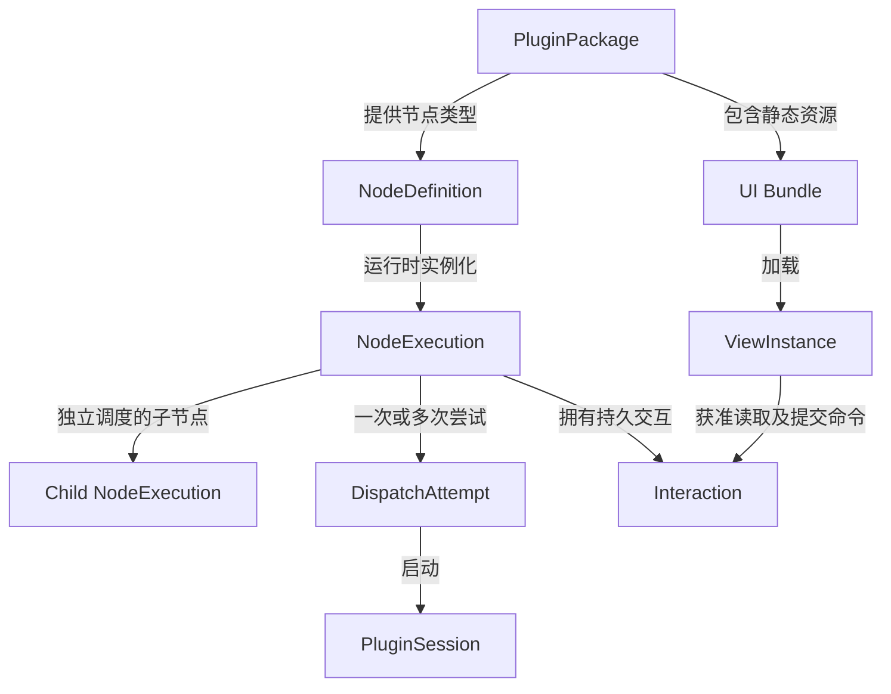
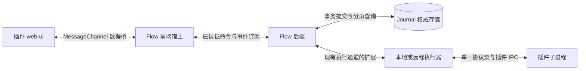
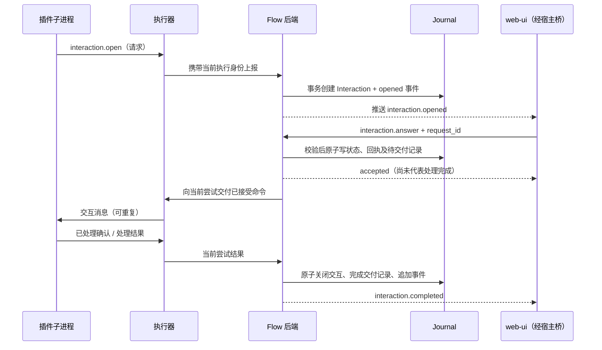
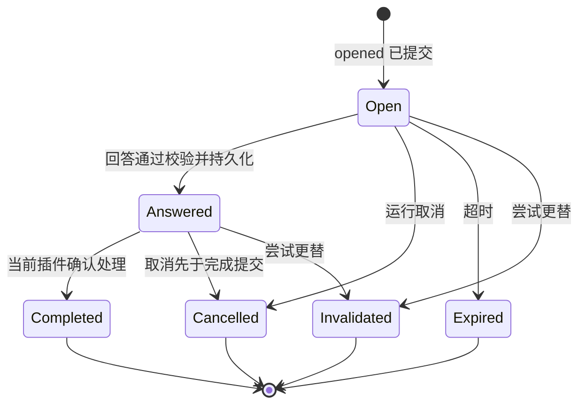
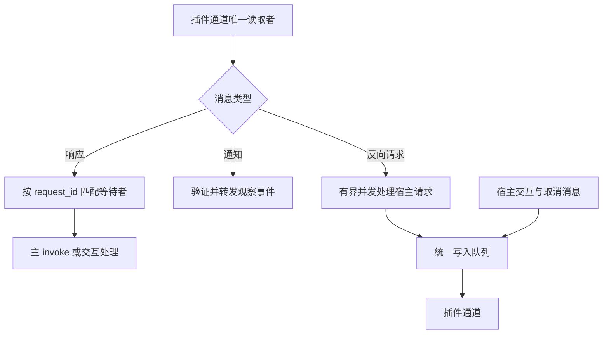

# 插件 Web UI 与 Flow 交互方案（Review 草案）

状态：设计参考，日期：2026-11-14。

实施更新：常驻服务、隔离 web-ui 消息桥、Flow 事件订阅、peer 白名单及节点绑定信号已落地，见 [当前实现与使用说明](../../features/resident-plugin-services.md)。实现复用既有持久信号和回执，没有新增通用 Interaction 状态实体。历史 UI bundle 留存和外置资源仍属于后续设计，以下提案不能整体视为已实现。

## 1. 结论与范围

插件包携带静态 `web-ui`，通过 manifest 声明运行详情或节点详情 tab。宿主负责 tab 容器、隔离、身份绑定、数据访问和业务命令。UI 和插件子进程均通过 Flow 交互，不直接连接彼此。

统一命令、事件和订阅契约；不把节点定义、节点执行、插件安装和子进程合并成一个万能 Component。首版以 harness 的“对话/提问回答”作为完整样例，仅开放运行/节点详情扩展，不包含应用顶部页面、任意 RPC、常驻插件服务和插件进程快照。

成功标准：插件可独立发布 UI；刷新或重连后内容可恢复；重复提交不重复消费；节点取消后旧页面不能继续操作；升级不替换历史运行 UI；本地与远程执行使用同一产品协议。

## 2. 当前代码事实

- `crates/flow-config/src/plugin_manifest.rs`：`UiSection` / `UiProjection` 仅含 palette、params_forms、run_view，投影随运行冻结。
- `web/src/components/RunMonitor.vue`：activity/timeline/logs tab 由宿主静态定义。
- `crates/flow-plugin-runtime/src/plugin_session.rs`：每个派发会话执行一次 invoke；单读取循环等待固定 ID 的主响应，转发通知、处理反向请求，其他响应忽略。不能直接追加并发 UI RPC。
- `crates/flow-plugin-runtime/src/plugin_registry.rs`：内容哈希覆盖 manifest 和插件执行文件，尚未覆盖 Web 资源。
- `web/src-tauri/tauri.conf.json`：有宿主 CSP；插件 frame 的隔离和资源加载需在 Web 与桌面端分别验证。

## 3. 模型与所有权

| 实体 | 职责与身份 | 所有者 |
|---|---|---|
| PluginPackage | 插件能力、manifest、可执行文件及 UI 资源身份 | 插件安装管理 |
| NodeDefinition | 节点类型、参数、边；随流程版本不可变 | 工作流版本 |
| NodeExecution | 一次逻辑节点执行，包含独立尝试和交互状态 | Flow 执行模型 |
| DispatchAttempt | 一次派发的执行器绑定和进程会话 | 调度器 |
| PluginSession | 插件进程的一次协议会话 | 执行器 |
| Interaction | 提问、回答、关闭等持久业务状态 | Flow 后端 |
| ViewInstance | 一个 tab 的临时页面实例和消息桥 | 前端宿主 |

独立调度、取消、重试且有结果的子节点可采用 NodeExecution，并通过 parent_execution_id 表达层级。普通工具调用/展示步骤使用事件或 span；不自动升级为调度节点。



交互属于逻辑节点执行；交付目标绑定当前有效尝试。重试不默认继承旧交互：首版旧交互失效，新尝试创建新 interaction_id。未来只有明确支持恢复的插件才能复用等待状态，不能把旧回答悄悄投递给新进程。

## 4. 包与 tab 声明

```text
plugin/
  plugin.toml
  bin/plugin
  web-ui/
    index.html
    assets/...
```

提案格式（最终字段名在实现时定稿）：

```toml
[[ui.tabs]]
id = "conversation"
title = "对话"
scope = "node-run"
entry = "web-ui/index.html"
bridge_version = 1
```

- 支持 scope：run、node-run；tab 标识为 plugin_id + tab_id，避免跨插件冲突。
- 仅当运行快照包含对应插件且上下文匹配时显示 tab；安装插件不等于所有运行都出现其 tab。
- tab 首次选中时加载；关闭/切换作用域后销毁桥并取消订阅。UI 隐藏不会取消业务执行。
- 保留已有声明式表单、摘要和原始 JSON 入口。声明式能力无需迁移。

## 5. 通信架构



事件订阅是数据路径，命令提交是状态变更入口。双方可以共用 envelope，但不共用任意发布权限。

- UI 提交 intent，Flow 校验后接受或拒绝；UI 不能发布“已接受/已完成”的业务事实。
- 插件报告 observation 或请求创建交互；Flow 校验当前派发身份并提交权威事件。
- 插件订阅自身交互命令及取消通知；不能订阅任意工作区事件。
- 执行器通过现有连接承载新增消息，首版不增加独立消息服务、插件 HTTP 端口或外部消息队列。
- 现有审批、取消、signal 等业务动作优先复用已有语义；新增 Interaction 不替代权限审批系统。

### 5.1 展示数据

先获取快照及其游标 C，再订阅 C 之后的事件；后端必须保证此边界无缺口。订阅重连使用游标补读，不使用客户端时间戳。若游标已过保留期，显式返回 resync_required，重新获取快照。

UI 首版读取：当前作用域信息、获准的展示事件、输出分页/下载引用、主题、语言。大输出走引用和分页，不塞进每个事件。历史 UI 读取历史数据，不重新运行插件来生成展示。

### 5.2 持久交互



提交事务不等待插件响应。待交付状态必须与接受事实同事务保存，由协调器扫描恢复；进程内队列只能做唤醒优化。

## 6. 协议契约（提案）

命令 envelope 示例：

```json
{
  "schema_version": 1,
  "kind": "command",
  "type": "interaction.answer",
  "request_id": "client-generated-stable-id",
  "interaction_id": "q-123",
  "expected_revision": 1,
  "payload": {"text": "继续"}
}
```

run_id、node_execution_id、dispatch_id、plugin_id、view_instance_id 由宿主绑定并验证。浏览器输入中的身份不是授权依据。后端将调用主体及命令摘要写入回执身份，同一 request_id 同一内容返回原回执，不同内容报冲突。

事件 envelope：event_id、type、schema_version、cursor、run_id、node_execution_id、interaction_id、correlation_id、payload。cursor 使用仓库既有无损序号编码；顺序含义限定于声明的事件流，不承诺跨流全局因果顺序。

| 消息/动作 | 语义 |
|---|---|
| interaction.open | 插件请求创建问题；必须有稳定业务键以免重放重复创建 |
| interaction.opened | Flow 已创建待回答交互 |
| interaction.answer | 用户尝试回答；需权限、revision、状态校验 |
| interaction.answered | Flow 已接受并持久化回答 |
| interaction.completed | 插件确认已消费/处理该交互；不等同整个节点完成 |
| interaction.cancelled / expired / invalidated | 因取消、超时、尝试更替终结交互 |

错误至少区分：forbidden、not_found、revision_conflict、interaction_closed、stale_attempt、payload_invalid、temporarily_unavailable、resync_required。SDK 保留现有 RPC 错误体系并提供语义映射，不吞掉错误重试。

首版不提供通用 session.request。将来如有内存调试需求，再增加明确的非持久方法；它们会随会话退出失效。

## 7. 状态、确认与故障



取消和完成的竞争由同一权威事务串行裁决；终态不可被迟到确认覆盖。首版超时只针对未回答交互，已接受命令受运行取消和执行恢复机制约束。

| 故障 | 行为 |
|---|---|
| UI 刷新/断线 | 按游标补读；提交重试复用 request_id |
| 两个浏览器同时回答 | revision 与状态比较，只有一个首次回答被接受 |
| Flow 接受后、发送前崩溃 | 从待交付记录恢复发送 |
| 插件处理后、确认前崩溃 | 允许重复交付；插件按 interaction_id 去重或恢复 |
| 插件无恢复能力 | 尝试结束后交互失效；新尝试创建新问题 |
| 旧进程/旧 tab 迟到消息 | 校验当前身份与 revision 后拒绝 |
| 消费速度不足 | 有界缓冲、暂停/断开、按游标补读；控制消息不被日志淹没 |
| 插件执行外部副作用 | 仅消息去重不够；仍遵循现有操作许可及不确定结果裁决 |

不承诺 exactly-once 传输或外部副作用；目标是权威状态原子变化、允许重放、业务幂等。插件的去重状态若只在内存中，不能声称跨进程恢复。

## 8. 插件会话改造与生命周期

现有固定 invoke ID 的读循环需要升级为单一协议泵：



避免权限询问占住整个读取循环，造成回答消息无法进入。主 invoke、宿主交互及插件反向请求使用独立 ID 命名空间。握手协商 interaction_events_v1；插件端也必须在主执行期间持续接收交互和取消。

首版等待用户时保持插件会话存活，沿用现有执行器挂起/取消与资源预算，不能允许无界常驻等待。需验证现有 park 机制是否适合交互等待；不适合时应设数量与时长上限，而非绕过执行槽管理。

取消/超时必须能打断等待并回收资源。进程退出后 UI 仍可查看持久事件，但不可伪装为在线会话。持久等待后退出、重启进程恢复属于后续能力，需插件明确声明和实现恢复协议。

## 9. 权限与浏览器隔离

- 静态 bundle 在 sandbox iframe 内运行；通过一次性握手建立 MessageChannel，验证 frame 来源、实例 nonce、协议版本，再限制 port 的上下文权限。opaque origin 不能只靠 origin 字符串授权。
- 不将 RPC token、密钥、Tauri invoke 或宿主全局状态交给页面。插件执行权限不自动成为 UI 权限。
- UI Bridge 限定 method 白名单、payload 大小、速率、订阅数与事件类别；字段投影/脱敏先于转发。必要业务输出可能敏感，插件不能任意跨作用域读取。
- 默认禁止直接网络访问、弹窗、顶层导航和任意文件访问。通过独立 frame CSP、资源响应策略及 Tauri 配置共同验证；不能只给 iframe 加一个 sandbox 字符串就宣称安全。
- 不在同源页面上同时开放 allow-scripts 和 allow-same-origin。资源加载方案必须实测脚本、字体、module 与 fetch 的兼容性。
- 路径归一化并验证真实路径，拒绝绝对路径、越界、符号链接逃逸、错误 MIME；资源接口不因放在插件目录下就默认公开。

参考浏览器约束：[iframe](https://developer.mozilla.org/en-US/docs/Web/HTML/Reference/Elements/iframe)、[postMessage](https://developer.mozilla.org/en-US/docs/Web/API/Window/postMessage)。以上隔离方案为设计要求，尚未在本项目实现验证。

## 10. 资源版本、历史和兼容

安装时计算 Web bundle 内容哈希（覆盖有序文件路径和文件内容），写入不可变资源目录。UI 哈希与现有执行内容哈希分别保留，不悄悄重定义已有授权身份。运行快照冻结 tab 声明、bundle_hash 和 bridge_version；历史运行不读取最新 manifest 来决定 UI。

升级不覆盖旧 bundle。卸载插件后保留被运行引用的资源；无引用资源再回收。旧资源可被管理员禁用，历史数据仍有宿主原始查看入口。UI 资源、journal 与引用元数据须共同备份。

旧插件未声明 tabs 或未协商交互能力时保持现有行为。旧宿主应在安装/解析时清楚拒绝不支持的必需 UI 能力；可选 UI 声明若希望被旧宿主忽略，必须先核查当前解析器能否做到。前后端桥版本不匹配时显示不可用，不尝试猜测协议。

## 11. 实施任务与验收

以下均为建议实施任务，当前请求仅整理方案，不授权产品改造。

| 阶段 | 目标与理由 | 范围与最小方案 | 验证及验收 | 约束 |
|---|---|---|---|---|
| A | 稳定扩展声明与资源身份，避免历史漂移 | flow-config manifest、安装注册及快照，新增 tabs/bundle 元数据 | 路径越界拒绝；升级/卸载仍命中原包；旧插件通过 | 不改变已有执行授权哈希含义 |
| B | 只读 tab 打通真实数据 | web 通用容器、UI Bridge、运行数据投影及资源路由 | Web/Tauri 均可加载；刷新无缺口；越权、令牌泄露、外联测试 | 不开放任意 RPC 和 UI 写操作 |
| C | 持久交互形成闭环 | Journal 状态/事务、命令回执、待交付扫描、RPC | 重复回答、并发提交、取消竞争、接受后崩溃均可观察验证 | 复用既有 signal/审批语义；不增加外部消息服务 |
| D | 子进程并发接收交互 | executor 协议、plugin-session 单协议泵、SDK 握手与路由 | 等待权限时仍能响应取消；本地/远程消息隔离；陈旧尝试拒绝 | 单读取者；有界队列和等待；不支持透明内存恢复 |
| E | harness 对话样例及故障回归 | harness 插件 web-ui、示例、E2E、打包 | 提问→回答→继续；刷新、重启、超时、卸载、版本不匹配均有确定结果 | 不把所有工具调用升级为节点 |

合并前运行仓库原生 unit/typecheck/lint/build 及针对新交互的 E2E。故障注入点至少覆盖：接受事务前后、交付前后、插件处理后确认前。隔离、资源路径、历史版本及多窗口测试均为必要验收，不能只验证正常点击路径。

## 12. Review 决策清单

建议按以下默认选择 review；均是待确认设计，不代表已获实施授权。

1. 首版仅运行/节点详情 tab，暂不开放应用级页面。
2. 统一交互端点协议，保留节点/尝试/插件/页面模型。
3. UI 只提交命令；Flow 负责权威事件、回执、交互状态和恢复交付。
4. 首版保持进程等待；新尝试使旧交互失效，不做自动内存恢复。
5. UI bundle 按内容哈希冻结，历史引用保留，原始数据可降级查看。
6. 首版只提供明确业务动作；任意会话 RPC 留待真实需求出现。

待实现前验证的技术问题：现有 park 预算如何承载等待；事件 cursor 是否满足无缺口快照订阅；旧 manifest 的未知字段策略；Tauri 下 opaque-origin frame 的资源加载与隔离。对这些问题目前只有设计要求，没有完成验证的结论。
